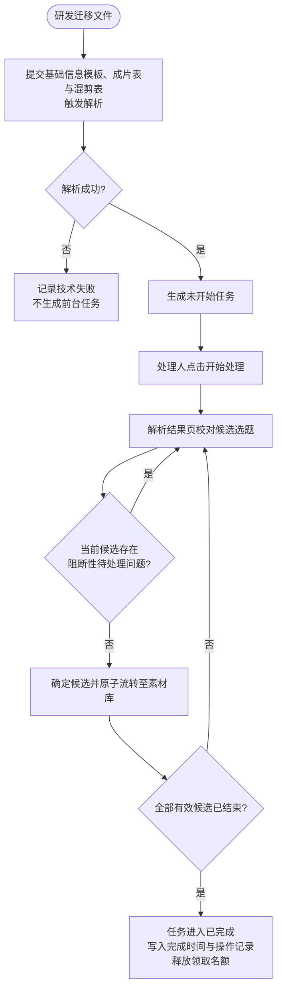
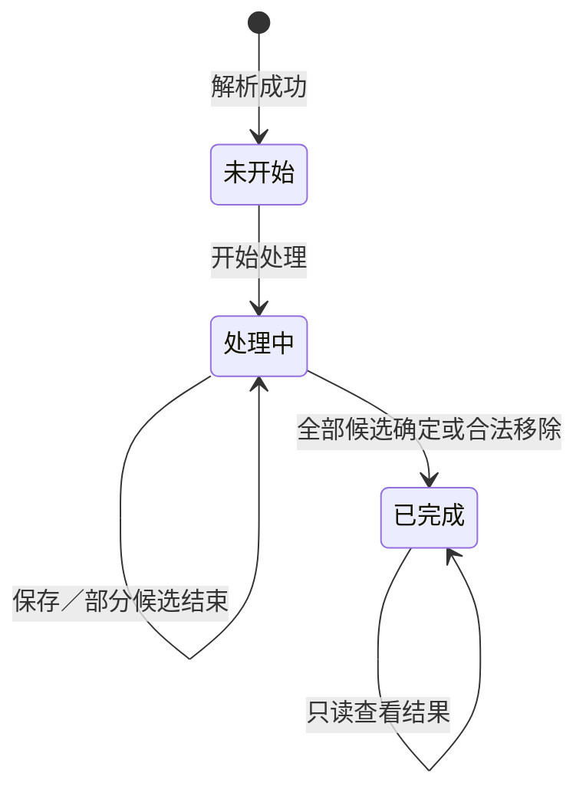

# 合数教育视频管理系统—素材库产品需求文档（PRD）

> 本文档按照公司《复杂业务 PRD 输出规范》整理，以《素材库 PRD V113.6（正式交付版）》为唯一业务内容基线。
>
> 本次仅调整文档结构和表达方式，不新增功能、不改变既有业务规则。原始需求登记暂不纳入本轮整理，待业务侧提供原始材料后另行补充。

## 一、文档信息

| 项目 | 内容 |
| --- | --- |
| 项目名称 | 合数教育视频管理系统—素材库 |
| 需求编号 | [待补充] |
| 当前版本 | V113.6（公司模板版） |
| 文档状态 | 已确认／开发中（最终状态待项目负责人确认） |
| 产品负责人 | [待补充] |
| PRD 编写人 | 李斯仪 |
| 技术负责人 | [待补充] |
| 测试负责人 | [待补充] |
| 创建日期 | [待补充] |
| 本次整理日期 | 2026-10-12 |
| 计划上线日期 | [待补充] |
| 本地原型 | `material-library-v2.html` |
| 线上原型 | https://e3870732-droid.github.io/heshu-video-management-demo/material-library-v2.html |
| GitHub 仓库 | https://github.com/e3870732-droid/heshu-video-management-demo |
| 当前实施基线 | `f4a3934937320777d94c0d4d572e27924e71222e` |

### 1.1 修订历史

| 版本 | 日期 | 修改人 | 修改内容 | 变更范围 |
| --- | --- | --- | --- | --- |
| V113.1 | 2026-10-08 | 李斯仪 | 从历史工作稿重建唯一正式 PRD；校正原片文件夹—选题—脚本关系；同步当前原型口径 | 全文基线 |
| V113.2 | 2026-10-09 | 李斯仪 | 重构选题与脚本字段归属，补充字段字典、业务线—产品线映射、日期规则和编导备注链接规则 | 数据模型、首页、详情、解析结果 |
| V113.3 | 2026-10-11 | 李斯仪 | 重写任务中心与解析结果页，明确三类解析数据源、候选选题、成片与混剪关系 | 任务中心、解析结果页 |
| V113.4 | 2026-10-11 | 李斯仪 | 统一首页五类对象的全局搜索口径 | 素材库首页 |
| V113.5 | 2026-10-11 | 李斯仪 | 收紧搜索穿透范围和结果去重规则 | 素材库首页 |
| V113.6 | 2026-10-11 | 李斯仪 | 统一脚本原片继承／排除规则，增加任务领取上限，完善任务完成闭环 | 原片关系、解析结果、任务中心 |
| V113.6 公司模板版 | 2026-10-12 | Codex 协助整理 | 按公司复杂业务 PRD 模板重新组织已有内容；原始需求登记暂不处理 | 文档结构，不改变业务规则 |

### 1.2 需求评审记录

| 评审日期 | 参与人 | 评审结论 | 遗留事项 | 负责人 | 截止日期 |
| --- | --- | --- | --- | --- | --- |
| [待补充] | [待补充] | [待补充] | 负责人、上线日期、容量指标、监控和日志保存周期待确认 | [待补充] | [待补充] |

### 1.3 会议纪要

| 项目 | 内容 |
| --- | --- |
| 会议时间 | [待补充] |
| 会议主题 | [待补充] |
| 会议纪要 | [待补充] |
| 关键结论 | 以本文档确认后的版本作为研发、测试和业务验收的统一依据 |

### 1.4 文档权威性与实施基线

本文档确认后，作为公司模板下的正式需求文档。其业务规则来源为《素材库 PRD V113.6（正式交付版）》；V113.1、`PRD-V112-to-V113/`、`素材库PRD文档.md`、备份文件、评审记录和差异清单仅用于历史追溯。若历史材料与本文档冲突，以本文档确认后的内容为准。

---

## 二、原始需求登记

> 本章节按本轮对齐结果暂不处理。本次不补写、不推断、不使用当前方案反向伪造原始需求。待需求提出人、原始描述、提出部门、日期和附件等材料齐备后，再按公司模板补充。

---

## 三、产品背景与目标

### 3.1 背景概述

现有视频资料分散在本地目录、飞书表格、脚本文档及多个文件夹中，合集、选题、脚本、原片、成片、封面和混剪之间缺少稳定、可追溯的数据关系。业务依赖文件名、目录结构和人工记忆查找及判断素材归属，历史资料迁移、解析校对、正式入库和日常维护缺少统一入口。

本项目建设企业内部素材库 Web 系统。研发完成文件迁移后，通过“选题与脚本基础信息模板”“成片表”和“混剪表”触发解析；素材管理员或编导在任务中心领取任务，在解析结果页校对候选选题，确定后流转至正式素材库。一期不承接拍摄、剪辑、审片、发布和投流流程。

### 3.2 业务现状与核心问题

| 问题 | 当前表现 | 影响 |
| --- | --- | --- |
| 资产分散 | 文件、表格和脚本文档分散存放 | 查找成本高，无法形成统一资产入口 |
| 关系易失真 | 关系依赖文件名和人工记忆 | 易发生误关联、漏关联和重复迁移 |
| 字段口径不统一 | 选题层和脚本层曾存在重复字段 | 多份脚本互相覆盖，数据归属不清 |
| 原片继承关系不清 | 原片可能被逐脚本复制或误认为唯一归属 | 一份脚本操作可能误伤其他脚本 |
| 任务闭环不完整 | 状态、处理人、完成时间和记录可能不同步 | 统计不准，刷新后状态存在回退风险 |
| 历史资料质量不稳定 | 字段缺失、字典外值和关系冲突需要人工处理 | 无法安全自动入库 |

### 3.3 核心目标

| 目标 | 目标说明 | 衡量指标 | 目标值 |
| --- | --- | --- | --- |
| 建立统一资产入口 | 统一检索和查看合集、选题、原片、成片及混剪 | 正式资产可检索率 | [待上线指标确认] |
| 建立解析入库闭环 | 支持迁移、解析、校对、确定和正式入库 | 有效候选确定成功率 | [待上线指标确认] |
| 保证关系准确 | 使用稳定 ID 和统一关系模型管理资产 | 核心关系专项用例通过率 | 100% |
| 保证任务状态一致 | 完成后同步状态、处理人、完成时间、记录、统计和名额 | 状态链路专项用例通过率 | 100% |
| 保证权限一致 | 界面和服务端使用相同权限口径 | 越权用例通过率 | 100% |

### 3.4 非目标

1. 不提供业务用户前台上传或替换视频文件。
2. 不提供从空白新建正式合集、选题或脚本的独立入口。
3. 不承接拍摄、剪辑、审片、发布、投流或平台数据回收。
4. 不提供合集、选题、正式脚本和正式视频文件的前台硬删除。
5. 不提供视频批量下载或业务数据报表导出。
6. 不进行视频画面的 AI 内容理解、自动分类或自动关联。
7. 不抓取、下载、解析或承诺编导备注中外部链接的可用性。
8. 不将剪辑备注等其他普通文本自动识别为链接。

### 3.5 用户价值

| 用户角色 | 当前问题 | 产品价值 |
| --- | --- | --- |
| 素材管理员 | 关系维护依赖人工记忆，难以追溯 | 统一维护正式资产、关系和操作记录 |
| 编导 | 历史资料校对入口分散 | 在任务中心和解析结果页完成结构化校对 |
| 剪辑师 | 查找脚本和素材耗时 | 按权限查看脚本、原片和成片并下载单条资产 |
| 运营 | 成片和混剪查找路径不统一 | 通过统一入口检索和预览权限内资产 |
| 投手 | 投放素材信息分散 | 快速定位成片、混剪和关联选题 |

### 3.6 核心业务流程



### 3.7 投入产出评估

| 项目 | 说明 |
| --- | --- |
| 预计投入 | [待补充：研发、测试、产品、迁移和业务校对人力] |
| 效率收益 | 降低人工查找、重复确认和关系校对成本 |
| 质量收益 | 统一数据关系和状态口径，减少误关联与状态回退 |
| 管理收益 | 建立任务、处理人、完成时间、操作记录和统计的可追溯闭环 |

---

## 四、需求范围

### 4.1 功能清单

| 编号 | 功能模块 | 功能说明 | 用户角色 | 优先级 | 本期范围 |
| --- | --- | --- | --- | --- | --- |
| FR-001 | 素材库首页 | 五类对象的统一搜索、筛选、排序和卡片展示 | 全部授权角色 | P0 | 是 |
| FR-002 | 合集与选题详情 | 查看合集、选题、脚本和关联资产 | 全部授权角色 | P0 | 是 |
| FR-003 | 正式选题统一编辑 | 统一编辑选题、当前脚本及其关系 | 素材管理员 | P0 | 是 |
| FR-004 | 原片关系管理 | 文件夹关联选题；脚本默认继承并支持脚本级补充、排除和恢复 | 素材管理员 | P0 | 是 |
| FR-005 | 普通成片与封面 | 成片唯一归属脚本，可选关联横版和竖版封面 | 素材管理员 | P0 | 是 |
| FR-006 | 任务中心 | 查看、领取、继续处理和查看已完成任务 | 素材管理员、编导 | P0 | 是 |
| FR-007 | 解析结果页 | 校对、保存、确定或移除候选选题 | 素材管理员、编导 | P0 | 是 |
| FR-008 | 混剪管理 | 管理独立混剪及其可选选题关系 | 授权角色 | P1 | 是 |
| FR-009 | 视频预览与单条下载 | 预览和下载权限内单条资产 | 授权角色 | P1 | 是 |
| FR-010 | 操作记录 | 记录关键状态和业务关系变更 | 授权查看角色 | P1 | 是 |

### 4.2 本期范围

- 迁移后资料解析、人工校对和正式入库。
- 素材库首页检索、筛选、排序和五类对象展示。
- 合集／选题详情、正式选题统一编辑。
- 原片文件夹—选题主关系、脚本默认继承、脚本级补充和排除。
- 普通成片唯一脚本归属及可选封面关系。
- 任务中心和解析结果页的完整状态链路。
- 混剪独立管理及可选选题关系。
- 权限内单条下载、操作记录、异常处理和关键埋点。

### 4.3 涉及系统与影响范围

| 系统或资料 | 关系 | 责任 |
| --- | --- | --- |
| 素材库 Web 系统 | 主体 | 列表、详情、任务、关系、权限和记录 |
| 选题与脚本基础信息模板 | 解析数据源 | 提供合集、选题、脚本和原片文件夹线索 |
| 成片表 | 解析数据源 | 提供成片及其选题、脚本和可选开头关系 |
| 混剪表 | 解析数据源 | 提供混剪字段及可选选题关系，不提供脚本关系 |
| 视频／文件存储 | 文件来源 | 按原目录迁移并提供预览和下载 |
| 用户、角色与人员主数据 | 平台能力 | 提供登录、角色、编导、摄像、剪辑师和出镜 IP 字典 |

### 4.4 数据初始化与迁移

| 项目 | 已确认规则 | 待确认项 |
| --- | --- | --- |
| 数据来源 | 三类结构化资料及对应迁移文件 | 原始资料版本和冻结日期 |
| 数据范围 | 历史合集、选题、脚本、原片、成片、封面和混剪 | 具体批次、数量和时间范围 |
| 字段映射 | 解析字段按本 PRD 字段层级写入候选数据 | 完整新旧字段映射表 |
| 唯一标识 | 正式对象使用稳定 ID，名称只用于展示和搜索 | ID 生成与历史对象匹配算法 |
| 冲突处理 | 字典外值、无效级联、关系无法唯一匹配时进入人工校对 | 技术失败重试次数和失败清单格式 |
| 数据验证 | 演练批次、失败样例和人工校对结果需抽样复核 | 数量核对标准和抽样比例 |
| 失败处理 | 源资料不可读或无法生成候选时不生成前台任务 | 技术告警、重试和责任人 |

---

## 五、需求说明

> 本章按实际页面组织。页面内部继续使用公司模板要求的“入口—初始状态—字段—操作—结果—异常—状态恢复”结构。已有原型组件、卡片、抽屉和弹窗必须直接复用。

### 5.1 素材库首页

#### 5.1.1 页面入口与初始状态

- 入口：素材库主导航。
- 访问条件：已登录且具有素材库查看权限。
- 对象 Tab：全部、选题、原片、成片、混剪。
- 顶部只保留一个全局关键词搜索框。
- 默认排序按当前对象对应的业务日期倒序。
- 各 Tab 独立保存结构化筛选、页码和有效滚动位置；全局关键词在五个 Tab 间共享。
- 空数据时仅显示当前对象的空状态和调整提示，不重复提供另一套重置入口。

#### 5.1.2 全局搜索

| 对象 Tab | 可检索字段 | 去重单位 | 命中说明 |
| --- | --- | --- | --- |
| 全部 | 合集名称、合集直接包含的选题名称 | 合集 | 选题命中时显示“包含选题” |
| 选题 | 选题名称、选题直接包含的脚本名 | 选题 | 脚本命中时显示“包含脚本” |
| 原片 | 原片文件名 | 原片稳定 ID | 不通过所属关系召回 |
| 成片 | 成片文件名 | 成片稳定 ID | 不通过所属关系召回 |
| 混剪 | 混剪文件名 | 混剪稳定 ID | 不通过关联选题召回 |

搜索提交、筛选组合、跨 Tab 状态和返回恢复遵循以下规则：

1. 按 Enter 后才执行搜索，输入但未提交不生效。
2. 去除关键词首尾空格，英文不区分大小写，使用名称包含匹配。
3. 不做语义、同义词、拼音、模糊推测或跨两层关系穿透。
4. 关键词与不同筛选字段之间为“且”；同一筛选字段多选值之间为“或”。
5. 搜索后同时更新五个 Tab 的结果数量。
6. 点击重置时清空全局关键词和当前 Tab 筛选。
7. 从详情或预览返回时恢复关键词、来源 Tab、该 Tab 筛选、页码和有效滚动位置。

#### 5.1.3 日期展示、筛选与排序

| 对象 | 展示日期 | 筛选字段 | 最近排序 | 禁止替代字段 |
| --- | --- | --- | --- | --- |
| 合集 | 创建日期 | 创建日期 | 创建日期倒序 | 更新、迁移、上传、最后操作时间 |
| 选题 | 更新日期 | 更新日期 | 更新日期倒序 | 进入编辑、取消和保存失败时间 |
| 原片 | 拍摄日期 | 拍摄日期 | 拍摄日期倒序 | 迁移、上传、关联时间 |
| 成片 | 剪辑日期 | 剪辑日期 | 剪辑日期倒序 | 迁移、上传、关联时间 |
| 混剪 | 剪辑时间 | 剪辑日期区间 | 剪辑时间倒序 | 迁移、上传、关联时间 |

日期区间边界均包含；只填开始日期时包含该日及之后，只填结束日期时包含该日及之前。预览、下载、关联、移除关系、调整归属、关联封面和备注修改不得自动改写业务日期。

#### 5.1.4 卡片展示

- 合集卡片展示名称、用途、选题总数、S 级选题数、A 级选题数和创建日期。
- 选题卡片展示所属合集、业务线、由脚本聚合的产品线、编导、出镜信息、选题方向，以及脚本／原片／成片数量。
- 原片卡片按稳定 ID 去重，展示文件名、文件大小、摄像和拍摄日期；首页不展示具体关系路径或关系数。
- 成片卡片展示平台、剪辑方向、视频类型、剪辑师、剪辑日期、关联脚本的编导与出镜 IP，以及可选封面。
- 混剪卡片展示混剪标题、关联选题、剪辑师、剪辑方向、视频类型和剪辑时间，不展示合集和脚本。

### 5.2 合集详情

- 展示合集基本信息和该合集下全部有效选题。
- 选题卡片直接复用首页选题卡片的组件、字段顺序、聚合逻辑和空值规则；仅可省略页面上下文已经明确的所属合集。
- 从合集详情进入选题详情，返回时恢复合集详情原位置。
- 本期不提供前台新增、删除或硬删除合集。

### 5.3 正式选题详情

- 选题信息按“所属合集、业务线、用途”顺序展示；所属合集只读。
- 选题层只保存选题名称、用途和业务线。
- 产品线、编导、出镜 IP、出镜素人、选题方向、脚本评级和创作／拍摄字段均属于脚本层。
- 脚本使用现有 Tab 组件切换；切换脚本同步切换该脚本的信息、内容、有效原片和成片。
- 历史脚本允许原片数或成片数为 0，不阻断保存。
- 摄像为可空字段，历史资料未提供时保留字段位置但值为空。
- 编导备注允许文本与一个或多个 `http://`、`https://` 链接混合保存；仅详情态将合法协议显示为安全可点击链接。

### 5.4 正式选题统一编辑

- 正式详情只有一个“编辑”入口，选题、当前脚本和关系修改共用一次保存。
- 保存时直接校验，不显示二次确认弹窗。
- 保存成功返回详情态；失败保留全部输入并定位错误字段。
- 有未保存内容时切换脚本或离开页面必须提示放弃修改。
- 变更业务线后，若脚本产品线不属于新业务线，保留当前编辑内容并标记冲突；全部冲突解决前禁止保存。
- 多人并发编辑使用乐观锁，检测到版本变化时拒绝静默覆盖。

### 5.5 视频预览

- 默认不自动播放。
- 支持播放／暂停、进度、音量和全屏。
- 不展示倍速控件。
- 非编辑态不显示替换和移除；编辑态只允许显示移除，不提供替换。
- 关闭预览后恢复原页面的未保存内容和滚动位置。
- 预览失败时显示重新加载入口，不影响业务信息和授权下载。

### 5.6 搜索关联抽屉

- 直接复用现有抽屉、搜索、目录树、素材卡片和确认按钮。
- 原片关联抽屉只展示已迁移原片和原目录树，不增加“待关联原片”页签。
- 在选题层确认原片文件夹时建立文件夹—选题主关系。
- 在当前脚本中确认单条原片时，只建立当前脚本的补充关系。
- 取消、关闭和预览不改变任何关系。
- 普通成片只可选择尚未被其他脚本占用的迁移成片。

### 5.7 任务中心

#### 5.7.1 任务信息

任务卡片展示任务名称或批次、创建时间、当前处理人、任务状态、候选选题数、脚本数、原片文件夹数、文件夹内视频总数、成片数、混剪数和待处理问题数。前台不得展示 `TASK-004`、`task_id` 等内部编号。

#### 5.7.2 任务操作

| 状态 | 主操作 | 完成结果 |
| --- | --- | --- |
| 未开始 | 开始处理 | 取得处理权，进入处理中并打开解析结果页 |
| 处理中 | 继续处理 | 恢复已保存进度并打开解析结果页 |
| 已完成 | 查看结果 | 只读查看处理结果，不占领取名额 |

同一用户最多同时领取五个未完成任务。达到上限时复用系统统一居中确认弹窗，不新建任务专用弹窗；弹窗不得出现内部任务编号。完成任务后必须从处理中移入已完成，写入处理人、完成时间和操作记录，按钮变为“查看结果”，同时释放一个领取名额；刷新后不得回退。

### 5.8 解析结果页

- 解析结果页是候选选题校对工作台，不是任务中心列表，也不是正式素材库详情页。
- 沿用现有合集维度页面；合集下展示候选选题，每个候选保留确定和移除操作。
- 当前候选选题是保存、确定和移除的最小业务单位。
- 左侧候选选题直接展示全部脚本；右侧复用正式选题详情的脚本组件和字段顺序。
- 保存只保存当前进度，不入库；确定将候选选题及合法关系作为一个原子单位流转至素材库。
- 解析结果页和正式选题编辑态使用完全相同的脚本原片计算、补充、排除和恢复规则。
- 一份脚本缺少脚本名时进入待处理；标题、开头、正文、编导备注、摄像、原片和成片允许为空。
- 所有候选已确定或合法移除后，任务自动完成并进入只读结果态。

### 5.9 混剪管理

- 混剪是独立视频对象，不归属脚本。
- 可不关联选题；如关联，最多关联一个有效选题。
- 剪辑方向、视频类型、剪辑师和剪辑时间来自混剪资料本身，不从选题或脚本继承。
- 已填写选题但无法唯一匹配时进入待处理；用户可重新选择或清空关系。
- 混剪解除选题关系后仍是合法独立资产。

### 5.10 操作记录

| 字段 | 已确认规则 | 待确认项 |
| --- | --- | --- |
| 操作时间 | 写操作成功或失败时记录实际时间 | 时间精度和时区展示规范 |
| 操作人 | 记录用户稳定标识和展示姓名 | 离职人员展示规则 |
| 操作对象 | 记录任务、候选选题、正式选题、脚本或资产 | 对象快照保留范围 |
| 操作类型 | 状态变化、字段保存、关系新增／移除／恢复、下载等 | 完整枚举表 |
| 变更详情 | 关键字段记录变更前值和变更后值 | 大文本截断规则 |
| 操作结果 | 成功或失败 | 失败原因标准码 |
| 查看权限 | 按角色授权 | 具体可查看角色 |
| 可编辑性 | 操作记录不得编辑或删除 | 保存期限和归档规则 |
| 导出能力 | 本期不默认提供 | 是否需要后续迭代 |

---

## 六、通用业务规则

### 6.1 核心数据关系

```text
合集 1 ── N 选题 1 ── N 脚本 1 ── N 普通成片
原片文件夹 N ── N 选题
选题 + 脚本 + 原片 ── 脚本级补充关系或排除项
普通成片 N ── N 封面（横版最多 1 张、竖版最多 1 张）
混剪 0..N ── 0..1 选题，不关联脚本
解析任务 1 ── N 候选选题
```

### 6.2 选题、脚本与原片继承规则

```text
某脚本有效原片
= 当前选题全部有效原片
+ 当前“选题 × 脚本”单独新增关联的原片
- 当前“选题 × 脚本”已排除的原片
且原片文件、脚本、选题及对应关系均为有效状态
```

1. 原片文件夹—选题是主关系；文件夹内有效原片组成选题原片。
2. 选题下现有和后续新增脚本默认继承全部选题原片。
3. 脚本内单独新增原片只影响当前脚本，不进入选题原片集合。
4. 脚本内移除继承原片只新增当前“选题＋脚本＋原片”排除项。
5. 恢复时只删除对应排除项。
6. 排除、恢复和脚本级补充均不影响同选题其他脚本。
7. 脚本有效原片允许为 0，不进入待处理，不阻断保存或确定。
8. 解除文件夹—选题关系后，相关原片不再属于该选题，失效排除项不得继续参与计算。

### 6.3 字段归属

| 层级 | 正式字段 |
| --- | --- |
| 选题层 | 选题名称、用途、业务线 |
| 脚本层 | 脚本名、产品线、编导、出镜 IP、出镜素人、选题方向、脚本评级、编导备注、摄像、场景、设备、机位、姿势／动作、服装、道具、视觉锤、镜号、音频、标题、开头、正文 |
| 成片层 | 成片文件、剪辑师、剪辑日期、平台、剪辑方向、视频类型、可选对应开头、可选封面 |
| 混剪层 | 混剪文件、剪辑方向、视频类型、剪辑师、剪辑时间、可选选题 |

选题评级由有效脚本评级实时派生：任一脚本为 S，则选题为 S；没有 S 但至少一份为 A，则选题为 A；否则为无。聚合值只用于展示和筛选，不反写选题表。

### 6.4 统一字段字典

| 字段 | 有效值 |
| --- | --- |
| 选题方向 | 反认知观点型、高低对比型、知识科普型、家长痛点型、课效销售型、避坑科普型、观点阐述型、政策解读型、人设故事型、家长批判型、清单推荐型、时事热点型、学员故事型、名人案例型 |
| 平台 | 小红书、抖音、快手、视频号、百家号；支持多选 |
| 业务线 | 教育规划、大场、飞轮学习力 |
| 视频类型 | AI、实拍、混合 |
| 剪辑方向 | 强IP、强营销、强痛点 |
| 脚本评级 | S、A、无；“无”存为空值 |

| 业务线 | 有效产品线 |
| --- | --- |
| 教育规划 | 教育规划精华课（阿留）、教育规划精华课（深圳店播）、教育规划精华课（北京店播）、教育规划陪跑营 |
| 大场 | 豆神双语小王者、豆神语文小王者、伴鱼阅读营、伴鱼科普营、火花思维、洋葱学园、一亩宝盒 |
| 飞轮学习力 | 飞轮学习力体验课、飞轮学习力 |

历史资料中的字典外值和无效业务线—产品线组合不得静默映射或写入正式数据，必须进入人工校对。

### 6.5 任务状态定义与流转

| 状态 | 进入条件 | 允许操作 | 离开条件 |
| --- | --- | --- | --- |
| 未开始 | 解析成功并生成任务 | 开始处理、查看摘要 | 用户取得处理权 |
| 处理中 | 已领取且存在未结束候选 | 编辑、保存、确定、合法移除 | 所有候选结束 |
| 已完成 | 无未结束候选 | 只读查看结果 | 无 |



“开始处理”是操作，不是状态。解析失败是技术结果，不生成前台任务，也不建立“失败”业务状态。

### 6.6 角色与权限

| 功能 | 素材管理员 | 编导 | 剪辑师 | 运营 | 投手 |
| --- | --- | --- | --- | --- | --- |
| 查看素材库 | ✓ | ✓ | ✓ | ✓ | ✓ |
| 查看任务中心 | ✓ | ✓ | — | — | — |
| 处理候选任务 | ✓ | ✓ | — | — | — |
| 编辑正式选题和脚本 | ✓ | — | — | — | — |
| 管理原片文件夹—选题关系 | ✓ | — | — | — | — |
| 管理脚本级原片关系 | ✓ | — | — | — | — |
| 调整普通成片和封面 | ✓ | — | — | — | — |
| 单条原片下载 | ✓ | ✓ | ✓ | — | — |
| 单条成片下载 | ✓ | ✓ | ✓ | ✓ | ✓ |
| 混剪下载 | ✓ | ✓ | ✓ | ✓ | ✓ |

权限必须同时在界面和服务端校验。无写权限时界面不展示入口，接口仍必须拒绝请求并记录安全日志。

### 6.7 并发、幂等与刷新恢复

1. 编辑对象使用版本号或等价的乐观锁机制。
2. 版本冲突时拒绝覆盖，并要求用户重新加载最新数据。
3. 保存超时后通过幂等标识查询最终结果，禁止重复提交。
4. 任务状态、处理人、完成时间、操作记录、统计数量和领取名额必须在同一事务或可靠一致性机制中完成。
5. 刷新后从正式持久化数据恢复，不能回到原型初始化状态。

### 6.8 关系移除与正式资产删除边界

- 候选选题可在解析结果页合法移除，不影响同合集其他候选。
- 原片可解除当前脚本关系或文件夹—选题关系，但不删除迁移文件。
- 成片不可直接解除为未关联，只能调整至另一有效选题和脚本。
- 封面可解除关系，不删除封面文件。
- 混剪可清空选题关系并作为独立资产保留。
- 本期不提供正式合集、选题、脚本和视频文件的前台硬删除、停用或注销。

---

## 七、异常与边界处理

| 异常场景 | 处理规则 |
| --- | --- |
| 源资料不可读或无法生成候选 | 记录技术失败，不生成前台任务 |
| 字典外值或无效级联 | 进入人工校对，不静默映射 |
| 关系无法唯一匹配 | 进入待处理，用户选择、清空或补充合法关系 |
| 已迁移文件搜索不到 | 提示联系研发完成迁移，不提供临时上传 |
| 脚本没有标题、开头或正文 | 合法状态，不计入待处理 |
| 脚本没有原片或成片 | 合法状态，不计入待处理 |
| 脚本名为空 | 计入待处理并阻断当前候选确定 |
| 脚本有效原片数为 0 | 允许保存和确定，显示空状态 |
| 多人并发编辑 | 提示版本冲突并拒绝静默覆盖 |
| 预览失败 | 显示重新加载，不影响业务信息和授权下载 |
| 保存超时 | 查询幂等结果，禁止双击重复提交 |
| 无权写操作 | 界面无入口，接口拒绝并记录安全日志 |
| 不安全链接协议 | 按普通文本展示，不执行、不跳转 |
| 外部链接失效 | 不影响备注和页面其他数据，不自动改写或删除链接 |

---

## 八、数据埋点与监控

### 8.1 数据埋点

| 事件 | 触发 | 核心参数 | 用途 |
| --- | --- | --- | --- |
| `material_library_view` | 进入素材库 | role, tab | 功能采纳率 |
| `task_processing_start` | 开始处理 | task_id, operator_id | 任务转化与耗时 |
| `candidate_confirm` | 确定候选 | task_id, topic_id, duration, pending_count | 校对效率与失败率 |
| `candidate_save` | 保存校对进度 | task_id, topic_id, pending_count | 中断与继续处理情况 |
| `candidate_pending_resolved` | 解决待处理问题 | task_id, topic_id, pending_type | 资料缺口分析 |
| `folder_topic_relation_save` | 新增／移除文件夹—选题关系 | folder_id, topic_id, action, operator_id | 原片关系使用情况 |
| `raw_script_exclusion_save` | 排除／恢复当前脚本原片 | raw_id, topic_id, script_id, action, operator_id | 脚本例外调整 |
| `video_preview_result` | 预览成功／失败 | asset_type, asset_id, result | 预览可用性 |
| `asset_download` | 下载单条文件 | role, asset_type, asset_id | 下载使用与权限审计 |

### 8.2 建议监控项

以下为公司模板要求下的建议监控方向，是否纳入一期、告警阈值和责任人均待技术评审确认：

- 解析成功率与技术失败率。
- 候选确定失败率、保存失败率和幂等查询异常数。
- 任务平均处理时长、长期未完成任务数和领取上限触发次数。
- 预览失败率和下载失败率。
- 状态、统计、操作记录或领取名额不一致的异常数。
- 迁移数据数量不一致和关系校验失败数。

---

## 九、验收标准

### 9.1 功能验收总则

1. 页面、接口、数据关系、操作记录和统计使用同一业务口径。
2. 解析结果页和正式选题编辑态使用同一套业务规则。
3. 已确认组件、卡片、抽屉、弹窗、尺寸和交互直接复用。
4. 用户界面不展示内部任务编号或后端字段。
5. 所有写操作校验权限、对象有效性、版本和关系完整性。
6. 验收以用户最终看到的页面和刷新后的持久化结果为准。

### 9.2 状态链路专项验收

- 任务完成后从处理中移出并进入已完成。
- 写入处理人、完成时间和操作记录。
- 按钮变为“查看结果”。
- 释放一个领取名额。
- 处理中、已完成和全部列表统计同步更新。
- 刷新后状态、列表归属、按钮、时间、记录和统计不得回退。

### 9.3 数据关系专项验收

- 文件夹关联选题后，该选题现有和后续脚本默认继承选题原片。
- 当前脚本移除原片只产生当前脚本排除项。
- 当前脚本补充原片不影响同选题其他脚本。
- 正式详情和解析结果页对同一关系计算结果一致。
- 成片始终唯一归属有效脚本。
- 混剪不建立脚本关系。

### 9.4 非功能验收

| 类型 | 已确认标准 | 待确认标准 |
| --- | --- | --- |
| 安全 | 双端权限校验；外链安全转义；拒绝不安全协议 | 日志保存期和审计范围 |
| 并发 | 乐观锁，禁止静默覆盖 | 冲突响应规范 |
| 一致性 | 状态、记录、统计和名额完整联动 | 服务端事务方案 |
| 可恢复性 | 保存失败保留输入；刷新恢复正式状态；上线可回滚 | 快照周期和恢复目标 |
| 性能 | 大视频预览失败不阻塞业务信息 | 页面、搜索、保存响应目标 |
| 容量 | 技术阈值不在本次业务规则中虚构 | 单文件、单文件夹、ZIP 和预览超时阈值 |
| 兼容性 | Web 端可用 | 浏览器和最低版本 |

### 9.5 核心验收用例索引

原 V113.6 附录 A 中的验收用例继续全部有效，迁入时不得删除或改写其业务含义。重点用例组包括：

- `AC-RAW-*`：原片继承、脚本补充、排除、恢复和多选题关系。
- `AC-TASK-*`：任务领取、五个任务上限、完成和只读查看。
- `AC-PARSE-*`：解析结果页结构、待处理、保存、确定和原子流转。
- `AC-SEARCH-*`：全局搜索、Tab 切换、去重、穿透边界和返回恢复。
- `AC-DATE-*`：日期展示、筛选、排序和不应被改写的操作。
- `AC-DIRECTOR-NOTE-*`：编导备注链接识别、安全与展示。
- `AC-DICT-*`：字段字典和业务线—产品线级联。
- `AC-LAYER-*`、`AC-RATING-*`、`AC-TOPIC-*`：字段归属、聚合和卡片一致性。
- `AC-SAVE-01`：保存不二次确认，失败保留输入并定位错误。

完整逐条用例在本文件完成最终定稿时从原 V113.6 无损迁入。

---

## 十、项目排期与依赖

### 10.1 关键里程碑

| 阶段 | 交付内容 | 负责人 | 计划日期 | 完成标准 |
| --- | --- | --- | --- | --- |
| 需求确认 | 公司模板版 PRD、原型和字段口径确认 | [待补充] | [待补充] | 业务、产品、研发、测试结论一致 |
| 技术评审 | 数据模型、迁移、权限、并发、幂等和容量方案 | [待补充] | [待补充] | 技术待决项关闭 |
| 数据演练 | 少量历史合集和选题迁移 | [待补充] | [待补充] | 数量、字段和关系抽样通过 |
| 功能测试 | 主流程、异常、权限和专项回归 | [待补充] | [待补充] | P0/P1 用例达到上线标准 |
| 业务试点 | 素材管理员和编导试点 | [待补充] | [待补充] | 任务闭环和正式维护可用 |
| 扩大使用 | 剪辑师、运营和投手接入 | [待补充] | [待补充] | 查询、预览和下载稳定 |
| 全量上线 | 全部授权用户使用 | [待补充] | [待补充] | 上线检查清单全部通过 |

### 10.2 外部依赖

- 三类源资料的正式字段版本和冻结机制。
- 视频、封面和目录文件迁移完成。
- 登录、RBAC 和人员主数据可用。
- 预览、下载和文件存储能力可用。
- 埋点工具、监控平台和日志规范确认。
- 研发提供容量、超时、重试和数据恢复方案。

### 10.3 风险清单

| 风险 | 概率 | 影响 | 应对 |
| --- | --- | --- | --- |
| 历史 PRD 被继续当作实施依据 | 高 | 高 | README 和文档顶部声明唯一基线 |
| 原片按唯一脚本关系或逐脚本复制实现 | 高 | 高 | 开发前评审 ER 模型和统一计算公式 |
| 迁移文件名或路径不稳定 | 中 | 高 | 稳定 ID 管理身份，名称只用于展示搜索 |
| 多人编辑覆盖 | 中 | 高 | 乐观锁、冲突提示、禁止静默覆盖 |
| 大视频预览或下载失败 | 中 | 中 | 预览降级且保留业务信息和授权下载 |
| 状态只在前端临时变化 | 中 | 高 | 以持久化结果和刷新恢复作为验收标准 |

### 10.4 待决事项

| 编号 | 待决事项 | 负责人 | 时限 | 是否阻断上线 |
| --- | --- | --- | --- | --- |
| TBD-1 | 需求编号、产品负责人、技术负责人、测试负责人 | 产品负责人 | 正式评审前 | 是 |
| TBD-2 | 最大单文件、单文件夹视频数、预览超时和 ZIP 阈值 | 研发 | 技术评审前 | 是 |
| TBD-3 | 埋点工具、监控阈值和日志保存周期 | 研发／数据 | 上线前 | 是 |
| TBD-4 | 迁移批次、字段映射、数量核对和失败处理方案 | 研发／业务 | 数据演练前 | 是 |
| TBD-5 | 试点范围、计划上线日期和培训责任人 | 业务／产品 | 上线计划评审前 | 是 |
| TBD-6 | 性能目标、浏览器兼容范围和故障恢复目标 | 研发／测试 | 测试方案评审前 | 是 |

---

## 十一、上线方案

### 11.1 发布策略

| 阶段 | 范围 | 目标 | 回滚方式 |
| --- | --- | --- | --- |
| 数据演练 | 少量历史合集和选题 | 验证解析、原片关系、成片和封面 | 删除演练候选，不影响原文件 |
| 试点 | 素材管理员、编导 | 验证任务闭环和正式资产维护 | 暂停新任务，保留已迁移文件和旧流程 |
| 扩大使用 | 剪辑师、运营、投手 | 验证检索、预览和下载 | 回退上一稳定版本 |
| 全量使用 | 全部授权用户 | 建立统一素材库入口 | 使用可恢复数据快照和上一稳定版本 |

### 11.2 上线检查清单

- [ ] 公司模板版 PRD 已完成评审并确认唯一基线。
- [ ] HTML 原型与正式 PRD 的页面、组件、按钮和业务规则一致。
- [ ] 原片主关系、脚本继承、补充和排除通过专项回归。
- [ ] 任务状态、列表归属、按钮、处理人、完成时间、记录、统计和名额通过专项回归。
- [ ] 解析结果页与正式选题编辑态使用同一业务规则。
- [ ] 权限同时通过界面和接口验证。
- [ ] 迁移数量、失败样例和人工校对结果完成抽样复核。
- [ ] 脚本语法检查、代码差异检查和关键交互链路检查通过。
- [ ] 回滚版本、数据快照和恢复步骤已确认。

---

## 十二、附录

### 12.1 术语

| 术语 | 定义 |
| --- | --- |
| 合集 | 一条业务线下承载多个选题的业务容器 |
| 选题 | 承载公共信息、脚本、原片文件夹关系和关联资产的核心对象 |
| 解析任务 | 一次成功资料解析产生的前台业务任务 |
| 候选选题 | 解析结果页中的最小保存、确定和移除单位 |
| 待处理问题 | 阻断当前候选确定的业务问题，不包含技术失败和允许为空字段 |
| 选题原片 | 通过有效原片文件夹—选题关系属于当前选题的原片集合 |
| 脚本默认继承 | 选题下脚本自动获得全部有效选题原片 |
| 脚本级补充 | 只为当前脚本新增的一条原片关系 |
| 脚本原片排除 | 只对当前脚本屏蔽一条继承原片的关系记录 |
| 普通成片 | 唯一归属一个选题下一份脚本的剪辑视频 |
| 混剪 | 可选关联零个或一个选题、但不关联脚本的独立视频对象 |

### 12.2 参考文档

| 文档或资源 | 用途 |
| --- | --- |
| `素材库PRD_V113.6_正式交付版.md` | 本文档的唯一业务内容来源 |
| `material-library-v2.html` | 当前交互原型 |
| GitHub Pages 线上原型 | 用户可见结果验收 |
| 公司《复杂业务 PRD 输出规范》 | 本文档结构模板 |
| 历史 V113 工作稿 | 仅用于历史追溯，不作为开发基线 |

### 12.3 核心架构与 ER 模型

应用架构图、完整 ER 数据模型和关系属性以原 V113.6 的 10.1 节为迁移来源。最终定稿必须保留以下核心实体：`COLLECTION`、`TOPIC`、`SCRIPT`、`RAW_FOLDER`、`RAW_ASSET`、脚本级补充关系、`RAW_SCRIPT_EXCLUSION`、`FINAL_ASSET`、`COVER_ASSET`、`MIX_ASSET`、`TASK`、`CANDIDATE_TOPIC`。

### 12.4 自检结论

| 检查项 | 结果 |
| --- | --- |
| 产品定位 | 企业自研业务型管理系统 |
| 公司模板骨架 | 已覆盖；原始需求登记按本轮确认暂不处理 |
| 核心流程 | 已覆盖迁移、解析、校对、确定、正式维护和任务完成 |
| 核心数据模型 | 已保留文件夹—选题主关系和脚本级例外关系 |
| 角色权限 | 已覆盖五类业务角色 |
| 异常与并发 | 已覆盖迁移失败、匹配冲突、并发、超时和预览失败 |
| 新增功能检查 | 未因模板占位项新增数据导出、独立新增、硬删除等功能 |
| 待补充项 | 文档治理信息、排期、迁移技术方案、性能容量和监控指标 |

