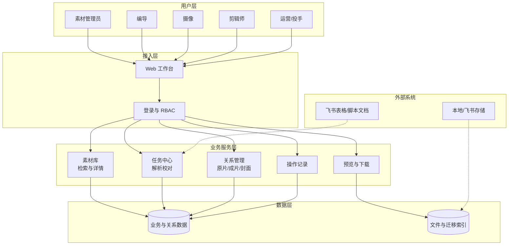
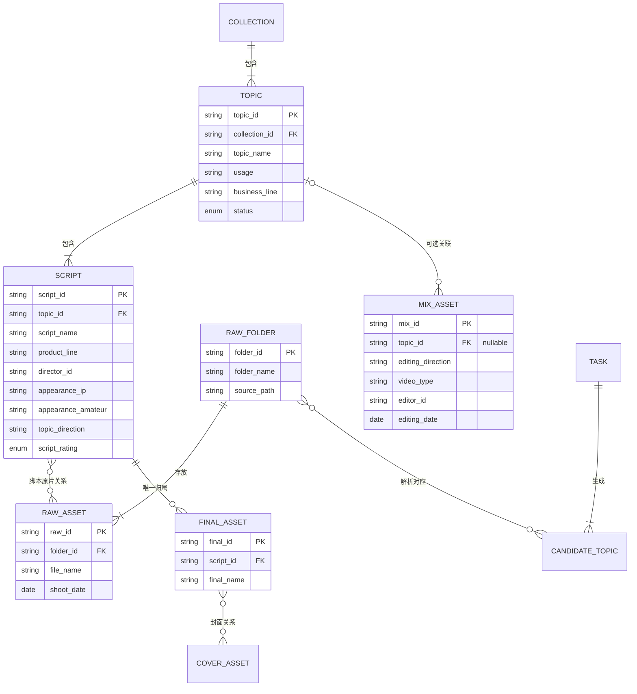
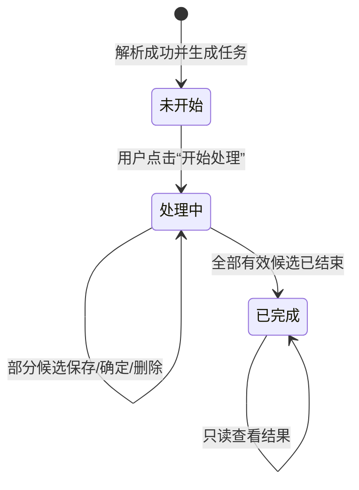

# 合数教育视频管理系统—素材库产品需求文档（PRD）

> 本文档按照公司《复杂业务 PRD 输出规范》整理，以《素材库 PRD V113.6（正式交付版）》为初始业务内容基线，并纳入本轮逐项确认的补充和修正规则。
>
> 本文档确认后，后续研发、测试和验收以公司模板版为正式口径；与初始基线冲突的内容，以本文档中已确认的新规则为准。原始需求正文由独立原始需求文档维护。

## 一、文档信息

| 项目 | 内容 |
| --- | --- |
| 项目名称 | 合数教育视频管理系统—素材库 |
| 需求编号／原始需求 | 《1.04. 视频管理原始需求》（正式飞书链接待补充，补充后本单元格直接使用该链接） |
| 当前版本 | V113.6（公司模板版） |
| 文档状态 | 已评审 |
| 产品负责人 | 李斯仪 |
| PRD 编写人 | 李斯仪 |
| 技术负责人 | 陈庆焕 |
| 测试负责人 | 彭乐文 |
| 创建日期 | 2026-09-10 |
| 计划上线日期 | 2026年10月底 |
| 本地原型 | `material-library-v2.html` |
| 线上原型 | https://e3870732-droid.github.io/heshu-video-management-demo/material-library-v2.html |
| GitHub 仓库 | https://github.com/e3870732-droid/heshu-video-management-demo |
| 当前实施基线 | `ebb4e0c89961e5d1ff38be666af6edce5b86110d` |

### 1.1 文档权威性与实施基线

本文档确认后，作为公司模板下的正式需求文档。原正式交付版用于追溯初始业务基线；本轮已确认的补充、修正及其验收口径以本公司模板版为准。

## 二、原始需求登记

原始需求已由独立文档统一维护，本 PRD 不重复抄录原始需求正文，避免两处内容并行修改后产生版本冲突。

| 项目 | 内容 |
| --- | --- |
| 原始需求文档 | 《1.04. 视频管理原始需求》（正式飞书链接待补充） |
| 维护原则 | 原始业务诉求、背景资料和需求功能模块以独立原始需求文档为准；本 PRD 负责记录经分析、确认后的产品范围、业务规则、交互方案和验收标准 |
| 变更关系 | 原始需求发生变化时，应先更新独立原始需求文档，再评估并同步修改本 PRD；不得直接用本 PRD 反向覆盖原始需求记录 |

## 三、产品背景与目标

### 3.1 项目背景

#### 业务现状

选题与脚本基础信息由标准模板提供，成片及其脚本关系由单独的成片表提供，混剪及其选题关系由单独的混剪表提供；历史迁移混剪允许没有选题，未来新增混剪必须关联选题。本期混剪不关联脚本，不设计混剪—脚本相关功能。原片仅以百度网盘文件夹作为解析和校对单位。标题、开头、正文和编导备注不在源模板中，由用户后续在系统内录入。研发完成文件迁移后触发解析；素材管理员或编导在解析结果页校对候选选题，确定后流转至素材库。一期不承接拍摄、剪辑或审片流程。

#### 核心问题

1. **资产分散**：业务内容与视频文件分布在多个载体，缺少统一查询和追溯。
2. **关系易失真**：原片文件夹、选题、脚本、成片及封面的关系主要依赖文件名和人工记忆。
3. **历史规则冲突**：旧文档曾将原片误定义为只能归属某一脚本，或把技术关系概念直接暴露给用户。最新口径是：解析阶段先完成选题与原片文件夹的对应，进入候选后按脚本展示原片；用户在某一脚本中新增、移除或纠错原片时，只影响当前脚本。
4. **校对与正式资产边界不清**：候选关系、正式关系、文件事实和业务字段需要分层管理。

#### 解决思路

- 建立统一的合集、选题、脚本、原片文件夹、原片、成片、封面和混剪资产模型。
- 通过“研发先迁移→系统解析资料→任务中心承接→解析结果页校对→候选选题确定并流转至素材库”形成可追溯闭环。
- 解析阶段通过“选题—原片文件夹”完成资料对应；进入候选和正式素材库后，每份脚本维护自身可见的原片关系，脚本内的新增、移除和纠错不影响同选题其他脚本。
- 将普通成片继续定义为唯一选题／脚本归属；每条成片或混剪可关联零张或多张封面，产品层不设置无依据的封面数量上限。

#### 决策依据

- 历史成片约 8,500 条，每日新增约 30–50 条（沿用项目现有资料，上线前由业务再确认）。
- 原片与选题名称不一定一致，不得通过名称相同自动建立正式关系。
- 业务确认解析时原片文件夹首先对应选题；解析进入系统后，原片按选题下具体脚本展示和维护。

### 3.2 需求基本情况

| 要素 | 内容 |
| --- | --- |
| 需求提出人 | 视频内容生产与素材管理团队 |
| 核心使用人 | 素材管理员、编导 |
| 其他使用人 | 摄像、剪辑师、运营、投手 |
| 受影响人 | 研发迁移与解析责任人、内容管理负责人 |
| 核心场景 | 历史素材迁移校对、日常新资料接入、正式资产检索、选题详情与素材关系维护 |
| 核心痛点 | 文件事实、业务对象和多层关系分散，无法稳定追溯和复用 |
| 需求价值 | 建立唯一资产入口和可追溯关系，降低人工查找、误关联和重复迁移成本 |

#### 核心场景

**场景 A：迁移资料解析与校对**

- 研发先按原目录迁移原片、成片、混剪及已提供封面，然后提交“选题与脚本基础信息模板”、“成片表”和“混剪表”触发解析。
- 系统生成一条解析任务及一个或多个候选选题；处理人从任务中心进入解析结果页校对。
- 解析结果页按当前脚本展示其原片；用户在某一脚本中新增、移除或纠错原片时，只更新当前脚本的原片关系。
- 当前候选选题的必填字段与必要业务关系合法后，用户点击“确定”，该候选选题作为一个原子单位流转至素材库。

**场景 B：选题与原片关系维护**

- 素材管理员在选题编辑态搜索已迁移原片文件夹。
- 解析阶段确认选题与原片文件夹的对应后，候选中的每份脚本展示对应原片。
- 某脚本新增、移除或纠错原片时，只改变当前脚本；不影响同选题其他脚本、其他选题、原文件或原片文件夹。

**场景 C：素材检索与复用**

- 用户在首页通过全局关键词、对象 Tab 和结构化筛选查询合集、选题、原片、成片和混剪。
- 从列表进入选题或播放视频，返回时恢复来源 Tab、筛选、页码和有效滚动位置。

### 3.3 业务分析与系统调研

#### 现有工具与参考

| 对象 | 类型 | 当前能力 | 可借鉴点 | 局限 |
| --- | --- | --- | --- | --- |
| 飞书表格／脚本文档 | 内部现有工具 | 维护选题、脚本及业务字段 | 模板灵活、业务已熟悉 | 不适合统一管理大量视频与复杂关系 |
| 本地／飞书文件存储 | 内部现有工具 | 存放原片、成片、封面 | 保留原目录和文件事实 | 不承载稳定业务关系 |
| 素材库系统 | 本期建设 | 统一解析、校对、检索、查看和关系管理 | 以稳定 ID 与操作记录建立可追溯资产 | 一期不承载内容生产流程 |

#### 业务痛点优先级

| 优先级 | 痛点 | 影响 | 严重程度 |
| --- | --- | --- | --- |
| P0 | 原片关系模型与真实业务不一致 | 导致误删关系、无法复用和错误禁用原片 | 高 |
| P0 | 多份 PRD 与原型规则不一致 | 研发与测试无法确认真实口径 | 高 |
| P1 | 历史资料量大、依赖人工校对 | 处理成本高、误差不可追溯 | 中高 |
| P1 | 素材检索和跳转上下文容易丢失 | 日常查找和复用效率低 | 中 |

#### 投入产出评估

| 维度 | 估算 |
| --- | --- |
| 预计投入 | 产品 1 人／14 天；开发 2 人／30 天；测试 1 人／5 天；数据迁移 2 人／30 天；业务校对 2 人／5 天 |
| 效率收益 | 缩短历史关系查找、日常素材检索和错误关系修复耗时 |
| 质量收益 | 原片、成片与选题关系可追溯，减少文件重复迁移和误覆盖 |

**已确认人员配置**

| 角色 | 负责人／参与人 | 人数 | 主要职责 |
| --- | --- | --- | --- |
| 产品 | 李斯仪 | 1 | PRD、原型、规则对齐和需求验收 |
| 技术负责人 | 陈庆焕 | 1 | 技术方案、技术评审和风险控制 |
| 前端开发 | 李好 | 1 | 前端页面、组件和交互实现 |
| 后端开发 | 李好 | 1，与前端为同一人 | 数据模型、解析、关系、状态、权限和日志实现 |
| 测试 | 彭乐文 | 1 | 功能、关系、状态、权限和回归测试 |
| 数据迁移 | 史明曦牵头 | 2 | 历史文件迁移、数据核对和迁移完成确认；计划投入 30 天 |
| 业务校对 | 史明曦、陈嘉华 | 2 | 历史资料校对、试点确认和业务验收；计划投入 5 天 |

> 投入时间按当前项目计划填写，不在本 PRD 中自行换算总人天；如后续需要财务或排期口径的人天统计，以实际排期和考勤口径另行确认。

### 3.4 项目目标与验收总则

#### 项目目标

| 目标类型 | 目标 | 指标 | 目标值 |
| --- | --- | --- | --- |
| 业务目标 | 建立统一、可检索、可追溯的正式素材资产库 | 正式资产可检索率 | 上线后两周建立基线 |
| 质量目标 | 消除原片唯一脚本归属错误 | 原片多选题／多脚本关系验收通过率 | 100% |
| 流程目标 | 支持从资料解析到正式入库闭环 | 有效候选选题确定成功率 | 上线后两周建立基线 |
| 效率观察 | 降低素材查找和关系确认成本 | 素材查找效率 | 暂不设置无依据的百分比目标 |
| 状态目标 | 保证任务状态、列表归属、按钮、处理人、完成时间、操作记录、统计数量和领取名额一致 | 状态链路专项验收用例通过率 | 100% |
| 安全目标 | 保证界面权限与服务端权限一致 | 越权与权限安全用例通过率 | 100% |

#### 交付验收总则

1. 页面、接口、数据关系和操作记录必须使用同一业务口径。
2. 解析结果以合集为处理容器，以候选选题为确定单位；选题与原片文件夹完成对应后，原片按候选中的具体脚本展示。
3. 脚本内新增、移除或纠错原片只改变当前脚本的原片关系；不影响同选题其他脚本、其他选题或原文件。
4. 同一原片可以关联多个选题及多份脚本，但首页只展示一张原片卡片。
5. 普通成片仍唯一归属一个选题下的一份脚本。
6. 所有写操作进行权限、对象有效性、并发版本和关系完整性校验。

## 四、需求范围

### 4.1 项目方案概述

#### 核心功能

| 模块 | 功能简述 | 优先级 |
| --- | --- | --- |
| 素材库首页 | 统一搜索并分 Tab 展示合集、选题、原片、成片和混剪 | P0 |
| 合集／选题详情 | 查看选题字段、脚本、原片和成片；按权限统一编辑 | P0 |
| 原片关系管理 | 解析时对应选题与原片文件夹；进入系统后按脚本新增、移除或纠错原片 | P0 |
| 普通成片与封面 | 成片唯一脚本归属；每条成片可关联零张或多张封面 | P0 |
| 任务中心／解析结果 | 承接研发迁移后资料的校对、修改、确定与追溯 | P0 |
| 混剪资产 | 独立管理混剪且不关联脚本或来源视频；历史迁移混剪可关联零个或一个选题，未来新增混剪必须关联一个选题 | P1 |
| 下载与操作记录 | 按权限下载脚本包或单条视频，保留关键变更记录 | P1 |

#### MVP 范围

**包含**：迁移后资料解析校对、正式入库、首页检索、合集／选题详情、原片关系、成片和封面、混剪、单条下载、权限、操作记录。

**不包含**：业务用户上传新视频、从空白新建选题／脚本、拍摄、剪辑、审片、删除正式资产、视频批量下载。

### 4.2 项目范围

#### 涉及系统

| 系统 | 关系 | 责任 |
| --- | --- | --- |
| 素材库 Web 系统 | 主体 | 列表、详情、任务、关系、权限和记录 |
| 选题与脚本基础信息模板 | 解析数据源 | 提供合集、选题、脚本名、脚本基础业务字段及百度网盘原片文件夹；不提供标题、开头、正文和编导备注 |
| 成片表 | 解析数据源 | 单独提供成片信息及“成片—候选选题—脚本—可选对应开头”关系 |
| 混剪表 | 解析数据源 | 单独提供混剪信息及“混剪—候选选题”关系；包含剪辑方向、视频类型、剪辑师和剪辑日期，不提供脚本关系。历史迁移记录允许选题为空，未来新增记录必须填写选题 |
| 视频／文件存储 | 文件来源 | 按原目录迁移并提供预览／下载 |
| 现有用户、角色与 IP 主数据 | 平台能力 | 提供登录、角色、编导／出镜 IP 字典 |

#### 影响范围

- **用户**：素材管理员、编导的校对和维护方式；摄像、剪辑师、运营、投手的查询和下载方式。
- **流程**：新增研发后台迁移和解析前置，业务从任务中心进入校对。
- **数据**：历史合集、选题、脚本、原片、成片、封面和混剪迁移及关系校准。

#### 数据迁移范围与完成标准

| 项目 | 已确认规则 |
| --- | --- |
| 迁移范围 | 迁移全部历史素材，不限定时间范围或业务线 |
| 迁移对象 | 合集、选题、脚本、原片、成片、封面、混剪全部包含 |
| 数据来源 | 选题与脚本基础信息模板、成片表、混剪表、百度网盘／现有文件目录 |
| 视频迁移方式 | 视频先通过本地上传迁移进入系统；本地上传成功并完成文件数量核对后，才视为该视频迁移完成。后续预览和下载均以系统内已迁移文件为准，不依赖外部临时链接 |
| 迁移负责人 | 史明曦 |
| 计划完成时间 | 2026年10月底彻底迁移完成 |
| 校验方式 | 按比例抽检；具体抽检比例由史明曦在正式全量迁移抽检前确认 |
| 失败数据处理 | 失败数据不得静默丢弃，必须进入失败清单，记录数据来源、失败对象、失败原因、处理状态和负责人 |

数据迁移同时满足以下条件后，才可判定完成：

1. 迁移范围内的历史文件全部完成迁移。
2. 选题与脚本基础信息模板、成片表和混剪表的数据全部完成解析。
3. 文件数量与对应表格记录数量完成核对。
4. 合集、选题、脚本、原片、成片、封面和混剪的核心关系完成按比例抽检，抽检结果符合上线标准。
5. 全部迁移失败项均已进入失败清单，并明确处理结果或后续责任人。

#### 不在本期范围

1. 前台上传、替换或删除视频文件。
2. 视频剪辑、审片、发布、投流和平台数据回收。
3. 合集、选题或正式脚本的前台删除。
4. 通过视频画面的 AI 内容理解、自动分类或自动关联。
5. 对编导备注中的外部链接进行内容抓取、文件下载、网页预览、标题解析或可用性承诺。
6. 将剪辑备注及其他普通文本字段自动识别为可点击链接；本期链接能力仅适用于编导备注。

## 五、需求说明

### 5.1 素材库首页

**页面结构**

- 顶部只保留一个全局关键词搜索框。
- 对象 Tab 固定为：全部／选题／原片／成片／混剪。
- 筛选与重置固定在筛选区右侧，不因字段数量变动位置。
- 全局关键词在五个对象 Tab 间共享；各 Tab 只独立保存结构化筛选、页码和有效滚动位置。
- 卡片长字段单行省略，鼠标悬停显示完整值。

**全局搜索唯一口径**

- 搜索框固定位于对象 Tab 上方，提示词统一为“搜索合集、选题、脚本、原片、成片或混剪”，不得随 Tab 切换而变化。
- 用户输入关键词并按 Enter 后执行搜索；未提交的输入内容不生效，也不因切换 Tab 自动触发搜索。
- 搜索执行后，系统同时计算全部、选题、原片、成片和混剪的结果数，并显示在各 Tab 名称右侧。切换 Tab 只切换结果对象范围，保留已执行的全局关键词，不要求重新搜索。
- 关键词自动去除首尾空格，采用不区分英文大小写的名称包含匹配。本期不做语义理解、同义词扩展、拼音匹配、模糊推测、业务字段联想或基于所属关系的穿透召回。
- 关键词与当前 Tab 结构化筛选之间为“且”；同一筛选字段内多个值之间为“或”，不同筛选字段之间为“且”。
- 点击“重置”时，清空全局关键词和当前 Tab 的结构化筛选，并恢复当前 Tab 的默认列表与分页。

| 对象 Tab | 关键词可检索字段 | 结果去重单位 |
| --- | --- | --- |
| 全部 | 合集名称、合集直接包含的选题名称 | 合集；同一合集内多个选题命中仍只返回一张合集卡片 |
| 选题 | 选题名称、选题直接包含的脚本名 | 选题；同一选题内多个脚本命中仍只返回一张选题卡片 |
| 原片 | 原片文件名 | 原片稳定 ID |
| 成片 | 成片文件名 | 成片稳定 ID |
| 混剪 | 混剪文件名 | 混剪稳定 ID |

- “全部”Tab 以合集为结果单位。关键词直接命中合集名称时，直接返回合集卡片；命中合集内选题名称时，返回其所属合集卡片，并在卡片内说明“包含选题：{ 选题名称 }”；多个选题命中时显示第一条并附“等 N 个选题”。
- 选题 Tab 以选题为结果单位。关键词直接命中选题名称时，直接返回选题卡片，不显示重复命中说明；命中选题内脚本名时，返回其所属选题卡片，并在卡片内说明“包含脚本：{ 脚本名 }”；多个脚本命中时显示第一条并附“等 N 个脚本”。不通过脚本原名、标题、开头、正文或备注召回。
- 召回只向下穿透一层：“合集 → 选题”和“选题 → 脚本”互相独立。脚本名命中选题时，不得再上穿到所属合集；本期不做递归、跨两层或更深的关系链召回。
- 原片、成片和混剪 Tab 只通过当前对象的文件名召回。不通过所属合集、所属选题、所属脚本、关联选题或其他业务字段间接命中。
- 原片可从卡片或详情的“查看选题”入口主动查看关联选题；该关联关系只用于导航和展示，不参与关键词召回。
- 混剪可以关联选题，也可以不关联；两种状态均只通过混剪文件名搜索。
- 当前 Tab 无结果时，仅显示对应对象的空状态和调整提示，不在结果区重复提供“重置条件”入口；用户统一使用顶部筛选栏中“筛选”旁的“重置”清空全局关键词和当前 Tab 的结构化筛选。
- 从搜索结果进入选题详情或视频预览后返回首页时，恢复已执行的全局关键词、来源 Tab、该 Tab 的筛选、页码和有效滚动位置。

**分页、加载与返回恢复**

- 素材库“全部／选题／原片／成片／混剪”五类卡片列表统一每页展示 12 条；直接复用原型现有分页组件，支持上一页、下一页、页码和输入页码跳转，不新增每页条数切换功能。
- 首页禁用“上一页”，末页禁用“下一页”。跳转页码小于 1、超过总页数、包含小数或不是数字时，不执行跳转，并提示用户输入有效页码。
- “共 N 条”表示全局关键词、当前 Tab 和该 Tab 已执行筛选条件共同作用后的去重结果总数，不是当前页数量。全部、选题、原片、成片和混剪分别按照合集、选题、原片稳定 ID、成片稳定 ID 和混剪稳定 ID 去重计数；同一对象被多个字段命中时只计算一次。
- 用户重新执行搜索、应用筛选、移除已生效筛选条件或点击“重置”后，当前 Tab 回到第 1 页。用户只修改筛选草稿但尚未点击“筛选”时，不改变当前结果、统计和页码。
- 切换对象 Tab 时保留已执行的全局关键词；每个 Tab 分别保留自己的结构化筛选、排序、页码和有效滚动位置。返回已访问 Tab 时恢复该 Tab 上一次有效状态。
- 点击“重置”时，清空全局关键词和当前 Tab 的结构化筛选，使当前 Tab 回到第 1 页；不清空其他 Tab 已保存的结构化筛选状态。
- 从素材库列表进入合集详情、选题详情或视频预览后返回时，恢复进入前的全局关键词、来源 Tab、已执行筛选、排序、页码和有效滚动位置。关闭视频预览后回到打开预览前的位置，不跳回页面顶部。
- 如果原记录仍存在且仍满足条件，返回列表时优先恢复至该记录所在位置；如果记录已不存在或不再满足条件，恢复原页列表，不强制定位到其他记录。
- 用户离开素材库进入首页、剪辑中心或其他模块后，再通过左侧导航重新进入素材库时，恢复离开前的对象 Tab、已执行全局关键词、当前 Tab 结构化筛选、排序和页码，回到用户之前停留的列表页；不恢复页面中间的精确滚动位置，从该页顶部开始展示。该规则不影响详情返回和关闭视频预览时恢复有效滚动位置的既定行为。
- 数据刷新后当前页超过最新总页数时，自动进入最新的最后一页，并提示“列表数据已更新，已显示最新结果”；不得显示已经不存在的空白页，也不强制返回第 1 页。最新总数为 0 时进入对应空状态，关键词和筛选条件保持不变。
- 首次加载、执行搜索、应用筛选、切换 Tab 或翻页时，仅在结果区域显示现有加载反馈，保留搜索框、筛选条件、Tab 和页面框架；加载期间禁止重复触发同一次操作。本期不新增另一套骨架屏组件。
- 新结果返回后，列表、结果总数、各对象 Tab 数量和分页信息必须一次性更新到同一查询版本，不得新旧数据混用。
- 加载失败或连续 5 秒仍未返回结果时，不得显示成“暂无数据”；页面显示“加载失败，请重试”并提供“重试”。重试保留当前关键词、Tab、筛选、排序和目标页码，且不得重复生成数据。
- 列表原本已有内容时，刷新失败应保留原列表并提示“刷新失败”，不得用空列表覆盖已有内容；普通用户不得看到接口参数、内部编号、错误堆栈或底层技术信息。
- 初始无数据时显示“暂无{对象}”，不提示调整筛选；搜索或筛选无结果时显示“没有符合条件的{对象}”并提示调整关键词或筛选条件。搜索／筛选空状态继续保留现有条件，结果区不重复提供“重置”按钮。
- 空状态、加载失败和业务待处理必须分别判断、分别展示，不得互相替代。当前脚本无原片显示“当前脚本暂无原片”；当前脚本无成片显示“当前脚本暂无成片”，并按成片缺失规则进入待处理、阻断候选确定。
- 翻页期间保持当前排序。同一业务日期的记录使用稳定对象 ID 作为第二排序条件，保证同一查询条件下连续翻页顺序稳定；数据未变化时刷新不得随机换位，数据变化后重新计算排序不得重复展示或无提示遗漏记录。

**基础业务字段字典**

以下选项为本期解析、编辑、筛选、卡片展示和统计使用的统一有效值。前端不得自行增加同义项，后端不得将字典外文本静默写入正式字段；历史数据中的非标准值需进入人工校对。

| 字段 | 有效选项 |
| --- | --- |
| 选题方向 | 反认知观点型、高低对比型、知识科普型、家长痛点型、课效销售型、避坑科普型、观点阐述型、政策解读型、人设故事型、家长批判型、清单推荐型、时事热点型、学员故事型、名人案例型 |
| 平台 | 小红书、抖音、快手、视频号、百家号；“全平台”为全选快捷项，不作为独立平台值存储 |
| 业务线 | 教育规划、大场、飞轮学习力 |
| 视频类型 | AI、实拍、混合 |
| 剪辑方向 | 强IP、强营销、强痛点 |
| 用途 | 投流、主页 |

**业务线—产品线映射**

| 业务线 | 该业务线下允许选择的产品线 |
| --- | --- |
| 教育规划 | 教育规划精华课（阿留）、教育规划精华课（深圳店播）、教育规划精华课（北京店播）、教育规划陪跑营 |
| 大场 | 豆神双语小王者、豆神语文小王者、伴鱼阅读营、伴鱼科普营、火花思维、洋葱学园、一亩宝盒 |
| 飞轮学习力 | 飞轮学习力体验课、飞轮学习力 |

**字段约束**

- 业务线是一级业务归属，产品线是受业务线约束的二级业务归属；产品线不得脱离业务线独立形成无归属值。
- 选择或变更选题业务线后，各脚本的产品线选项只展示该业务线对应的有效值。已有脚本产品线不属于新业务线时，必须标记冲突并要求用户逐份重新选择；在用户完成选择并保存前保留原编辑值，不得静默清空、替换或保存无效组合。
- 不设置“豆神双语”业务线，也不设置其独立产品线关系；“豆神双语小王者”只保留在“大场”业务线下。
- 用途为必填多选字段，至少选择“投流”或“主页”中的一项，允许同时选择两项，不支持自定义值，不重复保存同一用途；展示顺序固定为“投流、主页”。
- 平台是具体成片和具体混剪的自身字段，不属于合集、选题或脚本，不得将成片／混剪平台聚合后反写为选题或脚本平台。每条普通成片和每条混剪（包括历史迁移混剪与未来新增混剪）均必须至少选择小红书、抖音、快手、视频号、百家号中的一项。平台为必填多选字段，不提供“-”作为选项，不支持自定义值，不重复保存同一平台。成片的剪辑师和剪辑日期同样为必填项；剪辑师必须填写实际剪辑人员。历史脚本编导、历史成片剪辑师、历史混剪编导和历史混剪剪辑师的姓名允许原样保留、展示、检索和入库，不因人员已经离职、账号停用、不在当前组织架构或人员字典停用而进入待处理，也不得强制替换为在职人员。剪辑日期必须为有效的 `YYYY-MM-DD` 日期。任一必填值为空，或平台存在字典外值、剪辑日期格式无效时，进入待处理并阻断当前候选确定或混剪正式保存。
- 新建或编辑正式数据时，人员选择控件只提供权限管理中当前可选的人员；历史离职人员可以继续展示和保留，但不能作为新数据的新增候选人员。历史人员姓名为空且该人员字段属于必填项时，仍按字段缺失进入待处理。系统可在内部通过人员标识区分同名人员，但不得向普通业务用户展示内部人员 ID。
- “全平台”是选择当前平台字典中全部有效平台的快捷操作，不是第六个平台值。用户选择“全平台”时，系统保存当前字典版本下全部有效平台的明确集合；五个平台全部选中时，界面可聚合显示“全平台”。后续新增平台不得自动追加到历史记录；历史记录仍按保存时的明确平台集合展示。源表填写“全平台”时，按该模板版本对应的平台字典展开；“全平台”与字典外平台同时出现时不得忽略异常值，该行进入待处理。
- 剪辑方向是成片和混剪的业务字段；本期不新增“成片方向”字段。
- 同一字段的编辑选项、筛选选项、卡片标签及详情展示必须使用同一套字典值，不得出现简称、别名或额外枚举。
- 历史资料解析出字典外值或无效业务线—产品线组合时，不自动映射到相似名称；进入人工校对，确认后才能正式保存。

**字段长度、数量与文本规范**

| 字段 | 长度／数量规则 |
| --- | --- |
| 合集名称、选题名称、脚本名称、脚本原名 | 最多 100 个用户可见字符 |
| 标题 | 每条最多 100 个字符，最多 10 条 |
| 开头 | 每条最多 300 个字符，最多 10 条 |
| 正文 | 单条不设置产品字符数上限，最多 10 条；技术实现不得静默截断 |
| 编导备注 | 最多 1,000 个字符，文字与链接共同计数 |
| 剪辑备注 | 最多 300 个字符，允许为空，按普通文本展示 |
| 成片备注 | 最多 300 个字符，允许为空，按普通文本展示 |
| 混剪备注 | 最多 300 个字符，允许为空，按普通文本展示 |
| 场景 | 每个值最多 15 个字符，最多 10 条 |
| 视觉锤 | 每个值最多 15 个字符，最多 10 条 |
| 服装 | 每个值最多 15 个字符，最多 10 条 |
| 动作 | 每个值最多 15 个字符，最多 10 条 |
| 摄像 | 每个值最多 15 个字符，最多 10 条 |
| 设备 | 每个值最多 15 个字符，最多 10 条 |
| 机位 | 每个值最多 15 个字符，最多 10 条 |
| 道具 | 每个值最多 15 个字符，最多 10 条 |
| 镜号 | 每个值最多 50 个字符，最多 10 条 |
| 音频 | 每个值最多 50 个字符，最多 10 条 |
| 出镜 IP | 每个值最多 15 个字符，最多 10 条 |
| 出镜素人 | 每个值最多 15 个字符，最多 10 条 |

- 字段长度按用户可见字符计算，不按数据库字节数计算。前端和服务端执行相同校验，超过上限时阻止保存并定位具体字段，不得截断后保存。
- 编导备注属于具体脚本；成片表中的剪辑备注和成片备注属于具体成片；混剪表中的剪辑备注和混剪备注属于具体混剪。成片剪辑备注、成片备注、混剪剪辑备注和混剪备注按各自素材独立保存，不上移或汇总为脚本字段。上述四类素材备注均不自动识别或生成可点击链接；编导备注的合法链接能力不扩展至上述字段。
- 基础信息模板当前提供镜号 1—3 和音频 1—2：模板解析得到的非空值分别计入镜号、音频各自最多 10 条的总上限，不是在 10 条之外额外增加。解析后系统内最多还可新增 7 条镜号和 8 条音频；模板空列不生成空值占位。
- 正文不设置产品字符数上限；技术侧如确需设置数据库、接口或编辑器硬上限，必须覆盖历史和正常业务数据，并在上线前补充技术确认。
- 名称和普通短文本保存时去除首尾空格，中间空格及标点保持不变。必填字段去除首尾空格后为空时按未填写处理；可空字段去除首尾空格后为空时保存为空值，不保存空字符串。
- 标题和开头使用单行文本语义。粘贴内容中的换行统一替换为一个空格，连续换行合并为一个空格；正文和编导备注保留内部换行、段落及空行。
- 标题、开头、正文和普通文本按安全文本展示；类似 HTML 或脚本的内容不得作为页面代码执行。
- 同一多值字段内不重复保存完全相同的有效值：枚举以字典值判断，人员以稳定人员 ID 判断，普通文本在去除首尾空格后判断。重复新增时提示“该内容已存在”，不新增第二条；历史重复值进入人工校对，不静默删除可能存在业务差异的内容。

**名称与文件名唯一性**

- 合集名称、选题名称和脚本名称分别要求全局唯一。比较时去除首尾空格，英文不区分大小写；同名不自动合并、覆盖，也不自动追加“副本”或序号。
- 原片、成片、混剪和封面分别在各自素材类型内要求文件名全局唯一，不要求四种素材跨类型互相唯一。
- 唯一性检查同时覆盖正式素材库和尚未完成的候选，避免两个候选并发创建同名对象。
- 解析结果出现合集、选题或脚本重名时进入待处理，由用户修改业务名称后再确定。
- 解析结果出现文件名重复时进入迁移／解析待处理，展示原目录、文件大小和必要文件属性；如为不同文件，由研发／数据迁移流程修改文件名并重新处理；如为重复迁移，由迁移流程去重。普通业务页面不新增文件重命名、重新上传或替换入口。
- 所有对象仍使用稳定内部 ID 建立数据关系；内部 ID 不直接展示给普通业务用户。

**日期展示、筛选与排序的唯一口径**

| 对象 Tab | 列表展示日期 | 日期筛选字段 | “最近”排序字段 | 字段来源与变化时机 |
| --- | --- | --- | --- | --- |
| 全部／合集 | 创建日期 | 创建日期 | 创建日期倒序 | 合集首次成功创建时生成，之后不随选题或素材变更而改变 |
| 选题 | 更新日期 | 更新日期 | 更新日期倒序 | 选题或其脚本业务字段正式保存成功后更新；进入编辑、取消或保存失败不更新 |
| 原片 | 拍摄日期 | 拍摄日期 | 拍摄日期倒序 | 来源资料解析或有权用户校对的实际拍摄日期；迁移、关联、调整归属或修改备注不自动改变 |
| 成片 | 剪辑日期 | 剪辑日期 | 剪辑日期倒序 | 来源资料解析或有权用户校对的实际剪辑完成日期；迁移、关联封面、调整归属或修改备注不自动改变 |
| 混剪 | 剪辑日期 | 剪辑日期区间 | 剪辑日期倒序 | 来源混剪表解析或有权用户校对的实际剪辑完成日期；关联选题、调整关系或修改其他字段不自动改变 |

- 每个 Tab 只展示上表对应的一类业务日期，不在同一列表同时提供创建、更新、迁移、上传等多套日期筛选。
- 日期筛选使用“开始日期—结束日期”区间；起止边界均包含。只填开始日期时查询该日及之后，只填结束日期时查询该日及之前。
- 日期筛选为空时不限制结果；启用日期筛选后，对应业务日期为空的记录不命中。
- “最近”不得使用迁移时间、上传时间、关联时间或最后操作时间替代上表的业务日期。
- 预览、下载、搜索关联、移除关联、调整归属、关联封面及备注修改不自动改写拍摄日期或剪辑日期。
- 合集创建日期、选题更新日期、原片拍摄日期、成片剪辑日期和混剪剪辑日期统一展示为 `YYYY-MM-DD`；业务操作时间和任务完成时间统一展示为 `YYYY-MM-DD HH:mm`。后台保留操作时间的秒级或更高精度原始值，页面使用中国标准时间 `Asia/Shanghai` 展示。

**合集卡片**

- 用途标签放在合集名称右侧。
- 展示选题总数，并在其后展示“S 级选题数”和“A 级选题数”；无评级选题数不单独展示，可由总数减去 S、A 数得到。
- 底部只展示“创建”及合集创建日期，不展示合集更新日期。

**选题卡片**

- 用途标签固定放在选题名称右侧；不得在选题卡片上展示平台标签。
- 选题评级以 S／A 图标展示在名称区域；无评级不展示占位图标。评级只读，按选题下脚本评级聚合计算。
- 依次展示所属合集、业务线，以及由有效脚本聚合得到的产品线、编导、出镜 IP、出镜素人和选题方向；多值去重后展示，空值显示“-”。编导位于产品线下方，出镜素人位于出镜 IP 下方。
- 展示“脚本 N ｜ 原片 N ｜ 成片 N”数量摘要；同一选题在“选题”Tab 与合集详情中复用同一卡片字段、顺序、组件和空值规则，合集详情仅可省略已经由页面上下文明确表达的“所属合集”。
- 选题筛选中的产品线、编导、出镜 IP、出镜素人、选题方向均按“任一有效脚本命中”返回选题；评级筛选使用派生后的选题评级，并提供 S、A、无（空值）三个选项。
- 底部只展示“更新日期”，不同时展示创建日期。

**原片卡片**

- 视频区左上角仅在场景有值时显示场景标签，不显示组合设备／机位标签。
- 信息区显示原片名称、文件大小、摄像与拍摄日期；底部按“摄像姓名 · 日期”展示，不显示“摄像”字样。
- 没有脚本时按需显示“脚本 -”；首页原片卡片不展示具体选题／脚本路径或关系数摘要。
- 同一稳定原片 ID 只展示一张卡片。
- “查看选题”：只有一个有效选题时直接进入；多选题时先让用户选择；未关联时隐藏入口。

**成片卡片**

- 展示成片名称、平台、剪辑方向、视频类型、剪辑师、剪辑日期及可选封面；“成片名称”用于匹配成片视频的实际文件名，不另设“成片标题”字段。剪辑方向标签位于视频类型标签前。
- 展示关联脚本的编导与出镜 IP；出镜 IP 放在编导之后。成片筛选提供出镜 IP、剪辑方向和视频类型，出镜 IP 按关联脚本值匹配。
- 成片关系唯一指向具体选题／脚本，“查看选题”直接进入并定位脚本。

**混剪卡片**

- 展示混剪名称、关联选题（无关联显示“-”）、剪辑师、剪辑方向、视频类型和剪辑日期；“混剪名称”用于匹配混剪视频的实际文件名，不另设“混剪标题”字段。剪辑方向标签位于视频类型标签前。
- 混剪筛选提供剪辑方向和视频类型，不提供出镜 IP 或出镜素人筛选，卡片也不展示出镜 IP 或出镜素人。
- 不展示合集字段。
- 本期不展示“原视频”数量、来源成片或来源脚本信息，也不根据关联选题自动推测混剪来源。

### 5.2 选题详情与统一编辑

- 顶部“选题信息”按“所属合集、业务线、用途”顺序展示；“所属合集”为只读来源信息，位于“业务线”之前，不提供编辑入口。
- 顶部“选题信息”除所属合集外，只展示并编辑选题名称、用途、业务线，不展示产品线、编导、出镜 IP、出镜素人、选题方向或评级。
- 脚本使用 Tab 切换；切换脚本同时切换该脚本的产品线、编导、出镜 IP、出镜素人、选题方向、脚本评级、创作／拍摄字段、有效原片集合和成片集合。
- 脚本评级允许选择 S、A 或无；“无”在数据库中保存为空值。选题评级只由脚本评级派生，不在选题信息区提供编辑控件。
- 正式详情只有一个“编辑”入口；进入后允许的字段与关系共用一次保存。
- 点击保存后直接执行校验与保存，不再出现二次确认弹窗；保存成功返回详情态，失败则保留全部未保存输入并定位错误字段。
- 编辑态有未保存内容时，切换脚本或离开页面必须提示放弃修改。
- 脚本拍摄字段包括：场景、视觉锤、服装、动作、摄像、设备、机位、道具、镜号、音频。同类多值使用独立输入框复用现有输入样式，不合并为一个长字符串。
- 历史脚本允许没有原片，原片数为 `0..N`，不作为解析结果“确定”的阻断条件。每份脚本必须至少关联一条普通成片；成片数为 0 时进入待处理，允许保存校对进度，但阻断当前候选确定。
- `摄像` 为可空字段。历史资料未记录摄像时，详情保留该字段位置但值留空；不自动填充人名，不触发必填错误。

**并发编辑、原子保存与未保存修改保护**

- 本系统不提供草稿箱，不自动保存用户输入。未保存内容只存在于当前页面的本次编辑会话；用户确认离开、切换会替换编辑上下文的页面、刷新或关闭页面后，未保存内容立即丢弃。重新进入时只读取最后一次保存成功的正式数据。
- “保存候选校对进度”是用户主动点击保存后写入系统的正式处理进度，不属于草稿箱或自动保存。
- 所有会修改正式数据或业务关系的操作均进行权限、对象有效性、并发版本和关系完整性校验，包括正式选题、脚本、标题／开头／正文、编导备注、原片关系、成片归属、封面关系、混剪关系、候选校对、候选确定／删除及任务状态变更。纯查看、搜索、筛选、预览和下载不进行编辑版本冲突校验。
- 用户进入编辑态时读取当前业务对象版本；保存时提交该版本。服务端仅在提交版本与当前正式版本一致时继续校验和保存；版本不一致时拒绝本次保存，禁止“最后提交覆盖先前提交”或由前端修改版本号后强制重试。
- 发生版本冲突时，复用现有居中弹窗组件。标题固定为“当前内容已更新”，正文固定为“当前内容已更新，本次保存未生效。”，不显示辅助说明；按钮为“取消”和“刷新”。
- 点击“取消”只关闭弹窗并停留在当前页面，本次保存仍未生效；后续保存仍必须重新通过版本校验。点击“刷新”后，丢弃当前页面的全部未保存内容，重新读取最新正式数据，并以非编辑状态展示最新页面。
- 一期不自动合并不同用户的修改，不提供字段级冲突对比或强制覆盖功能；弹窗不展示内部版本号、数据库字段或请求参数。
- 正式选题的一次保存单元包括本次编辑会话中的选题字段、脚本字段、新增脚本、标题／开头／正文、编导备注、当前脚本原片关系、成片归属及字段、各成片自身的剪辑备注与成片备注，以及封面关系。任一校验或写入失败时，本次保存全部不生效，不得出现部分成功。
- 保存单元以业务对象为边界：一个正式选题及其本次编辑内容为一个单元；一个混剪对象为一个单元；一个候选选题为一个确定单元。同一任务内不同候选可分别保存或确定；一个对象失败不影响无关对象，不锁定整个合集或素材库。
- 用户编辑一个对象时，不阻止其他用户查看该对象，也不阻止其他用户编辑无关对象。
- 当前页面存在未保存修改时，返回上一级、返回素材库、切换脚本、切换导航模块、切换角色、关闭编辑态或打开会替换当前编辑上下文的其他对象，均复用现有放弃修改确认弹窗。取消则留在当前页面并继续保留本次编辑会话中的未保存内容；确认放弃则立即清除全部未保存内容，恢复最后一次保存成功的正式状态后再执行原动作。
- 浏览器刷新或关闭标签页时，如存在未保存修改，使用浏览器原生离开提示，不新增浏览器级自定义弹窗。

**编导备注与链接规则**

- 编导备注支持纯文本，以及纯文本与一个或多个链接混合输入；保存时必须完整保留用户输入的文字、链接内容及先后顺序，不自动改写备注。
- 系统仅将包含完整协议的 `http://` 或 `https://` 地址识别为链接。无法识别的地址或不完整地址按普通文本保存和展示，不阻止整条备注保存。
- 正式详情态中，识别成功的链接显示为可点击文本；点击后在新标签页打开，当前素材库页面、脚本位置及页面状态保持不变。
- 编辑态仍以原始文本显示和编辑，不将链接拆分为独立字段，不因链接数量改变编导备注的数据结构。
- 长链接必须自动换行或在不丢失原始值的前提下省略展示，不得撑破内容区、遮挡相邻字段或造成横向滚动。
- `javascript:`、`data:`、`file:` 等非 `http(s)` 协议不得生成可点击链接；前端展示和跳转必须进行安全转义，并使用安全的新标签页打开方式。
- 系统不主动访问、抓取、下载或解析链接目标，也不对外部页面的真实性、安全性、权限或持续可用性作保证。
- 本期只有编导备注具备上述链接能力。剪辑备注以及其他普通文本字段即使包含类似 URL 的内容，也仍按普通文本展示，不生成可点击链接。
- 当前产品模型不存在“原片备注”字段，本需求不得据此新增该字段。

### 5.3 原片关系管理（核心规则）

| 编号 | 规则类型 | 规则 |
| --- | --- | --- |
| RAW-01 | 解析 | 解析阶段先完成选题与原片文件夹的对应，再按选题下具体脚本生成页面可见的原片关系 |
| RAW-02 | 展示 | 切换脚本时，只展示目标脚本当前关联的原片及数量，不沿用上一份脚本的结果 |
| RAW-03 | 新增 | 在某一脚本中新增原片关联，只增加当前脚本与该原片的关系，不影响同选题其他脚本 |
| RAW-04 | 移除 | 在某一脚本中移除原片，只解除当前脚本与该原片的关系，不影响同选题其他脚本 |
| RAW-05 | 约束 | 新增或移除脚本原片关系均不删除原片文件、原片文件夹，也不影响该原片在其他选题或脚本中的关系 |
| RAW-06 | 约束 | 同一原片可以关联多个选题及多份脚本；同一脚本也可以关联零个或多个原片 |
| RAW-07 | 空值 | 当前脚本原片数允许为 0，不进入待处理，不阻断保存或候选确定 |
| RAW-08 | 页面 | 页面仅展示当前脚本已关联的原片及现有新增、移除入口，不增加其他关系状态、字段、标签或操作入口 |

**搜索关联抽屉**

- 不设“待关联原片”页签；搜索关联抽屉展示已迁移原片，提供名称搜索与原目录树，不提供关联状态、合集等多层复杂筛选。
- 解析阶段使用选题与原片文件夹完成初始对应；进入解析结果页后，当前脚本展示本脚本的原片。
- 在解析结果页或正式选题详情的当前脚本中执行“搜索关联”时，确认后只新增当前脚本与所选原片的关系，不影响其他脚本。
- 在两个页面中从当前脚本移除原片时，只解除当前脚本与该原片的关系；沿用现有原片区组件和操作入口，不新增其他关系管理区域。
- 取消、关闭或预览不改变任何关系。

### 5.4 普通成片与封面

- 普通成片只能唯一归属一个选题下的一份脚本。
- 每份正式脚本必须始终保留至少一条普通成片；正式编辑不得保存会使任一脚本成片数变为 0 的结果。调整成片归属时，如原脚本仅剩该成片，必须在同一次原子保存中先为原脚本补充其他有效成片，否则阻止保存。
- 搜索关联成片时，只能选择尚未占用的已迁移成片。
- 成片不提供直接解除为未关联状态，只能调整到另一有效选题／脚本。
- 搜索框同时支持成片名称与封面名称。
- 关联抽屉内使用“成片／封面” Tab。
- 成片必选，封面可不选；每条成片可关联零张或多张封面，产品层不设置无依据的封面数量上限。
- 同一张封面可以关联多条成片或混剪。移除某条视频的某张封面时，只解除当前视频与该封面的关系，不删除封面文件，不影响当前视频的其他封面，也不影响该封面与其他视频的关系。
- 本期不设置“主封面”，也不提供封面拖拽排序。视频卡片使用关系建立时间最早的第一张有效关联封面；详情页按关系建立时间正序展示全部关联封面。移除当前第一张后，下一张有效封面自动成为卡片展示封面；刷新和重新进入后顺序不得变化。

**脚本内容删除规则**

- 脚本名称是脚本存在的最小必备值；每份脚本必须有且仅有一个脚本名称。
- 标题、开头和正文分别允许为 0..10 条，用户可以删除其中任意单条，也可以删除至 0 条；为空时不进入待处理。
- 删除标题或正文不影响成片关系。删除一条已被成片关联的开头前，必须先清空该成片的对应开头关系，或改为关联同一脚本下另一条有效开头。
- 只有脚本名称、没有标题／开头／正文属于合法脚本结构；但每份脚本必须至少关联一条普通成片。只有脚本名称而没有成片时，允许保存校对进度，解析结果页不得完成“确定”。
- 标题、开头和正文的删除参与当前选题统一原子保存；保存失败时，原内容和原关系均保持不变。

### 5.5 视频预览

- 默认不自动播放；支持播放／暂停、进度、音量与全屏。
- 所有视频预览均不展示倍速控件。
- 非编辑态不显示“替换”和“移除”；编辑态只可显示“移除”，不提供“替换”。
- 关闭预览后恢复页面原有未保存内容和滚动位置。

### 5.6 任务中心

**页面职责**

- 任务中心用于查看和管理解析任务，不在列表中编辑候选选题的具体内容。
- 任务状态只有：未开始、处理中、已完成。“开始处理”是操作，不是状态；“待处理”只用于解析结果页的阻断性业务问题，不作为任务状态。
- 解析失败不生成前台业务任务，因此任务中心不建立“失败”状态。

**任务摘要与统计**

- 任务卡片展示：任务名称／批次、创建时间、当前处理人、任务状态、候选选题数、脚本数、原片文件夹数与文件夹内视频总数、成片数、混剪数、待处理问题数。
- 原片统计统一使用“`N 个原片文件夹 · 共 M 个视频`”，不把文件夹数与具体视频数混为同一指标。
- 任务的待处理数等于该任务下所有未结束候选选题的阻断性业务问题数之和。

**任务操作**

- 同一用户最多同时领取 5 个状态为“处理中”且尚未完成的任务；查看已完成任务不占用领取名额。
- 用户领取第 1～5 个任务时，系统直接取得处理权并打开解析结果页；领取成功后提示“当前已领取 N/5 个任务”。
- 用户已有 5 个未完成任务时，再点击其他未开始任务的“开始处理”，系统不得改变任务处理人或状态，应使用居中弹窗提示其优先完成已领取任务。
- 达到上限时直接复用系统统一确认弹窗组件，不新建任务专用弹窗样式；标题为“当前最多可同时处理 5 个任务”，正文仅说明当前已领取 5 个未完成任务并提示优先完成至少 1 个；不展示 `5/5` 图形、补充说明卡片、`TASK-XXXX`、`task_id` 等内部字段，也不默认指定某一个任务为“当前任务”。
- 点击“查看已领取任务”后关闭弹窗并切换到任务中心“处理中”列表；点击“我知道了”只关闭弹窗。

| 任务状态 | 主操作 | 操作结果 |
| --- | --- | --- |
| 未开始 | 开始处理 | 任务进入“处理中”，并打开该任务的解析结果页 |
| 处理中 | 继续处理 | 打开解析结果页，保留上次已保存的校对进度 |
| 已完成 | 查看 | 以只读方式查看已结束的处理结果 |

**任务列表分页与完成后刷新**

- 任务中心每页展示 20 条，直接复用原型现有分页组件；各状态数量和“共 N 条”均按当前用户实际可见、且满足当前检索条件的任务计算。
- “处理中”列表对单个用户最多只能存在 5 个尚未完成任务。分页不会扩大领取上限；用户已领取 5 个任务时，第 6 个任务不得被领取、不得变为“处理中”，并按上述统一弹窗提示。
- 用户完成某任务的最后一个未结束候选后，该任务立即从“处理中”列表移出并进入“已完成”列表；同步写入处理人、完成时间和操作记录，主按钮变为“查看结果”，释放 1 个领取名额，并同时更新“处理中”和“已完成”数量。
- 任务移出后当前页变为不存在的空白页时，自动进入该状态下最新的最后一页；如果仍存在有效当前页，则保留当前页。刷新后任务不得回退至“处理中”。
- 从已完成任务结果返回任务中心时，恢复“已完成”状态筛选和有效页码；前台列表、提示和操作记录均不得展示后端任务编号。

**操作记录分页**

- 操作记录每页展示 20 条，按一条字段变更明细计一条；同一次保存修改多个字段时，各字段变更按现有操作记录表格分别展示，但共享同一操作人和操作时间。
- 翻页不得拆错操作对象、原信息和修改后信息的对应关系；操作记录总数、分页总数和实际可查看明细数必须一致。

### 5.7 解析结果页

**核心口径**

- 解析结果页是某一解析任务的候选选题校对工作台，不是任务中心列表，也不是正式素材库详情页。
- 解析结果页沿用现有合集维度页面结构。合集下增加候选选题列表，用户在同一合集内切换当前候选选题；当前候选选题仍是保存、确定或删除的最小业务单位。
- 一条解析任务可生成一个或多个候选选题。每个候选选题独立保存、确定或删除。
- “保存”只保存当前校对进度，不流转至素材库；“确定”用于将当前候选选题及其合法关系作为一个原子单位流转至素材库。
- 顶部统计只承担任务汇总；合集名称、候选选题列表及当前选题状态在左侧容器展示，不在顶部重复展示来源合集、来源业务线、任务业务线、匹配正式合集或匹配状态。

**合集、候选选题与脚本展示**

- 合集容器中展示该合集下的候选选题，不新增独立的合集详情页或新的导航层级。
- 每个候选选题提供“确定”和“删除”操作；“确定”执行当前候选选题的流转校验，“删除”只删除当前未确定候选，不影响同合集其他候选选题或已经迁移的素材文件。
- 点击“删除”复用现有居中确认弹窗组件。标题为“确认删除当前候选选题？”，正文为“删除后，当前候选选题不会流转至素材库。”，按钮为“取消”和“确认”。
- 候选删除成功后不提供前台恢复入口，刷新后不得重新出现；删除操作记录候选名称、所属任务、操作人、操作时间和结果。
- 左侧每个候选选题卡片始终直接展示其全部脚本，不以选题是否被点击作为展示条件；当前选题与当前脚本只使用高亮状态区分。
- 进入解析结果页时默认选中第一个候选选题的第一份脚本；点击任意选题下的其他脚本后，右侧切换为该脚本详情。
- 右侧当前脚本详情直接复用正式选题详情中已有的脚本展示形式和字段顺序；不在右侧重复增加另一组脚本导航，也不改变正式选题详情本身。
- 不为解析结果脚本新增其他原片关系状态、摘要、标签或操作入口。
- 左侧每份脚本展示自身实时的“N 个原片 · M 条成片”；一份脚本的原片新增、移除或纠错不影响其他脚本的数量。
- 除增加候选选题列表、候选选题操作、复用脚本展示及统一脚本原片操作外，解析结果页的统计区、选题信息区、成片区和现有布局均保持不变。

**数据来源**

| 数据源 | 用途 | 解析字段 |
| --- | --- | --- |
| 选题与脚本基础信息模板 | 生成合集、候选选题、脚本基础信息和原片文件夹线索 | 选题合集、选题、选题方向、剪辑方向、脚本名、拍摄日期、脚本原名、脚本评级、百度网盘文件夹、镜号 1、镜号 2、镜号 3、音频 1、音频 2、编导、摄像、用途、业务线、产品线、出镜 IP、出镜素人、场景、视觉锤、服装、动作、设备、机位、道具 |
| 成片表 | 生成成片信息及其业务关系 | 选题合集、选题、脚本名、开头、剪辑师、剪辑备注、剪辑方向、视频类型、剪辑日期、成片名称、成片备注、成片封面、平台；“成片名称”用于匹配成片视频的实际文件名，可填完整文件名或不含扩展名的文件名，不存在独立的“成片标题”字段；“成片封面”中的每个值都是封面图片文件名，扩展名可填可不填 |
| 混剪表 | 生成独立混剪资产及其选题关系 | 选题合集、选题、编导、剪辑师、剪辑备注、剪辑方向、视频类型、剪辑日期、混剪名称、混剪备注、混剪封面、平台；“混剪名称”用于匹配混剪视频的实际文件名，可填完整文件名或不含扩展名的文件名，不存在独立的“混剪标题”字段；“混剪封面”中的每个值都是封面图片文件名，扩展名可填可不填。不包含脚本字段或脚本关系。历史迁移混剪允许选题合集和选题同时为空，未来新增混剪两者都必填 |

| 飞书模板 | 链接 |
| --- | --- |
| 选题与脚本基础信息模板 | [待补充：飞书模板链接] |
| 成片表 | [待补充：飞书模板链接] |
| 混剪表 | [待补充：飞书模板链接] |

- 三份模板位于飞书，模板版本随对应飞书模板识别；正式链接补入上表后，研发、测试和迁移统一使用链接指向的受支持版本，不以聊天截图代替正式模板。

- 每个解析批次必须同时提供选题与脚本基础信息模板、成片表和混剪表；三份表缺少任意一份时，判定为模板输入不完整，不生成前台业务任务。
- 混剪表必须提供，但允许只有合法表头而没有数据行；混剪表没有数据行时，表示本批次没有混剪，不阻断选题、脚本和成片解析。
- 源模板不提供标题、开头、正文和编导备注；这些属于系统内脚本内容，由用户在系统中新建或维护。
- 脚本没有标题、开头或正文是合法状态，不属于解析缺失，不进入待处理，不阻断确定；标题、开头和正文各自最多 10 条。

**解析输入顺序与文件事实**

1. 研发或数据迁移人员先将本批次原片、成片、混剪和封面文件从本地迁入系统存储，迁移成功的文件取得稳定对象标识。
2. 系统读取同批次三份版本化源表，根据表格字段匹配已经迁入系统的文件并生成候选业务结构。
3. 业务用户在解析结果页校对；只有候选“确定”成功后，对应选题、脚本、脚本原片关系和成片关系才流转为正式素材。
4. 表格解析成功不等于文件迁移成功，文件迁移成功也不等于业务关系解析成功；系统必须分别记录文件状态与业务解析状态。
5. 文件尚未迁入系统时，不得只凭表格文件名创建一条看似正常、实际没有文件实体的正式素材。原片未匹配到文件允许脚本原片数为 0；脚本未匹配到至少一条真实普通成片时进入待处理并阻断候选确定。

**模板版本与表头契约**

- 三份源表均包含可识别的模板版本号。系统必须分别识别模板类型与版本，并在每次解析记录中保存三份表的模板名称、版本号和识别结果。
- 每个受支持版本维护独立、明确的字段映射。表头新增、删除、重命名或字段含义变化均视为模板版本变化，不得继续套用旧版本映射。
- 未识别、未支持或与声明结构不一致的模板版本不得强行解析，判定为模板结构错误，不生成前台业务任务；技术记录保存失败原因，业务页面不显示接口参数、内部字段或错误堆栈。
- 系统按照字段名识别列，不依赖列位置。只要模板版本受支持且字段名符合该版本映射，调整列顺序不得影响解析。
- 表头首尾空格允许自动清理；英文表头匹配不区分大小写，中文字段名必须符合对应版本的正式映射。不得根据简称、相似文字或列内容猜测字段。
- 同一字段在一份表中出现两列时，不自动选择其中一列，判定为模板结构错误。
- 对应模板版本定义的必需列缺失时，判定为解析失败；允许为空的可选列缺失时，按该字段允许为空的业务规则处理。
- 模板出现当前版本未定义的附加列时，该列不参与业务解析，也不得写入备注或其他相似字段；系统在技术解析记录中保存未识别列名以供核对。
- 已生成的解析任务不因后来发布新模板版本而自动重算或覆盖。需要重新解析时必须形成新的解析结果，不得静默覆盖用户已经保存、确定或删除的处理结果。

**必需列与必填业务值**

- “必需列”属于模板结构约束：对应列在整份表中不存在时，系统无法按该模板版本建立基础结构，判定为解析失败。
- “必填业务值”属于单条业务数据约束：列存在但某一行的值为空或不合法时，只要仍能生成候选选题结构，整批保持解析成功，该行对应对象进入待处理。
- 例如，基础信息模板缺少脚本名称列或成片表缺少剪辑师列属于模板结构错误；列存在但某一行脚本名称或剪辑师为空，则生成任务并将对应候选计入待处理。
- “对应开头”是可选关系字段；某条成片未填对应开头时合法，只建立成片—脚本关系，不进入待处理。

| 数据对象／模板 | 必填业务值 | 允许为空的业务值 |
| --- | --- | --- |
| 基础信息模板—选题层 | 选题合集、选题、用途、业务线 | — |
| 基础信息模板—脚本层 | 脚本名、剪辑方向、拍摄日期、编导、产品线、出镜 IP | 选题方向、脚本原名、脚本评级、百度网盘文件夹、镜号、音频、摄像、出镜素人、场景、视觉锤、服装、动作、设备、机位、道具 |
| 成片表 | 选题合集、选题、脚本名、剪辑师、剪辑方向、视频类型、剪辑日期、成片名称、平台 | 开头、剪辑备注、成片备注、成片封面 |
| 历史迁移混剪表 | 编导、剪辑师、剪辑方向、视频类型、剪辑日期、混剪名称、平台 | 选题合集与选题可同时为空；剪辑备注、混剪备注、混剪封面可空 |
| 未来新增混剪 | 选题合集、选题、编导、剪辑师、剪辑方向、视频类型、剪辑日期、混剪名称、平台 | 剪辑备注、混剪备注、混剪封面 |

- 选题方向位于脚本层但不是必填项。脚本可以只有脚本名称及其他必填基础字段，没有选题方向、标题、开头或正文；这些可选内容为空不进入待处理。每份脚本仍必须关联至少一条有效普通成片，否则进入待处理并阻断当前候选确定。
- 拍摄日期和出镜 IP 为脚本层必填值。对应列存在但当前行为空或不合法时，当前候选进入待处理；拍摄日期必须为有效的 `YYYY-MM-DD` 日期。

**逐行记录与合集／选题归并**

- 基础信息模板以“一行一份脚本”为最小记录单位。每一行都完整填写所属合集和所属选题，不使用合并单元格，也不使用“上方填写一次、下方空白表示继承”的方式。
- 系统不得对任何业务字段执行向下填充或沿用上一行。完全空白的数据行，以及只有格式、边框或计算结果为空的行，直接忽略，不生成对象，也不计入待处理。
- 解析时先对合集名称和选题名称执行规定的基础文本清洗，再按相同合集名称归并为同一候选合集；同一合集内按相同选题名称归并为同一候选选题。
- 同一合集、同一选题可以在多行重复填写；归并只复用合集和候选选题，不合并脚本。每一条合法数据行仍生成或对应一份独立脚本。
- 脚本名称全局唯一。两行使用同一脚本名称时不得自动生成两份脚本，也不得用后一行覆盖前一行；完全重复行只解析一次并记录重复行号，名称相同但其他业务字段不同则进入待处理。
- 同一选题归并后，选题层的用途、业务线等公共字段必须一致。多行填写不一致时，不自动选择第一行或最后一行，进入待处理并要求用户确定正确值。

**文本清洗与匹配边界**

- 系统只自动执行不会改变业务含义的清洗：去除单元格首尾空格；空字符串、纯空格和结果为空的公式按空值处理；标题和开头内部换行替换为一个空格；多选值去除首尾空格并对完全相同的值去重；日期按既定格式校验。
- 名称及文件匹配采用清洗后的精确匹配；英文字母及文件扩展名不区分大小写。成片名称、混剪名称和封面名称可包含或不包含文件扩展名：已填扩展名时按完整文件名精确匹配，未填扩展名时按去除扩展名后的文件名精确匹配。不得使用包含匹配、相似度、拼音、简称、错别字、繁简转换或语义推测自动建立正式关系。
- 不删除名称中间的空格或标点，不互换中文数字与阿拉伯数字；除成片名称、混剪名称和封面名称允许省略文件扩展名的明确规则外，其他文件名匹配不忽略扩展名；不自动拆分无法确认分隔符的多值文本。
- 不自动修改合集、选题、脚本或文件名称，不自动追加序号解决重名，不自动把字典外值映射为相近字典值，不自动替换人员姓名，也不静默截断超过字符上限的内容。

**跨表和文件匹配**

- 成片表和混剪表均使用“选题合集＋选题”的组合键匹配当前解析任务中的候选选题，不得只按选题名称命中后忽略合集不一致。选题名称存在但合集不一致、合集不存在或选题不存在时均进入待处理，不自动猜测或改写。
- 成片表先用“选题合集＋选题”匹配候选选题，再用脚本名匹配该选题下的具体脚本，最后根据成片名称匹配已经迁入系统的真实成片文件；成片名称已填扩展名时按完整文件名匹配，未填时按不含扩展名的文件名匹配，两种情况均必须唯一命中。开头有值时，再匹配目标脚本内的具体开头。
- 成片对应选题或脚本缺失、无效或无法唯一匹配时进入业务待处理；成片文件未匹配到真实文件时进入待处理；同名成片匹配到多个实际文件时进入迁移／解析异常，由研发或数据迁移人员处理，系统不得自动选择第一条。
- 混剪表的“混剪名称”用于匹配已迁入系统的真实混剪文件；已填扩展名时按完整文件名匹配，未填时按不含扩展名的文件名匹配，两种情况均必须唯一命中。未匹配到真实文件，或同一不含扩展名的名称命中多个不同文件时，进入待处理，不得按文件类型或相似文件名自动选择。历史迁移混剪的选题合集和选题可同时为空，此时生成无选题的独立混剪；不允许只填选题合集而不填选题，填写选题时必须同时填写选题合集并通过组合键唯一匹配。未来新增混剪的选题合集和选题均必填，未关联或无法唯一匹配时进入待处理并阻断正式保存或确定。本期不解析、不创建也不维护混剪—脚本关系。
- 混剪表中的编导属于混剪自身业务字段，不从关联选题或任何脚本继承；调整混剪选题关系时不得自动改写混剪编导。
- 成片封面和混剪封面字段按对应飞书模板版本读取。字段中的每个值都是封面图片文件名，不存在独立的“封面标题”字段。当前单字段允许提供多个封面名称并建立多条正式封面关系，具体分隔方式由对应飞书模板版本的字段契约确定；如果后续模板版本改为封面 1、封面 2 等多列，则按该版本字段映射逐列读取。空值不生成占位，重复封面名称去重，不得混用两种模板结构猜测解析。
- 系统根据每个封面名称匹配已迁入的真实封面文件。封面名称已填扩展名时按完整文件名匹配，未填时按不含扩展名的文件名匹配，两种情况均必须唯一命中。封面字段为空时是合法的无封面状态，不进入待处理，不阻断当前候选确定。一旦填写封面名称，每个非空名称都必须成功且唯一匹配；未匹配到真实封面文件，或未填扩展名且命中多个不同文件时，该关系进入待处理并阻断当前候选确定，不得因封面非必填而静默丢弃已填关系，也不得根据图片类型或相似名称自动选择。每条成片或混剪可关联零张或多张封面，产品层不设置数量上限；其他已正确匹配的封面关系保留在当前候选校对结果中，但在所有待处理项解决前不部分流转为正式关系。用户可修正为能唯一匹配的封面，或删除错误的封面名称；删除后按无封面合法状态继续校验。
- 原片按照基础信息模板中的原片文件夹线索匹配已经迁入系统的原片文件夹。同名文件夹不唯一时展示来源路径和必要文件属性，不自动选择第一条；未匹配到原片文件夹时允许原片数为 0，不阻断候选确定。
- 表格中的成片名称、混剪名称和封面名称只是文件匹配值。唯一匹配成功后，系统以被匹配真实文件的完整文件名（含扩展名）作为正式素材名称。卡片、详情、搜索结果、关系选择器、下载、Word／ZIP 关系清单和业务操作记录统一展示该真实完整文件名，不展示或使用省略扩展名的表格匹配值代替正式名称。
- 表格原始填写值可作为解析来源数据保留，仅用于迁移、解析排查和待处理校对，不得覆盖、重命名或改写已迁入的真实文件。普通业务页面不将表格原始填写值作为第二个素材名称展示。
- 原片不通过表格中的“原片名称”字段匹配；系统从已迁入的原片文件夹中读取原片，并直接使用每个真实原片文件的完整文件名（含扩展名）作为正式原片名称。
- 同一份表中所有参与解析的字段完全相同的重复行只解析一次并记录重复行号；对象名称相同但其他业务字段不同，或两行指向同一文件但关系字段不同，不自动覆盖、合并或选择，进入相应关系冲突处理。
- 重复行不得导致候选数、脚本数、成片数或混剪数虚增；普通用户查看冲突时只显示可理解的对象名称、来源行和冲突字段，不显示数据库 ID 或内部解析编号。

**部分成功、失败与处理责任**

- 只要系统能够生成至少一个可打开的候选选题结构，整批判定为解析成功并生成任务；有问题的候选进入待处理，没有问题的候选可以独立确定，一个候选的问题不得阻断同任务其他合法候选。
- 单个候选确定仍保持原子性：选题、脚本、脚本原片关系、成片关系、操作记录及相关状态全部成功或全部不生效。
- 三份表缺失、模板版本无法识别、必需列缺失、源文件无法读取、无法生成任何候选选题基础结构，或解析程序达到技术重试上限后仍失败时，整批判定为解析失败，不生成前台业务任务。
- 解析结果页允许业务用户修正合集、选题和脚本名称及业务字段，修正脚本原片关系和成片对应脚本，为平台为空或不合法的成片或混剪选择有效平台，填写实际剪辑师和剪辑日期，清空或修正成片对应开头，以及修正混剪关联选题；仅历史迁移混剪允许清空选题关系。
- 普通业务页面不处理文件重命名、文件重新迁移、重复文件去重、本地文件重新上传或替换、模板版本转换、技术解析失败、底层路径合并或数据库修复；上述问题进入迁移／技术异常清单，由研发或数据迁移负责人处理并记录结果。

**页面对象结构与字段归属**

```text
解析任务
├── 选题合集
│   └── 候选选题
│       ├── 选题信息
│       ├── 一份或多份脚本
│       │   ├── 脚本基础信息（模板解析）
│       │   └── 脚本内容（系统内录入）
│       ├── 零个或多个原片文件夹
│       └── 零条或多条成片
└── 零条或多条混剪（任务级独立资产；历史迁移可无选题，未来新增必须关联候选选题）
```

| 层级 | 字段或对象 | 规则 |
| --- | --- | --- |
| 选题层 | 选题名称、用途、业务线 | 候选选题的公共信息；不在选题层重复保存脚本字段 |
| 脚本层 | 脚本名、选题方向、剪辑方向、拍摄日期、脚本原名、镜号、音频、编导、摄像、产品线、出镜 IP、出镜素人、场景、视觉锤、服装、动作、设备、机位、道具、脚本评级 | 每份脚本独立校对；脚本名、剪辑方向、拍摄日期、编导、产品线和出镜 IP 必填，选题方向及其他明确允许为空的字段非必填；脚本评级可为 S、A 或无，“无”存为空值；展示形式复用正式选题详情现有脚本组件 |
| 脚本内容 | 标题、开头、正文、编导备注 | 用户在系统内录入；标题、开头、正文均为 `0..N`，编导备注可空 |
| 原片 | 百度网盘原片文件夹、文件夹内原片与脚本原片关系 | 解析阶段先对应选题与原片文件夹；进入候选后按脚本展示，当前脚本新增、移除或纠错不影响其他脚本 |
| 成片 | 选题合集、选题、脚本名、开头、剪辑师、剪辑备注、剪辑方向、视频类型、剪辑日期、成片名称、成片备注、成片封面、平台 | 每条成片独立校对；平台、剪辑师和剪辑日期必填；开头和封面可空；每条成片可关联零张或多张封面 |
| 混剪 | 选题合集、选题、编导、剪辑师、剪辑备注、剪辑方向、视频类型、剪辑日期、混剪名称、混剪备注、混剪封面、平台 | 不关联脚本；编导是混剪自身字段；历史迁移允许选题合集和选题同时为空，未来新增两者必填；每条混剪可关联零张或多张封面 |

**原片文件夹规则**

- 解析结果页原片区域保持当前原型的名称、位置、分组、原片卡片和拍摄日期校对形式；切换脚本时必须读取目标脚本自身的原片关系。
- 原片文件夹可关联一个或多个候选选题；同一候选选题可关联零个或多个原片文件夹。
- 原片文件夹与候选选题完成解析对应后，候选中的脚本展示对应原片；页面不展示底层关系结构。
- 解析结果页与正式选题详情编辑态复用同一移除规则：用户在某份脚本中移除原片 A，只解除当前脚本与 A 的关系；不删除 A，不影响同选题其他脚本或其他选题。
- 切换脚本后，原片卡片、原片数量和空状态必须使用目标脚本自身的关系重新计算，不得沿用上一份脚本的显示结果。
- 脚本的具体原片数允许为 0，不进入待处理，不阻断保存或确定。
- 确定候选选题时，各脚本最终确认的原片关系与其他候选数据一并原子流转至素材库；正式选题详情使用相同结果。

**成片关系规则**

- 每份脚本必须至少关联一条普通成片。脚本成片数为 0 时进入待处理；用户可以保存当前候选校对进度，但补齐有效成片前不得确定该候选。
- 成片表中的每条普通成片必须唯一对应当前候选选题下的一份有效脚本。
- 每条普通成片的平台、剪辑师和剪辑日期均为必填项。平台至少选择一个有效值；剪辑师填写实际人员姓名，历史离职人员允许保留且不按当前在职状态校验；剪辑日期必须为有效的 `YYYY-MM-DD` 日期。任一字段为空、平台校验不通过或剪辑日期格式无效时进入待处理。
- “对应开头”为可选关系。成片表未填对应开头时，不进入待处理，成片只关联脚本。
- 成片表已填对应开头，但目标脚本中不存在或无法唯一匹配该开头时，进入待处理。用户可任选一种处理：清空对应开头，仅保留成片—脚本关系；或在目标脚本中创建开头后再建立关系。系统不强制用户创建开头。
- 成片表中的剪辑备注和成片备注均属于当前该条成片，在成片详情及成片编辑区中展示和维护，分别独立保存，均允许为空且不识别链接。同一脚本关联多条成片时，每条成片保留自己的两类备注；修改任一成片的备注不影响同脚本其他成片，也不改写脚本的编导备注。
- 成片封面为可选的多值关系，完全未填写或用户删除全部封面名称时，按无封面合法状态处理，不阻断候选确定；多张封面均可建立关系，不因数量超过一张进入待处理。已填写但未能唯一匹配真实封面文件的任一关系进入待处理，在修正或删除该错误名称前阻断当前候选确定。混剪是独立资产，不参与普通成片关系校验。

**混剪解析规则**

- 混剪由单独的混剪表解析，作为任务级独立资产展示和校对，不归属脚本。
- 历史迁移混剪允许不关联选题；如关联，最多只能关联一个有效候选选题。历史未关联选题不进入待处理，不阻断其作为独立混剪流转至素材库。未来新增混剪必须关联且只能关联一个有效选题，未关联或无法唯一匹配时进入待处理并阻断正式保存或确定。
- 混剪的编导、剪辑师、剪辑备注、剪辑方向、视频类型、剪辑日期、混剪备注、平台和封面均为混剪自身字段，不从选题或脚本继承；剪辑备注与混剪备注在混剪详情及混剪编辑区中展示和维护，分别独立保存，不得因调整混剪的选题关系而改写。
- 历史迁移混剪和未来新增混剪的平台均为必填多选字段，至少包含一个有效平台。平台为空或存在字典外值时进入待处理；用户在解析结果页选择至少一个有效平台后才可正式保存或确定。调整混剪关联选题时不改写其平台。
- 每条混剪可关联零张或多张封面，产品层不设置数量上限。未匹配到真实封面文件的关系进入待处理；其他已匹配关系不受影响。
- 混剪表填写了选题，但无法唯一匹配有效候选选题时，该关系进入待处理；用户可重新选择选题；仅历史迁移混剪可以清空选题关系，未来新增混剪不得清空为无选题。

**解析成功与解析失败**

| 结果 | 判定标准 | 后续处理 |
| --- | --- | --- |
| 解析成功 | 系统能生成至少一个可在解析结果页打开的候选选题结构 | 生成前台任务；字段缺失、字典冲突和业务关系不明确作为待处理问题，不将整任务判为解析失败 |
| 解析失败 | 三份必需源表缺失任意一份、模板版本无法识别、必需列缺失、源资料无法访问或读取、无法生成任何候选选题、无法建立基础对象结构，或解析程序在达到技术重试上限后仍失败 | 不生成前台业务任务；记录技术失败原因并交由研发处理 |

**待处理规则**

> 待处理只统计“用户可处理且未处理前会阻断当前候选选题确定”的业务问题。技术失败不计入待处理。

| 进入待处理的情况 | 不进入待处理的情况 |
| --- | --- |
| 选题名称、用途或业务线缺失，或值不在有效字典内；用途未至少选择“投流”或“主页”中的一项 | 脚本没有标题、开头或正文 |
| 任一脚本缺少脚本名 | 脚本没有具体原片，或当前脚本已移除全部原片 |
| 业务线与脚本产品线冲突，或源数据中已填的枚举值无法对应有效字典 | 摄像、脚本评级、脚本原名、编导备注、封面或其他明确允许为空的字段未填 |
| 原片文件夹无法唯一确定应关联的候选选题，或存在重复、冲突的文件夹—候选选题关系 | 成片表未填“对应开头” |
| 任一脚本成片数为 0；成片未唯一对应当前候选选题下的有效脚本，或脚本匹配缺失、无效、不唯一 | 原片缺失或脚本有效原片数为 0 |
| 成片平台、剪辑师或剪辑日期为空；平台存在字典外值或剪辑日期格式无效 | 历史迁移混剪未关联选题 |
| 历史迁移混剪或未来新增混剪的平台为空，或存在字典外平台值 | 选题和脚本没有平台字段；不从关联成片或混剪聚合反写平台 |
| 成片表已填对应开头，但目标脚本中不存在或无法唯一匹配该开头 | 预览代理或外部文件临时无法打开；此类技术问题按异常处理，不伪装成业务待处理 |
| 混剪表已填选题但无法唯一匹配有效候选选题；未来新增混剪未填选题 | 历史迁移混剪未填选题 |
| 解析得到的合集名称、选题名称或脚本名称与正式数据或其他未完成候选重复 | 允许为空的普通字段未填写 |
| 原片、成片、混剪或封面在各自素材类型内出现重复文件名 | 不同素材类型之间出现相同文件名 |

**保存、确定与任务完成**

- 保存时允许当前候选选题仍存在待处理问题；保存成功后任务仍为“处理中”。
- 确定前重新执行待处理校验。存在任一阻断性问题时，当前候选选题不得流转，页面必须保留已编辑内容并定位问题。
- 确定是候选选题级原子操作：选题、脚本、各脚本原片关系和成片关系必须全部成功或全部不生效，不允许部分流转。
- 当任务下所有候选选题均已确定或删除时，任务自动进入“已完成”。

### 5.8 混剪

- 混剪是独立视频对象，不关联脚本。历史迁移混剪可关联零个或一个已正式入库选题；未来新增混剪必须关联且只能关联一个已正式入库选题。
- 混剪展示选题；没有选题时显示“-”，不展示合集。
- 历史迁移混剪的剪辑方向、视频类型、剪辑师和剪辑日期来自混剪表，不从关联选题或选题下脚本派生。
- 混剪编导及其他混剪业务字段属于混剪本身，不从选题或脚本继承。
- 历史混剪编导或剪辑师已经离职、账号停用或不在当前可选人员列表时，保留源表中的历史姓名，不因此进入待处理；未来新增或正式编辑混剪时，只能从权限管理中当前可选人员范围选择编导和剪辑师。
- 历史迁移混剪未关联选题是合法状态；关联后可调整为另一个有效选题，也可解除关联恢复为无选题。未来新增混剪可调整至另一个有效选题，但不得解除为无选题。上述关系调整均不改变混剪文件本身。
- 本期不建立混剪—来源视频关系，不从关联选题下的脚本、成片或原片自动生成来源列表。混剪表没有来源视频字段，系统不得通过名称、选题关系或其他业务字段推测来源。
- 混剪详情只展示混剪封面、混剪自身信息和历史操作，不展示“原视频”区域，不生成“来源成片 1／来源成片 2”等演示或占位数据。
- 业务字段长度超出卡片时省略，悬停显示完整值。

### 5.9 下载、文件处理与容量边界

**下载对象与格式**

| 下载对象 | 输出格式 | 内容边界 |
| --- | --- | --- |
| 单份脚本 | Word（`.docx`） | 当前脚本的选题名称、脚本名称、标题、开头、正文、编导备注、业务及拍摄字段，以及原片／成片名称和关系清单；不包含视频原文件 |
| 整个选题资料 | ZIP（`.zip`） | 选题基本信息、素材关系清单，以及该选题下每份脚本分别生成的 Word 文件；不包含原片、成片或混剪视频原文件 |
| 单条原片／成片／混剪 | 保持原视频文件格式 | 下载原文件，不转码为其他下载格式，不打入脚本或选题 ZIP |
| 单张封面 | 保持原图片文件格式 | 从成片或混剪的封面预览中下载当前正在查看的单张封面原文件，不自动下载同一视频的其他封面 |

- 本期只支持单条视频下载，不支持勾选多个原片、成片或混剪后批量下载，不生成视频 ZIP 下载任务。HTML 原型中遗留的“全选”“已选 N 项”“下载所选”等视频批量下载控件不属于正式需求，后续原型对齐时应移除或隐藏。
- 封面允许单张下载。用户在成片或混剪的封面预览中点击“下载”时，只下载当前正在查看的封面原文件；不自动下载其他关联封面，不新增“批量下载全部封面”或封面 ZIP 功能。
- “下载成片”只下载当前成片原视频，“下载混剪”只下载当前混剪原视频，均不得自动捆绑关联封面。封面需要通过已有封面预览入口单独下载。同一封面关联多条成片或混剪时始终下载同一份封面文件，下载记录同时保存本次发起下载的成片或混剪入口。
- 当前 HTML 原型的成片／混剪封面预览已经支持单独下载当前封面，混剪下载也只下载混剪原视频；正式成片卡片仍将下载内容表达为“成片及 N 张封面”，与本规则不一致。后续原型对齐时只将该入口改为单独下载当前成片，不改封面预览及其单张下载交互。
- 单份脚本 Word 和整个选题 ZIP 属于业务资料下载，不等同于视频批量下载。选题 ZIP 只打包文档和关系清单，不得默认包含任何视频原文件。
- 本期不向普通业务用户提供上传、重新上传或替换视频的前台入口。视频本地上传迁移未成功或未完成时，由研发和数据迁移流程继续处理；HTML 原型中的“重新上传”“上传素材”等演示入口不属于当前正式需求，后续原型对齐时应移除或隐藏。
- 单条视频下载必须同时校验页面入口和服务端权限。点击下载后按钮进入处理中状态并禁止重复点击；失败时保留当前页面状态并提供重新下载入口，不影响业务信息、预览或素材关系。
- 视频下载使用原文件，不以预览代理替代原文件。超过 10GB 的原片不得要求应用服务器先将完整文件载入内存或生成 ZIP 后才能下载，应使用适合大文件的直接或流式下载方案。
- 单条原片、成片或混剪下载时必须保持真实原文件的完整文件名和扩展名，不得使用表格中省略扩展名的匹配值生成下载文件名。
- 每次下载均写入下载审计记录。正式视频从系统内已迁移文件下载，不设置面向用户的临时下载链接过期或重新申请流程。
- 封面下载与视频下载使用相同的页面入口和服务端权限双重校验。封面下载权限跟随其所属成片或混剪的下载权限，不因用户能够查看封面而自动获得下载权限。

**单份脚本 Word 内容**

- Word 只导出当前脚本及其所属选题已经保存成功的正式数据，不包含同选题其他脚本内容，也不包含任何视频原文件。
- 内容按照“选题信息—脚本基本信息—脚本正文内容—关联原片清单—关联成片清单—导出信息”的固定顺序输出。
- 选题信息包含所属合集、选题名称、用途和业务线；脚本基本信息包含脚本名称、脚本原名、产品线、编导、摄像、选题方向、剪辑方向、脚本评级、拍摄日期、出镜 IP、出镜素人、场景、视觉锤、服装、动作、设备、机位、道具、镜号和音频。
- 脚本正文内容依次输出标题、开头、正文和编导备注，不输出一个没有具体素材归属的脚本级“剪辑备注”。多条标题、开头、正文分别按“标题 1／标题 2”“开头 1／开头 2”“正文 1／正文 2”编号；正文保留段落和换行，标题及开头按系统保存后的单行内容导出。
- 编导备注中的合法 `http://`／`https://` 链接在 Word 中保留为可点击链接。
- 关联原片清单只列当前脚本实际关联的原片，每条包含原片文件名、拍摄日期、摄像、场景、设备、机位、镜号和音频，不列同选题其他脚本的原片。
- 关联成片清单只列当前脚本实际关联的普通成片，每条包含成片文件名、平台、剪辑师、剪辑日期、剪辑方向、视频类型、对应开头、该成片自身的剪辑备注与成片备注，以及全部已关联封面文件名；多张封面按关系建立时间正序逐条列出，并标明系统中已有的视频／封面方向信息。成片剪辑备注和成片备注按普通文本输出，不自动生成链接；为空时显示“-”。清单不嵌入视频或高清封面文件。
- 导出信息包含导出时间、数据范围“当前脚本正式数据”和“本文档不包含视频原文件”提示。不得包含内部任务编号、数据库 ID、接口字段、技术错误、底层存储地址或访问凭证。

**Word 空值与多值展示**

- 允许为空的普通字段保留字段名称，值显示为“-”，保证不同脚本导出的结构一致。
- 标题、开头或正文为 0 条时，分别显示“暂无标题”“暂无开头”“暂无正文”；不因为这些内容为空而禁止有权限用户下载正式脚本 Word。
- 对应开头或封面关系为空时显示“-”。
- 用途、平台等固定枚举多选值使用中文顿号连接；场景、视觉锤、服装、动作、摄像、设备、机位、道具、出镜 IP、出镜素人、镜号和音频等多值字段按每个值单独换行展示，保持系统中的值顺序且不重复输出完全相同的值。
- Word 不展示 JSON、数组括号或后端字段结构。

**Word 文件名**

- 单份脚本文件名使用“`{选题名称}_{脚本名称}.docx`”。文件名只用于下载，不改变系统内正式选题名称或脚本名称。
- 下载文件名去除首尾空格；文件系统不允许的字符替换为短横线，连续替换字符合并为一个短横线。
- 文件名超过技术可用长度时，优先保留完整脚本名称并安全截短选题名称；截短不影响 Word 正文和正式业务数据。
- 文件名不包含内部 ID。ZIP 内因安全处理或截短产生文档同名时，仅在下载文件名末尾追加可理解序号解决冲突，不修改业务对象名称。

**选题 ZIP 目录与内容**

- 选题 ZIP 文件名使用“`{选题名称}_选题资料.zip`”，应用与 Word 相同的首尾空格、不允许字符和超长文件名处理规则；重复下载由浏览器或操作系统处理本地同名文件，不修改服务端业务名称。
- ZIP 固定包含“选题信息.docx”“素材关系清单.docx”和“脚本”目录；脚本目录中的每份 Word 直接复用单份脚本下载的同一内容和版式规则，不另外生成近似版本。
- “选题信息.docx”包含所属合集、选题名称、用途、业务线、脚本总数、当前选题关联原片数量、当前选题关联成片数量、导出时间及“本压缩包不包含视频原文件”说明。
- “素材关系清单.docx”按脚本分组列出脚本名称、当前脚本关联原片文件名，以及每条普通成片的成片文件名、成片平台、对应开头、剪辑备注、成片备注和全部已关联封面文件名；多张封面逐条列出。备注为空时显示“-”。
- “素材关系清单.docx”另设“关联混剪”章节，只列已与当前选题建立有效关系的混剪文件名、平台、剪辑师、剪辑日期、剪辑方向、视频类型、剪辑备注和混剪备注；两类备注为空时显示“-”，按普通文本输出，不包含混剪视频原文件。
- 历史迁移混剪允许没有选题关系，未关联任何选题的历史混剪不进入任何选题 ZIP；未来新增混剪必须关联选题，因此进入其所关联选题 ZIP 的混剪关系清单。当前选题没有关联混剪时显示“暂无关联混剪”。
- ZIP 不包含原片、成片、混剪视频原文件、封面图片原文件、预览代理、操作记录、内部任务编号、数据库字段或技术文件。

**正式数据快照与未保存修改**

- 点击“下载脚本”或“下载选题”时，服务端读取点击时已经保存成功的正式数据；不包含页面尚未保存的临时输入，也不从浏览器缓存读取编辑草稿。
- 编辑态存在未保存修改时允许下载，但必须提示“下载内容为最近一次保存成功的数据，当前未保存修改不会包含在内。”下载不触发自动保存，不清空或改变当前未保存内容。
- 单次 Word 或 ZIP 生成使用同一正式数据版本快照。生成过程中即使其他用户修改选题、脚本或素材关系，本次文件不得混用新旧版本；再次下载时读取最新正式版本。
- 文件名不展示内部版本号；下载审计记录下载对象、操作人、下载时间和结果，技术日志可以保存内部数据版本但不得向普通用户展示。

**生成状态、失败与原子性**

- 点击下载后按钮立即进入处理中状态并禁止重复点击；文件完整生成成功后才触发浏览器下载，不得提前显示成功。
- Word 或 ZIP 生成失败时不得下载空文件、不完整文件或临时文件；页面提示“文件生成失败，请重试”并提供“重新下载”。
- 重试读取重试时最新的正式数据并作为一次新的下载尝试；成功或失败均写入下载审计，不改变业务数据、未保存输入或素材关系。
- ZIP 中任意必需 Word 生成失败时，整个 ZIP 生成失败，不向用户提供缺少部分文档的半成品 ZIP。
- 普通用户不得看到模板引擎错误、服务器文件路径、错误堆栈、内部任务编号或其他技术信息。

**下载权限通用原则**

- 页面入口和服务端下载接口必须分别校验权限。无权查看脚本正文的用户不能通过直接调用接口取得该脚本 Word。
- 选题 ZIP 不得为生成完整文件而绕过脚本查看或下载权限，也不得静默删除无权内容后生成一个看似完整的 ZIP；用户无权下载选题下任一必需脚本文档时，不生成该选题 ZIP，并明确提示无下载权限。
- 阿留脚本公开不自动扩大下载权限。具体角色、部门、项目组、业务线和个人数据范围继续保留，等待部门架构与权限表确认后补齐。
- 详细数据范围不在本 PRD 中重复设计，后续直接引用已经输出的部门架构与业务权限表；正式链接补入后，该表与本节共同作为页面入口、数据查询和下载接口的权限依据。

| 权限依据 | 链接 |
| --- | --- |
| 部门架构与业务权限表 | [待补充：飞书链接] |

**Word 最低版式标准**

- 默认使用常见中文办公字体，不依赖公司另行提供字体文件，不要求用户安装特殊字体或插件。
- 一级标题明确区分选题信息、脚本信息、脚本内容、原片清单、成片清单和导出信息；字段名称与字段值保持清晰层级。
- 正文保留段落；表格跨页时重复表头；长文件名允许在单元格内换行，不截断正文内容；合法链接保持可点击并显示原始链接文字。
- 不嵌入视频，不依赖颜色表达唯一含义。如后续公司提供统一 Word 页面规范，可在不改变本 PRD 内容范围和字段顺序的前提下应用该规范。

**容量基线与硬上限**

- 当前已知原片可能超过 10GB；“超过 10GB”是必须支持的实际业务场景，不是最大文件上限。文件大小不得影响业务信息展示、检索和关系管理。
- 单个原片文件夹通常包含几十个视频；“几十个”是当前业务规模描述，不是最大数量。系统不得无提示截断文件夹内容，文件夹视频总数、可关联数、已关联数和实际列表范围必须一致。
- 单个任务通常包含十几个候选选题；“十几个”是当前业务规模描述，不是最大数量。任务摘要候选数必须与解析结果页实际候选数一致，不得无提示截断。
- 当文件夹视频或任务候选超过单页承载范围时，应通过分页或分段加载完整展示，不得只读取前若干条后仍显示为完整结果。具体单页数量由现有列表和分页组件统一确定，不另建近似组件。
- 产品 PRD 不在缺少历史盘点和压测依据时编造最大单文件、单文件夹或单任务数量。技术硬上限必须覆盖全部历史迁移范围内的合法数据，并结合实际最大值、安全余量和容量压测确定。
- 超过技术确认上限的数据必须进入异常清单，明确对象、来源、实际容量、失败原因、处理状态和负责人，不得静默丢弃或只展示部分数据。
- 容量压测至少记录：历史最大单文件、最大文件夹视频数、最大任务候选数、最大选题脚本数、最大选题关联原片数、最大成片／封面关系数，以及对应响应时间、失败率和资源占用。

### 5.10 删除与关系解除边界

| 对象／操作 | 正式规则 |
| --- | --- |
| 候选选题 | 尚未确定的候选可以删除；删除后不流转至素材库、不提供前台恢复，不影响同任务其他候选或已迁移素材文件 |
| 正式合集、选题、脚本 | 本期业务页面不提供删除入口 |
| 原片、成片、混剪、封面文件 | 本期业务页面不提供文件删除入口 |
| 当前脚本原片 | 新增、移除或纠错只改变当前脚本关系，不删除原片文件，不影响其他脚本或选题 |
| 普通成片 | 不能解除为无脚本状态，只能调整至另一有效脚本；调整后原脚本仍须至少保留一条普通成片 |
| 成片／混剪封面 | 每条视频可关联零张或多张同方向封面；移除只解除当前视频与指定封面的关系，不删除封面文件，不影响当前视频其他封面，也不影响同一封面与其他成片或混剪的关系 |
| 混剪选题 | 历史迁移混剪允许解除，解除后恢复为未关联选题的合法状态；未来新增混剪不得解除为无选题，只能调整至另一个有效选题。关系调整不改变混剪文件和其他业务字段 |
| 标题、开头、正文 | 允许删除任意单条并删至 0 条，不删除脚本；删除被成片引用的开头前须先处理对应关系 |

- 所有删除、移除、调整和解除关系操作均执行权限、对象有效性、并发版本和关系完整性校验，并写入业务操作记录。
- 任何关系调整都不得被实现为删除原始视频、图片或文档文件。
- 迁移过程中发现的重名、重复或异常文件继续按迁移异常清单处理，本期不因此新增普通业务页面的文件删除、重命名、重新上传或替换入口。

## 六、通用业务规则

### 6.1 产品框架、数据模型、流程与状态机

#### 应用架构



#### 核心数据模型



**脚本原片关系（唯一业务口径）**

- 解析阶段先识别选题与原片文件夹的对应，用于将文件夹内原片带入当前候选。
- 进入候选和正式素材库后，页面按具体脚本展示和维护原片关系。
- 用户在某一脚本中新增、移除或纠错原片时，只改变当前脚本的原片关系，不影响同选题其他脚本、其他选题或原文件。
- 同一原片可以关联多个选题及多份脚本；同一脚本可以关联零个或多个原片。
- 页面只展示当前脚本已关联的原片及现有操作，不展示底层数据结构或中间状态。
- 脚本原片数允许为 0，不进入待处理，也不阻断保存、确定或流转至素材库。

**选题与脚本字段归属（唯一口径）**

| 数据层级 | 正式存储字段 | 说明 |
| --- | --- | --- |
| 选题层 | 选题名称、用途、业务线 | 仅保存同一选题下所有脚本共用的信息；不得在选题层重复保存产品线、编导、出镜信息、选题方向或评级 |
| 脚本层 | 产品线、编导、出镜 IP、出镜素人、选题方向、脚本评级、脚本原名、编导备注、摄像、场景、设备、机位、姿势／动作、服装、道具、视觉锤、镜号、音频、标题、开头、正文 | 每份脚本独立维护；列表中的选题级展示值按聚合规则计算，不反写选题表 |

- 选题评级由脚本评级派生：任一有效脚本为 S，则选题评级为 S；没有 S 但至少一份有效脚本为 A，则为 A；全部脚本均无评级或选题暂无有效脚本，则为无。
- 产品线仍受选题业务线约束，但值存储在脚本层。变更选题业务线后，如任一脚本产品线不属于新业务线，系统保留用户尚未保存的编辑内容并标记冲突，要求逐份脚本重新选择后方可保存；不得静默清空、替换或映射。
- 成片唯一关联具体脚本；其产品线、编导、出镜 IP、出镜素人、选题方向等业务归属均从关联脚本读取，不从选题复制或维护第二份值。

#### 核心业务流程


#### 任务状态机



| 状态 | 进入条件 | 允许操作 | 离开条件 |
| --- | --- | --- | --- |
| 未开始 | 解析成功并生成前台任务 | 开始处理、查看任务摘要 | 点击“开始处理”后进入处理中 |
| 处理中 | 已开始处理，且仍有未结束候选选题 | 编辑、保存、确定或删除候选选题 | 所有候选选题均已确定或删除后进入已完成 |
| 已完成 | 任务下无未结束候选选题 | 只读查看 | 无 |

> “开始处理”是操作，不是任务状态。解析失败属于技术结果，不生成前台业务任务，因此不设“失败”业务状态。

### 6.2 角色与权限

#### 角色

| 角色 | 核心责任 |
| --- | --- |
| 素材管理员 | 正式资产维护、原片／成片／封面关系管理、任务处理 |
| 编导 | 任务处理、正式内容查看与脚本下载 |
| 摄像 | 查看原片拍摄相关的选题、脚本和原片信息，按权限查看与下载原片并追溯相关操作记录 |
| 剪辑师 | 正式内容查看、单份脚本及授权视频下载 |
| 运营／投手 | 正式内容查看及权限内成片／混剪下载 |

#### 功能权限矩阵

| 功能 | 素材管理员 | 编导 | 摄像 | 剪辑师 | 运营 | 投手 |
| --- | --- | --- | --- | --- | --- | --- |
| 查看素材库 | ✓ | ✓ | ✓ | ✓ | ✓ | ✓ |
| 查看任务中心 | ✓ | ✓ | — | — | — | — |
| 处理候选任务 | ✓ | ✓ | — | — | — | — |
| 查看任务中心操作记录 | ✓ | ✓ | — | — | — | — |
| 查看正式素材操作记录 | ✓ | ✓ | ✓ | ✓ | ✓ | ✓ |
| 编辑正式选题／脚本 | ✓ | — | — | — | — | — |
| 在脚本中新增、移除或纠错原片关系 | ✓ | — | — | — | — | — |
| 调整普通成片／封面 | ✓ | — | — | — | — | — |
| 单条原片下载 | ✓ | ✓ | ✓ | ✓ | — | — |
| 单条成片下载 | ✓ | ✓ | — | ✓ | ✓ | ✓ |
| 混剪下载 | ✓ | ✓ | — | ✓ | ✓ | ✓ |
| 单张成片／混剪封面下载 | ✓ | ✓ | — | ✓ | ✓ | ✓ |

- 一期六类角色可查看全部业务线的正式素材。
- 操作记录仅供查看，六类业务角色均无权编辑或删除。素材管理员和编导可查看任务中心操作记录；六类角色均可查看其有权访问的正式素材操作记录。
- 业务页面中的操作记录只展示业务可理解的信息，不展示内部任务编号、数据库字段、接口参数、错误堆栈、安全规则、登录凭证或访问令牌。
- 权限必须同时在界面和服务端校验。

## 七、异常与边界处理

### 7.1 异常处理

| 异常 | 处理 |
| --- | --- |
| 选题与脚本基础信息模板、成片表或混剪表缺少任意一份 | 判定为模板输入不完整和解析失败，不生成前台业务任务；即使本批次没有混剪，也必须提供具有合法表头和版本号的空混剪表 |
| 模板版本无法识别、不受支持或声明版本与实际表头结构不一致 | 不套用其他版本映射强行解析；判定为解析失败并记录模板名称、版本和结构问题，交研发／数据迁移负责人处理 |
| 对应模板版本的必需列缺失，或同一字段出现重复列 | 判定为模板结构错误和解析失败，不自动选择近似列或其中一列 |
| 源资料无法访问或读取，或无法生成任何候选选题 | 判定为解析失败，不生成前台业务任务；记录技术原因并交研发处理 |
| 解析成功但必填字段或必要业务关系缺失 | 生成任务并计入解析结果页的待处理问题；不将整个解析判为失败 |
| 同一合集／选题在多行重复填写且公共字段一致 | 按清洗后的相同合集名称和选题名称归并；每一行仍生成或对应一份独立脚本，不执行单元格向下继承 |
| 同一候选选题多行填写的用途、业务线等公共字段不一致 | 不自动采用第一行或最后一行，进入待处理并要求用户确定正确值 |
| 完全重复数据行 | 只解析一次并记录重复行号，不重复生成候选、脚本或素材，也不作为业务待处理反复要求用户确认 |
| 对象名称相同但其他业务字段不同，或同一文件对应多组冲突关系 | 不自动覆盖、合并或选择，进入对应业务关系待处理或迁移异常清单 |
| 成片已填对应开头，但目标脚本无该开头 | 阻断当前候选选题确定；允许用户清空对应开头或新建开头，不强制新建 |
| 历史迁移混剪表未填选题 | 按无选题的独立混剪处理，不计入待处理，不自动猜测选题 |
| 未来新增混剪未填选题 | 进入待处理并阻断正式保存或确定；必须选择一个有效选题 |
| 混剪表已填选题，但无法唯一匹配 | 该选题关系进入待处理；历史迁移混剪允许重新选择或清空关系，未来新增混剪必须重新选择一个有效选题 |
| 视频本地上传迁移未成功或未完成 | 不进入已完成迁移范围；记录迁移失败原因并由研发／数据迁移责任人继续处理，普通业务页面不提供临时上传或替换入口 |
| 同名文件夹／视频匹配不唯一 | 展示来源路径和文件属性供人工选择，不自动选第一条 |
| 文件或关系版本已变更 | 拒绝静默覆盖并打开版本冲突弹窗；标题为“当前内容已更新”，正文为“当前内容已更新，本次保存未生效。”，按钮为“取消”和“刷新”。点击刷新后丢弃当前页面全部未保存内容，读取最新正式数据并进入非编辑状态 |
| 移除原片后脚本原片数为 0 | 允许保存；展示“当前脚本暂无原片”空状态，不删除脚本或其他素材关系 |
| 当前脚本尝试关联已不存在或不可用的原片 | 不建立关系；刷新当前脚本可关联原片范围并提示该原片当前不可关联 |
| 脚本成片数为 0 | 进入待处理；允许保存当前候选校对进度并展示“当前脚本暂无成片”，但关联至少一条有效普通成片前不得确定当前候选 |
| 成片平台、剪辑师或剪辑日期为空，或平台／剪辑日期校验不通过 | 进入待处理；允许保存校对进度，补齐至少一个有效平台、实际剪辑师姓名及有效剪辑日期后才能确定当前候选；历史离职剪辑师不因此进入待处理 |
| 合集、选题或脚本名称重复 | 进入待处理；不自动覆盖、合并或追加序号，由用户修改为全局唯一名称后重新校验 |
| 原片、成片、混剪或封面在各自类型内文件名重复 | 进入迁移／解析待处理；普通业务页面只展示冲突信息，由研发／数据迁移流程完成重命名或去重后重新处理 |
| 预览代理失败 | 显示“视频暂时无法预览”和重新加载，不影响业务信息或授权下载 |
| 保存超时 | 通过幂等请求标识查询最终结果，不允许双击重复提交 |
| 字段或关系校验失败 | 本次保存全部不生效；定位具体错误字段或关系，并在用户仍停留于当前页面时保留全部未保存内容，用户修正后可再次保存 |
| 网络或系统原因导致保存失败 | 本次保存不得显示成功；用户仍停留于当前页面时保留全部未保存内容并允许重试，重试使用幂等标识，不得重复创建脚本、关系或操作记录；用户确认离开、刷新或关闭页面后不保留 |
| 单条视频或单张封面因网络或系统异常下载失败 | 保留当前页面状态和业务信息，提示本次下载失败并提供“重新下载”；重试仍读取同一系统内正式文件，不改变素材关系 |
| 文件或数量超过技术确认上限 | 不静默丢弃、不截断为部分结果；进入容量异常清单，记录实际容量、失败原因、处理状态和负责人 |
| 同一候选被并发确定或删除 | 只允许一个请求成功；其他请求不得重复创建正式数据、关系、完成记录或释放名额，页面提示当前候选已完成处理并加载最终结果 |
| 无权写操作 | 界面无入口，接口仍拒绝请求并记录安全日志 |
| 监控发现状态链路或核心关系不一致 | 例如任务已完成但仍在“处理中”、领取名额未释放、列表统计与实际任务数不一致、同一成片重复归属多个脚本，或原片关系计算结果不一致；系统立即告警并记录异常对象、异常类型和发生时间。刷新或重试只能重新读取真实持久化状态，不得自动覆盖冲突数据或伪造正常结果；由责任人核对并修复后关闭告警 |
| 编导备注包含无法识别或不安全协议的地址 | 备注整体允许保存；该部分按普通文本安全展示，不生成可点击链接 |
| 编导备注中的外部链接无法打开 | 不影响备注本身和页面其他数据；浏览器按外部页面实际状态处理，不由素材库改写或删除该链接 |

### 7.2 数据备份、故障恢复与版本回滚

#### 保护范围

| 数据类型 | 必须保护的内容 |
| --- | --- |
| 正式业务数据 | 合集、选题、脚本、任务、候选、业务字段、任务状态、处理人和完成时间 |
| 正式关系数据 | 脚本原片关系、成片归属、封面关系和混剪—选题关系 |
| 文件资产 | 已成功迁移进入系统的原片、成片、混剪、封面及生成的预览代理 |
| 追溯数据 | 业务操作记录、下载审计、安全日志及迁移失败清单 |

尚未保存成功的页面输入、加载或弹窗等临时界面状态、可重新生成的缓存，以及尚未被系统确认成功的临时处理文件，不属于正式恢复范围。系统不设草稿箱；用户离开、刷新或关闭页面后，未保存内容不恢复。

#### 文件与版本回滚规则

1. 只有文件已完整上传至系统、文件记录建立成功并完成必要校验后，才可标记为迁移成功。
2. 已标记迁移成功的原片、成片、混剪和封面不得因应用版本回滚而删除。
3. 应用版本回滚只回退程序版本，不得直接清空文件、正式业务数据或正式关系数据。
4. 新版本已写入正式数据时，回滚前必须确认旧版本是否能够识别现有数据；不能兼容时，必须执行已确认的数据转换或数据回退方案，不得直接强制启动旧版本。
5. 预览代理允许重新生成，但不得以预览代理代替原始文件。

#### 恢复目标

| 指标 | 目标 |
| --- | --- |
| 正式业务数据 RPO | 不超过 15 分钟 |
| 正式关系数据 RPO | 不超过 15 分钟；对象与关系使用同一恢复口径 |
| 已确认迁移成功的原始文件 | 不允许因单一系统故障永久丢失 |
| 核心服务 RTO | 不超过 4 小时；恢复查询、查看和核心业务处理能力 |
| 非核心能力恢复 | 不超过 1 个工作日；包括不阻断核心业务的埋点统计和历史报表等能力 |

- 已向用户明确显示“保存成功”或“候选确定成功”的数据，应完整恢复。确实存在无法恢复的数据缺口时，必须形成异常清单并逐项核对，不得静默消失。
- RPO、RTO 是恢复结果和恢复时效的验收目标，具体备份工具、备份频率、存储介质和恢复技术由技术方案确定。

#### 恢复点生成场景

正式版本上线、数据库结构变更、全量历史数据迁移、批量修正素材关系、批量重算任务状态或统计数量、批量处理迁移失败数据，以及其他可能影响大量正式文件或正式关系的后台操作开始前，必须生成可恢复的数据快照或确认存在等效恢复点。

恢复点至少记录生成时间、应用版本、数据库版本、操作批次、操作负责人、恢复点验证结果和预计保留时间。日常单条保存、单条关系调整和单条下载不要求单独生成完整快照，但仍受持续备份和操作记录保护。

#### 故障期间业务规则

1. 系统无法确认保存或候选确定最终结果时，暂停相关写操作；能够保证数据安全时，可以保留只读查询、查看和预览能力。
2. 只读状态下不得展示可执行但实际无法保存的编辑入口。
3. 不允许通过重复点击、重复创建对象或未经授权直接修改数据库绕过故障。
4. 人工修复必须由授权人员执行并写入修复记录。
5. 恢复后先完成核心数据与关系核对，再恢复正式写操作；故障期间产生的请求不得在恢复后被重复执行。

#### 恢复与回滚责任

| 事项 | 负责人 |
| --- | --- |
| 判断是否暂停写操作 | 陈庆焕 |
| 决定应用版本回滚 | 陈庆焕 |
| 执行应用及数据库恢复 | 陈庆焕、李好 |
| 验证功能和数据一致性 | 彭乐文 |
| 验证业务数据与关系口径 | 李斯仪、史明曦、陈嘉华 |
| 验证迁移文件及迁移批次 | 史明曦 |
| 确认恢复业务使用 | 李斯仪、陈庆焕共同确认 |

发生 P0 问题时，陈庆焕可先暂停写操作以阻止影响扩大。恢复业务使用必须同时取得技术验证和业务验证结论，不得仅以页面能够访问作为恢复完成标准；恢复和回滚操作均须形成记录。

## 八、数据埋点与监控

### 8.1 记录类型与边界

| 类型 | 用途 | 是否展示在业务页面 |
| --- | --- | --- |
| 业务操作记录 | 记录谁在什么时间对哪个业务对象执行了什么操作，以及操作前后变化和结果 | 是，在相关任务、合集、选题或素材的操作记录中展示 |
| 安全与技术日志 | 记录权限拒绝、越权尝试、接口异常、系统错误、慢查询及后台处理信息 | 否，仅供研发、运维及经授权的管理人员排查 |
| 数据埋点 | 统计功能使用、任务处理效率、成功率、失败率和性能趋势 | 否，用于数据分析和系统监控 |

- 三类记录分别管理，不得将技术错误堆栈、接口参数、数据库字段或内部安全规则直接展示给业务用户。
- 业务操作记录生成后不可编辑、不可由前台删除。系统只可按照已确认的保存周期自动归档或清理；因合规要求进行后台清理时，必须由授权人员执行并额外记录清理操作。
- 业务对象失效或按后续合规规则清理时，不得同步静默删除其操作记录；操作记录至少保留对象类型、对象名称及必要变更摘要。
- 所有日志和埋点不得记录密码、完整登录凭证、完整访问令牌、密钥或其他不必要的敏感数据。
- 本期不提供前台操作记录或日志导出功能。确有审计导出需要时，由经授权人员通过后台流程处理；不得因此在本期前台新增导出入口。

### 8.2 业务操作记录

以下操作必须写入业务操作记录：

- 领取任务、开始处理任务；
- 保存候选校对进度、确定候选、删除候选及任务完成；
- 候选确定后创建正式选题和脚本，以及修改正式选题或脚本；本期不据此开放从空白新建或删除正式选题／脚本；
- 当前脚本新增、移除或纠错原片关系；
- 新增、调整或解除成片归属；
- 新增、调整或移除成片封面关系；
- 新增、调整或移除混剪封面关系；
- 新增、调整或解除混剪—选题关系；
- 修改脚本编导备注、成片剪辑备注、成片备注、混剪剪辑备注或混剪备注；
- 更正脚本编导、成片剪辑师、混剪编导或混剪剪辑师信息；
- 下载脚本包、原片、成片、混剪或封面；
- 数据迁移、迁移失败处理和人工纠错；
- 授权管理员执行的其他关键数据修正。

每条业务操作记录至少包含：操作类型、操作对象类型、操作对象名称、修改内容、修改前、修改后、操作人、操作时间和操作结果。操作对象为原片、成片、混剪或封面时，对象名称使用系统已匹配真实文件的完整文件名（含扩展名），不使用省略扩展名的表格匹配值。失败原因仅在业务用户能够理解且不会泄露技术或安全信息时展示；详细技术原因写入技术日志。

### 8.3 数据指标与埋点

| 事件 | 触发 | 核心参数 | 用途 |
| --- | --- | --- | --- |
| `material_library_view` | 进入素材库 | role, tab | 功能采纳率 |
| `task_processing_start` | 开始处理 | task_id, operator_id | 任务转化与耗时 |
| `candidate_confirm` | 确定候选 | task_id, topic_id, duration, pending_count | 校对效率与失败率 |
| `candidate_save` | 保存候选校对进度 | task_id, topic_id, pending_count | 统计中断与继续处理情况 |
| `candidate_pending_resolved` | 解决一项待处理问题 | task_id, topic_id, pending_type | 分析历史资料的主要缺口 |
| `script_raw_relation_save` | 当前脚本新增、移除或纠错原片关系 | raw_id, topic_id, script_id, action, operator_id | 脚本原片关系调整情况 |
| `video_preview_result` | 预览成功／失败 | asset_type, asset_id, result | 预览可用性 |
| `asset_download` | 下载文件 | role, asset_type, asset_id | 下载使用与权限审计 |

埋点工具和事件上报规范由研发、测试和数据团队在上线前补充技术确认。该补充确认不改变原技术评审已通过的结论。内部 ID 可用于系统关联和数据分析，但不得直接展示给普通业务用户。

### 8.4 保存周期

| 数据类型 | 最低保存周期 |
| --- | --- |
| 业务操作记录 | 不少于 1 年 |
| 下载审计记录 | 不少于 1 年 |
| 权限拒绝、越权尝试等安全日志 | 不少于 1 年 |
| 接口异常、系统错误、慢查询等技术日志 | 不少于 180 天 |
| 数据埋点明细 | 不少于 180 天 |
| 聚合统计结果 | 长期保存 |

如公司统一日志、数据安全或合规制度要求更长保存周期，以公司制度为准。

### 8.5 系统监控与告警

#### 一级：数据安全和业务一致性问题

以下任意问题出现 1 条即立即告警：

- 越权写入成功；
- 候选确定出现部分成功；
- 同一成片同时归属多个脚本；
- 脚本展示的原片与已保存脚本原片关系不一致；
- 迁移文件数量和业务数据数量无法核对；
- 核心关系完整性校验失败；
- 任务已完成但仍占用领取名额；
- 任务已完成但仍留在“处理中”列表；
- 任务状态、列表归属、按钮、处理人、完成时间、操作记录或统计数量不一致；
- 刷新后正式状态回退。

#### 二级：核心功能连续失败

对保存连续失败、候选确定连续失败、视频预览连续失败、下载连续失败、解析连续技术失败、搜索接口连续超时，以及同一用户短时间内多次保存或确定失败进行及时告警。连续次数和时间窗口由研发、测试结合生产容量在上线前补充技术确认，不在缺少依据时预设百分比或次数。

#### 三级：趋势性指标

持续统计解析成功率、保存失败率、候选确定失败率、预览失败率、下载失败率、任务平均处理时长、长期未完成任务数、搜索慢查询比例、普通保存 P95、候选确定 P95／P99、视频可播放 P95、搜索与筛选响应 P95。上线两周建立数据基线后，再确定趋势告警阈值。

#### 告警接收与处理责任

| 告警类型 | 第一接收人／牵头人 | 同步人员 |
| --- | --- | --- |
| 系统异常、接口失败、性能异常 | 技术负责人陈庆焕、开发李好 | 测试彭乐文 |
| 权限越权、安全异常 | 技术负责人陈庆焕 | 产品负责人李斯仪、测试彭乐文 |
| 状态链路、数据关系不一致 | 技术负责人陈庆焕、开发李好 | 产品负责人李斯仪、测试彭乐文 |
| 数据迁移数量或关系异常 | 数据迁移负责人史明曦 | 技术负责人陈庆焕、产品负责人李斯仪 |
| 业务规则或正式资产异常 | 产品负责人李斯仪、业务校对负责人史明曦、陈嘉华 | 技术负责人陈庆焕 |
| 测试环境异常 | 测试彭乐文 | 技术负责人陈庆焕、开发李好 |

技术问题由陈庆焕牵头，业务口径问题由李斯仪牵头，数据迁移问题由史明曦牵头。具体告警渠道、二级告警连续次数和时间窗口在上线前补充技术确认。

## 九、验收标准

### 9.1 功能验收总则

1. 页面、接口、数据关系、操作记录和统计使用同一业务口径。
2. 解析结果页和正式选题编辑态使用同一套业务规则。
3. 已确认组件、卡片、抽屉、弹窗、尺寸和交互直接复用。
4. 用户界面不展示内部任务编号或后端字段。
5. 所有写操作校验权限、对象有效性、版本和关系完整性。
6. 验收以用户最终看到的页面和刷新后的持久化结果为准。

### 9.2 状态链路专项验收

- 任务完成后从处理中移出并进入已完成。
- 写入处理人、完成时间和操作记录。
- 按钮变为“查看结果”。
- 释放一个领取名额。
- 处理中、已完成和全部列表统计同步更新。
- 刷新后状态、列表归属、按钮、时间、记录和统计不得回退。

### 9.3 数据关系专项验收

- 解析阶段选题与原片文件夹对应后，各脚本显示正确的原片。
- 当前脚本新增、移除或纠错原片只影响当前脚本。
- 当前脚本补充原片不影响同选题其他脚本。
- 正式详情和解析结果页对同一关系计算结果一致。
- 成片始终唯一归属有效脚本。
- 混剪不建立脚本关系；混剪—选题关系满足历史迁移和未来新增的完整性约束。
- 混剪不建立来源视频关系，不根据关联选题、脚本、成片或原片自动推测来源。

### 9.4 非功能验收

| 类型 | 已确认标准 | 待确认标准 |
| --- | --- | --- |
| 安全 | 双端权限校验；外链安全转义；拒绝不安全协议；操作记录与安全日志分离；按已确认周期保留；日志不记录敏感凭证 | 日志存储和归档实现方案 |
| 并发 | 所有写操作执行版本校验；版本冲突拒绝保存；复用“当前内容已更新”弹窗；不自动合并或强制覆盖 | 乐观锁、版本字段或等效机制的技术实现 |
| 一致性 | 状态、记录、统计和名额完整联动 | 服务端事务方案 |
| 可恢复性 | 普通保存失败保留输入；版本冲突刷新后读取最新正式状态；上线可回滚；迁移和数据库变更前生成可恢复快照 | 快照周期、RPO 和 RTO |
| 性能 | 预览、搜索、保存和候选确定按本节量化目标验收 | 生产环境容量压测结果 |
| 容量 | 支持现有超过 10GB 的原片；文件夹和任务不得无提示截断；视频只支持单条原文件下载；脚本为 Word、选题资料为不含视频的 ZIP | 历史容量盘点、技术硬上限、安全余量、压测方案及选题 ZIP 文档数量／容量阈值 |
| 兼容性 | 桌面 Web 端自适应；支持最新版 Chrome、Edge 和 Safari | 自动化兼容测试范围由测试方案确认 |

#### 视频预览性能

1. 用户点击视频预览后，播放器容器和加载状态应在 1 秒内展示。
2. 在公司正常办公网络、预览代理文件已生成且视频服务正常的条件下，从用户点击视频预览开始，到视频达到可播放状态为止，响应时间 P95 不超过 5 秒。
3. “达到可播放状态”是指播放器已加载出可识别的视频画面或首帧，用户可以正常开始播放；仅展示播放器空容器、黑屏或持续加载动画，不视为达到可播放状态。
4. 超过 5 秒仍未达到可播放状态时，页面应继续显示明确的加载反馈，不得出现空白播放器、无响应状态或误报加载成功。
5. 连续 15 秒仍无法播放时，判定本次预览失败，显示“视频暂时无法预览”和“重新加载”入口。
6. 预览失败不得影响视频名称、归属关系、业务字段等信息的正常展示，也不得影响有权限用户下载原文件。
7. 对超过 10GB 的原片，不要求浏览器完整下载原文件后再开始播放；研发应通过预览代理、转码、分片或流式播放方案满足上述性能和交互要求。

#### 搜索与筛选性能

1. 搜索与筛选性能从用户提交关键词或确认筛选条件开始计时，到结果列表、结果总数和各对象 Tab 数量全部完成更新为止。
2. 在公司正常办公网络和约定数据规模内，搜索与筛选响应时间 P95 不超过 2 秒。
3. 性能验收使用的数据规模，应以全部历史素材迁移完成后的生产数据基线为准，并在性能测试报告中记录合集、选题、脚本、原片、成片、封面和混剪的实际数据数量。
4. 在正式数据基线尚未建立前，可以使用模拟数据进行阶段性测试，但模拟数据规模不得明显低于预计上线后的生产数据规模，且阶段性测试结果不得代替上线前的正式性能验收。
5. 查询过程中必须展示明确的加载状态。查询失败时，应保留用户已经输入的关键词、当前来源 Tab 和结构化筛选条件，并提供重新查询入口。
6. 响应时间超过 2 秒的请求应记录为慢查询；连续 5 秒仍未返回结果时，应提示查询超时并允许用户重试。
7. 用户重试查询不得清空原有关键词和筛选条件，也不得产生重复列表数据或错误的结果数量。

#### 普通保存性能

1. “普通保存”是指页面中已有业务字段以及当前对象关联信息的保存，不包括文件上传、视频转码、预览代理生成、ZIP 生成、批量数据迁移和候选确定操作。
2. 普通保存从用户点击“保存”开始计时，到服务端返回明确的成功或失败结果为止，响应时间 P95 不超过 3 秒。
3. 保存成功以服务端完成数据持久化，并能够在用户刷新页面或重新进入当前对象后恢复相同结果为准。不得仅以前端提示“保存成功”作为保存完成的判断标准。
4. 用户点击“保存”后，保存按钮应立即进入加载状态并禁止重复点击，直至本次保存获得明确的成功或失败结果。
5. 保存成功后，页面应展示明确的成功反馈，并同步展示本次保存后的正式数据。
6. 因字段校验失败导致保存失败时，应定位并提示具体错误字段；用户仍停留于当前页面时，保留已经输入但尚未成功保存的其他内容。
7. 因网络异常、服务异常或其他非字段校验原因导致保存失败时，应显示统一的保存失败提示；用户仍停留于当前页面时，保留全部未保存内容并提供重新保存入口。
8. 保存失败时，在当前页面中不得立即恢复为旧值或清空用户输入，也不得产生部分字段成功、部分字段失败但未向用户说明的结果。用户确认离开、刷新或关闭页面后，未保存内容全部丢弃，重新进入时只读取最后一次保存成功的正式数据。

#### 候选确定性能与完整性

1. 用户点击候选“确定”后，按钮应在 1 秒内进入加载状态并禁止重复点击。
2. 候选确定从用户点击“确定”开始计时，到本次确定涉及的数据、关系、操作记录和状态变化全部完成持久化，并返回可刷新验证的最终结果为止。
3. 候选确定涉及的持久化内容包括：

   - 候选选题数据；
   - 选题下的脚本数据；
   - 各脚本最终确认的原片关系；
   - 成片与脚本的归属关系；
   - 本次确定对应的操作人、操作时间和操作记录；
   - 候选状态、任务状态及相关统计数量。

4. 候选确定完整完成的响应时间 P95 不超过 3 秒，P99 不超过 5 秒。
5. 超过 5 秒仍未获得最终结果时，页面应进入“正在确定”状态，并通过本次操作的幂等请求标识查询最终处理结果。用户不得重复提交同一确定操作。
6. 不得为了缩短页面响应时间，先在前端显示“确定成功”，再异步补写上述关键数据和关系。本次确定涉及的数据与关系必须全部成功或全部不生效，不得产生未明确提示的部分成功状态。
7. 当前候选确定后，如果任务中仍存在尚未结束的候选，任务继续保持“处理中”，不得提前进入“已完成”。
8. 当前候选确定后，如果任务中的全部候选均已结束，应在同一条完整业务链路中同步完成以下变化：

   - 任务从“处理中”移入“已完成”；
   - 任务不再出现在“处理中”列表，并进入“已完成”列表；
   - 任务操作按钮变为“查看结果”；
   - 写入处理人和完成时间；
   - 写入任务完成操作记录；
   - 更新任务状态及相关统计数量；
   - 释放当前处理人占用的一个领取名额。

9. 候选确定成功后，刷新页面、重新进入解析结果页或从任务中心重新查看时，候选数据、关系、任务状态、列表归属、按钮、处理人、完成时间、操作记录、统计数量和领取名额均不得回退。
10. 候选确定失败时，当前候选应保持可编辑状态；用户此前已经保存的校对内容不得丢失。页面应显示明确的失败原因或统一失败提示，并允许用户重新执行确定操作。
11. 对同一次候选确定操作进行重试或结果查询时，系统不得重复创建选题、脚本、关系、操作记录或任务完成记录。

#### 并发冲突与原子保存验收

1. 两名有编辑权限的用户先后打开同一对象时，第一名用户保存成功后，第二名用户使用旧版本保存必须被拒绝；第一名用户的正式结果不得被覆盖。
2. 冲突弹窗只展示标题“当前内容已更新”、正文“当前内容已更新，本次保存未生效。”以及“取消”“刷新”两个按钮，不显示辅助说明或内部版本信息。
3. 点击“刷新”后丢弃当前页面全部未保存内容，加载最新正式数据并进入非编辑状态。点击“取消”后本次保存仍不生效，任何后续保存仍须重新通过版本校验。
4. 正式选题统一保存中的选题字段、脚本字段、内容字段、原片关系、成片关系和封面关系必须全部成功或全部不生效。
5. 字段或关系校验失败、网络或系统失败时，仅在用户仍停留于当前页面的本次编辑会话中保留未保存内容并允许幂等重试；用户确认离开、刷新或关闭页面后不保留。版本冲突刷新时直接丢弃未保存内容并加载最新正式数据。
6. 存在未保存修改时，返回、切换脚本、切换导航、切换角色或退出编辑态均触发同一个放弃修改确认弹窗；保存成功或没有修改时不弹窗。
7. 两个请求同时确定同一候选时只允许一个成功；正式选题、脚本、关系、操作记录、任务完成记录和名额释放均不得重复。

#### 下载与容量验收

1. 下载单份脚本生成 Word 文件；下载整个选题资料生成 ZIP，ZIP 内包含选题信息、关系清单和各脚本 Word，不包含原片、成片或混剪视频。
2. 原片、成片和混剪只允许单条下载并保持原文件格式；页面不得出现视频“全选”“下载所选”或视频 ZIP 入口。
3. 普通业务用户页面不得出现上传、重新上传或替换视频入口；视频本地上传迁移未成功或未完成时，由研发／数据迁移流程继续处理。
4. 超过 10GB 的合法原片可以展示业务信息、检索、关联、预览代理和按权限下载，不因文件大小被静默丢弃。
5. 文件夹和任务数据超过单页范围时，分页或分段加载后的总数、列表内容、可关联数和统计数量一致，不得无提示截断。
6. 单条视频因网络或系统异常下载失败后可以重新下载，页面状态、业务信息和素材关系不变；重试读取同一系统内正式文件，每次下载均形成审计记录。
7. 容量压测覆盖历史数据实际最大值和安全余量；超过技术硬上限的数据进入异常清单并有明确处理结果。

#### 桌面端自适应与浏览器兼容

1. 本期支持桌面 Web 端，不适配移动端操作界面。
2. 支持最新版 Chrome、Edge 和 Safari。
3. 以 1440px 宽度作为主要设计基准，1280px 及以上保持完整布局和全部功能。
4. 在 1024—1279px 宽度下，通过区域重排、侧栏折叠、抽屉和弹窗复用保证核心功能可用，不得仅通过整体横向滚动解决布局问题。
5. 低于 1024px 的窄屏和手机端不属于本期适配范围。
6. 自适应不得改变业务字段、按钮权限、组件逻辑或数据关系，只允许改变布局排列、区域宽度和辅助信息展示方式。

#### 备份、恢复与回滚验收

1. 全量上线前至少完成一次恢复演练；数据库、正式关系、文件记录、任务状态链路、角色权限以及保存、候选确定、搜索、预览和下载均纳入验证。
2. 演练记录至少包含演练时间、恢复点、恢复范围、实际恢复耗时、数据差异、未恢复项目、责任人和最终结论，并验证是否满足 RPO 不超过 15 分钟、核心服务 RTO 不超过 4 小时的目标。
3. 数据模型、文件存储、任务状态机、原片关系计算规则、迁移方式或备份恢复方案发生重大变化后，必须重新执行恢复演练或专项恢复验证。
4. 恢复后至少核对合集、选题、脚本、候选及文件数量，文件记录与实际文件，全部正式素材关系，任务状态和列表归属，任务按钮、处理人、完成时间、操作记录、统计数量、领取名额及角色权限。
5. 已完成任务仍在“处理中”、仍占用领取名额、对象存在但关系缺失、文件存在但不可检索、同一成片重复归属、操作记录与正式状态不一致，或核心保存、确定、查询、预览、下载不可用时，不得判定恢复验收通过。
6. 回滚演练必须验证：应用版本可以安全回退；已成功迁移的原始文件不被删除；上线后产生的正式数据不被旧版本直接覆盖；数据库不兼容时能够执行已确认的转换或数据回退方案。

### 9.5 核心验收用例

| 编号 | 初始条件／操作 | 预期结果 |
| --- | --- | --- |
| AC-RAW-01 | 文件夹 F 含 A、B；解析时将 F 对应候选选题 T，T 含脚本 S1、S2 | 解析结果按脚本正确展示 A、B；页面只展示当前脚本的原片和现有操作，不暴露底层关系结构 |
| AC-RAW-02 | 在 T/S1 移除 A | S1 只展示 B，S2 仍展示 A、B；A 文件、F 文件夹及其他脚本关系不变 |
| AC-RAW-03 | 原片 A 同时关联 T1/S1 和 T2/S2 | 两个脚本均可展示 A；任一脚本移除 A 不影响另一脚本 |
| AC-RAW-04 | 在 T/S1 单独新增关联原片 C | S1 展示 C 且原片数加 1；S2 不展示 C 且数量不变 |
| AC-RAW-04A | 在 T/S1 移除全部原片，使原片数为 0 | 允许保存并展示“当前脚本暂无原片”；不计入待处理，不影响 S2 或候选确定 |
| AC-RAW-05 | 原片 A 同时对三个选题、五份脚本有效 | 原片 Tab 只展示一张 A 卡片，不展示单一关系路径或关系数摘要 |
| AC-RAW-06 | A 有多个关联选题，点击查看选题 | 先展示关联选题列表，不默认跳转任意选题 |
| AC-HISTORY-01 | 历史脚本 S1 没有具体原片，但存在成片 | 不计入待处理；只要其他必填与关系规则合法，允许确定并流转至素材库 |
| AC-HISTORY-02 | 历史脚本 S2 成片数为 0 | 进入待处理；允许保存校对进度，但关联至少一条有效普通成片前不得确定并流转至素材库 |
| AC-HISTORY-03 | 历史脚本没有具体原片且没有成片 | 原片缺失不计入待处理；成片缺失进入待处理，补齐至少一条有效普通成片后才允许确定 |
| AC-CAMERA-01 | 历史脚本未记录摄像 | 摄像字段留空显示，编辑时输入框为空，不报必填错误 |
| AC-FINAL-01 | 成片 V 已归属 T/S1，尝试在 T/S2 重复关联 | 禁止重复占用；如需更改，使用调整归属且保持唯一关系 |
| AC-FINAL-02 | 正式脚本 S1 仅有一条成片，将该成片调整至其他脚本且未给 S1 补充成片 | 阻止保存并提示 S1 至少需要一条普通成片；不得产生正式脚本成片数为 0 的中间或最终状态 |
| AC-FINAL-03 | 成片表的“成片名称”填写完整文件名，或填写不含扩展名且能唯一命中已迁入文件的名称 | 精确匹配该成片文件；卡片、详情、搜索、下载及操作记录统一使用“成片名称”，不生成或展示独立的“成片标题” |
| AC-FINAL-04 | 未填扩展名的成片名称未命中真实文件，或命中多个不同扩展名文件 | 进入待处理并阻断正式确定；不按文件类型或相似文件名自动选择 |
| AC-COVER-01 | 为一条成片或混剪关联多张封面 | 全部封面关系均可保存；产品层不限制为一张或两张，不影响成片归属或混剪选题关系 |
| AC-COVER-02 | 同一张封面分别关联成片 V1、成片 V2 和混剪 M1 | 三条关系均可保存；从 V1 移除该封面只解除 V1 的关系，不删除封面文件，也不影响 V2 或 M1 |
| AC-COVER-04 | 一个封面字段中存在多个封面名称，或模板版本提供封面 1、封面 2 等多列 | 按该模板版本字段契约解析全部非空值，重复名称去重，为每张匹配成功的封面建立独立关系 |
| AC-COVER-06 | 从一条视频移除其中一张封面 | 只解除指定关系；当前视频其他封面、封面文件及该封面和其他视频的关系全部保持不变 |
| AC-COVER-07 | 一条视频关联多张合法封面后刷新或重新进入 | 卡片始终展示关系建立时间最早的第一张有效封面；详情和下载清单按关系建立时间正序展示全部封面，不提供主封面或拖拽排序 |
| AC-COVER-08 | 移除当前卡片展示的第一张封面 | 下一张有效封面自动成为卡片展示封面；其他关系顺序不变，不删除任何封面文件 |
| AC-COVER-09 | 成片封面或混剪封面填写完整图片文件名，或填写不含扩展名且能唯一命中已迁入封面文件的名称 | 精确匹配该封面文件并建立关系；不生成或展示独立的“封面标题” |
| AC-COVER-10 | 未填扩展名的封面名称未命中真实文件，或命中多个不同扩展名文件 | 该封面关系进入待处理；不按图片类型或相似文件名自动选择，其他已匹配封面关系保持不变 |
| AC-COVER-11 | 成片封面或混剪封面字段为空 | 视为合法的无封面状态；不进入待处理，不阻断当前候选确定，正式页面显示暂无封面 |
| AC-COVER-12 | 封面字段填写了至少一个无法唯一匹配的名称，同时存在其他已正确匹配封面 | 错误关系进入待处理并阻断当前候选确定；已匹配封面保留在校对结果中但不单独流转为正式关系；用户修正名称或删除错误名称后重新校验 |
| AC-COVER-13 | 用户删除当前候选中所有无法匹配的封面名称，且无其他封面待处理问题 | 按剩余已匹配封面建立关系；如无剩余封面，则按合法的无封面状态处理，不再因封面阻断确定 |
| AC-FILENAME-01 | 表格中的成片、混剪或封面名称省略扩展名，但已唯一匹配真实文件 | 系统正式素材名称使用被匹配真实文件的完整文件名（含扩展名）；卡片、详情、搜索、下载、关系清单和操作记录保持一致 |
| AC-FILENAME-02 | 从已迁入原片文件夹读取任一原片 | 无需表格原片名称匹配；直接使用该原片真实完整文件名作为正式名称，下载时文件名与扩展名保持不变 |
| AC-VIDEO-01 | 打开任一视频预览 | 不显示倍速控件；非编辑态无替换和移除，编辑态只有移除 |
| AC-TASK-01 | 解析成功并生成任务 | 任务初始状态为“未开始”；“开始处理”仅作为操作按钮展示 |
| AC-TASK-02 | 在未开始任务上点击“开始处理” | 任务进入“处理中”并打开解析结果页 |
| AC-TASK-02A | 当前用户已领取 4 个未完成任务，再领取 1 个未开始任务 | 领取成功并打开解析结果页；当前用户未完成任务数变为 5，提示“当前已领取 5/5 个任务” |
| AC-TASK-02B | 当前用户已领取 5 个未完成任务，再点击其他未开始任务的“开始处理” | 不取得新任务处理权；显示居中上限提示弹窗，弹窗不出现任何任务 ID；可关闭或进入“处理中”查看已领取任务 |
| AC-TASK-03 | 任务下所有候选选题均已确定或删除 | 任务自动进入“已完成”，后续只读查看；同步写入完成时间和操作记录、更新统计并释放领取名额 |
| AC-TASK-04 | 用户在“处理中”列表完成当前页最后一个任务 | 任务移入“已完成”，同步更新按钮、处理人、完成时间、操作记录、状态数量和领取名额；当前页不存在时进入最新有效末页，刷新后状态不回退 |
| AC-PARSE-00 | 打开包含多个候选选题的解析结果页 | 沿用现有合集维度页面；合集下展示候选选题列表，每个选题提供“确定”和“删除”，切换选题只切换当前校对对象 |
| AC-PARSE-00A | 点击候选“删除” | 显示确认弹窗，标题“确认删除当前候选选题？”，正文“删除后，当前候选选题不会流转至素材库。”，按钮“取消”“确认” |
| AC-PARSE-00B | 确认删除一个未确定候选 | 只删除当前候选，不影响同任务其他候选和已迁移素材文件；不提供前台恢复，刷新后不重新出现，并写入操作记录 |
| AC-TEMPLATE-01 | 一个解析批次缺少基础信息模板、成片表或混剪表中的任意一份 | 判定为模板输入不完整和解析失败，不生成前台任务；没有混剪的批次也必须提供合法空混剪表 |
| AC-TEMPLATE-02 | 三份表均存在，其中混剪表只有版本号、合法表头且没有数据行 | 正常解析基础信息和成片；本批次混剪数为 0，不进入待处理，不阻断其他候选确定 |
| AC-TEMPLATE-03 | 模板版本号无法识别、不受支持或与实际表头结构不一致 | 不套用其他版本映射；解析失败并记录模板名称、版本和结构问题 |
| AC-TEMPLATE-04 | 必需列整体缺失或同一正式字段出现两列 | 解析失败，不自动选择相近列或其中一列，不生成前台任务 |
| AC-TEMPLATE-05 | 必需列存在，但某一行的脚本名称、成片平台、剪辑师或剪辑日期为空 | 整批仍可解析并生成任务；对应候选进入待处理，补齐前不能确定 |
| AC-TEMPLATE-06 | 基础信息模板多行填写相同合集名称和相同选题名称，每行脚本名称不同 | 归并为一个候选合集下的一个候选选题；每行分别生成或对应一份独立脚本 |
| AC-TEMPLATE-07 | 同一选题的多行用途、业务线等选题公共字段填写不一致 | 不采用第一行或最后一行覆盖，候选进入待处理并明确展示冲突字段 |
| AC-TEMPLATE-08 | 模板中存在完全空行、仅有格式的空行或空结果公式行 | 忽略该行，不生成空对象，不增加待处理数，不执行上一行值的向下填充 |
| AC-TEMPLATE-09 | 两行所有参与解析字段完全相同 | 只解析一次并记录重复行号；候选数、脚本数和素材数不虚增 |
| AC-TEMPLATE-10 | 两行脚本名称相同但其他业务字段不同 | 不合并、不覆盖、不生成两份同名脚本；进入待处理并展示冲突字段 |
| AC-TEMPLATE-11 | 调整受支持模板的列顺序，但字段名和版本均保持合法 | 解析结果不受列位置影响，仍按对应版本字段映射生成相同业务结构 |
| AC-TEMPLATE-12 | 表头或单元格只有首尾空格差异，或文件扩展名只有英文大小写差异 | 按规定清洗后进行精确匹配；不扩展为模糊、相似度、拼音或语义匹配 |
| AC-TEMPLATE-13 | 成片表的平台为空或存在字典外值 | 候选进入待处理；用户在解析结果页为该成片选择至少一个有效平台后才允许确定，不自动推测平台 |
| AC-TEMPLATE-14 | 新模板版本发布时，旧版本已生成过解析任务 | 已生成任务不自动重算或覆盖；重新解析必须形成新解析结果 |
| AC-TEMPLATE-15 | 基础信息模板的镜号 1—3、音频 1—2 均有值 | 分别生成 3 条镜号和 2 条音频，占用各自最多 10 条的前 3 条和前 2 条；解析后仍可新增最多 7 条镜号和 8 条音频 |
| AC-TEMPLATE-16 | 镜号 1、镜号 3 有值但镜号 2 为空，或音频列部分为空 | 只按非空值生成实际条目，空列不生成占位，不影响后续继续新增至总上限 10 条 |
| AC-PARSE-01 | 源资料可读，系统生成至少一个候选选题，但部分必填字段缺失 | 判定为解析成功并生成任务；缺失项进入待处理 |
| AC-PARSE-02 | 源资料不可读，或经技术重试后仍无法生成任何候选选题 | 判定为解析失败；不生成前台任务，仅记录技术原因 |
| AC-PARSE-03 | 查看解析结果的原片区 | 区域名称、位置、分组和原片卡片保持当前原型；切换脚本后按目标脚本自身原片关系重新展示 |
| AC-PARSE-03A | 查看当前候选选题下的脚本 | 脚本展示形式、字段顺序和切换方式与正式选题详情现有脚本组件一致；不新增其他原片关系状态、标签或操作入口 |
| AC-PARSE-03B | 在解析结果页的 T/S1 移除原片 A，再切换至 S2 | S1 不再展示 A 且原片数减 1；S2 仍展示 A 且数量不变；A 文件和原片文件夹不变 |
| AC-PARSE-03C | 将已调整各脚本原片关系的候选选题确定入库 | 各脚本最终确认的原片关系原子流转；正式选题详情使用相同结果，不重新分配原片 |
| AC-PARSE-04 | 一份脚本有脚本名，但标题、开头和正文都为空 | 不计入待处理，不阻断确定 |
| AC-PARSE-05 | 一份脚本缺少脚本名 | 计入待处理，补全脚本名前阻断当前候选选题确定 |
| AC-PARSE-05A | 一份脚本没有任何普通成片 | 计入待处理；保存校对进度成功，但阻断确定，直至关联至少一条有效普通成片 |
| AC-PARSE-05C | 一份脚本只有脚本名，没有标题、开头、正文和成片 | 标题、开头、正文为空不报错；因成片缺失进入待处理，允许保存进度但不能确定 |
| AC-PARSE-05B | 一条普通成片的平台、剪辑师或剪辑日期任一未填写 | 计入待处理；补齐至少一个有效平台、实际剪辑师姓名及有效剪辑日期后才允许确定 |
| AC-PARSE-05D | 普通成片已填写平台、剪辑师和剪辑日期，但平台存在字典外值或剪辑日期不是有效的 `YYYY-MM-DD` 日期 | 计入待处理；修正平台或剪辑日期后才允许确定 |
| AC-PARSE-05E | 历史成片的剪辑师已离职、账号停用或不在当前可选人员列表中，但姓名有值 | 保留并展示历史剪辑师姓名；不进入待处理，不强制改为在职人员，不阻断当前候选确定 |
| AC-PARSE-06 | 成片表未填对应开头，但已唯一关联有效脚本 | 不计入待处理，成片只建立脚本关系 |
| AC-PARSE-07 | 成片表已填对应开头，但目标脚本中不存在该开头 | 计入待处理；用户可清空对应开头或创建开头，系统不强制创建 |
| AC-PARSE-08 | 当前候选选题仍有待处理问题时点击“保存” | 保存当前进度成功，不流转至素材库，任务保持“处理中” |
| AC-PARSE-09 | 当前候选选题无待处理问题时点击“确定” | 选题、脚本、各脚本原片关系与成片关系全部成功流转至素材库，或全部不生效 |
| AC-MIX-01 | 历史迁移混剪表提供混剪名称、编导、剪辑方向、视频类型、剪辑师、剪辑日期和至少一个有效平台，但未填选题 | 解析为无选题的独立混剪，不因选题为空计入待处理，不建立脚本关系；平台保存在当前混剪上 |
| AC-MIX-02 | 混剪表中填写了能唯一匹配的选题 | 建立混剪与该选题的唯一关系，不建立脚本关系 |
| AC-MIX-03 | 混剪表已填选题，但无法唯一匹配候选选题 | 该关系进入待处理；历史迁移混剪可重新选择或清空，未来新增混剪必须重新选择一个有效选题 |
| AC-MIX-04 | 将已关联选题的历史迁移混剪解除关联 | 混剪恢复为无选题的合法历史状态，混剪文件和剪辑业务字段不变 |
| AC-MIX-05 | 未来新增混剪未选择选题，或尝试解除为无选题 | 阻止正式保存或确定；必须选择并唯一关联一个有效选题 |
| AC-MIX-06 | 打开任一历史或未来混剪详情 | 只展示混剪封面、混剪自身信息和历史操作；不出现“原视频”区域、来源成片卡片或来源脚本信息 |
| AC-MIX-07 | 混剪已关联一个包含多份脚本和成片的选题 | 不自动将该选题下的脚本、成片或原片作为混剪来源，不生成任何来源视频关系或演示数据 |
| AC-MIX-08 | 混剪表的“混剪名称”填写完整文件名，或填写不含扩展名且能唯一命中已迁入文件的名称 | 精确匹配该混剪文件；卡片、详情、搜索、下载及操作记录统一使用“混剪名称”，不生成或展示独立的“混剪标题” |
| AC-MIX-09 | 未填扩展名的混剪名称未命中真实文件，或命中多个不同扩展名文件 | 进入待处理并阻断正式确定；不按文件类型或相似文件名自动选择 |
| AC-MIX-10 | 历史迁移混剪或未来新增混剪未填平台，或平台包含字典外值 | 进入待处理并阻断正式保存或确定；用户必须为该混剪选择至少一个有效平台，不从选题、脚本或其他素材推测 |
| AC-MIX-11 | 一条已有有效平台的混剪调整关联选题或由历史未关联状态关联至选题 | 混剪平台保持不变；不继承目标选题下成片的平台，不向选题或脚本反写平台 |
| AC-MIX-PERSON-01 | 历史混剪的编导或剪辑师已经离职、账号停用或不在当前人员可选列表，但源表姓名有值 | 原样保留并展示历史姓名，不进入待处理，不要求替换为在职人员，不阻断混剪入库 |
| AC-MIX-PERSON-02 | 新增或编辑混剪时选择编导或剪辑师 | 只能从权限管理中当前可选人员范围选择；历史离职人员可以继续展示，但不能被新增选择 |
| AC-DOWNLOAD-01 | 下载一份正式脚本 | 生成“{选题名称}_{脚本名称}.docx”；内容仅为当前脚本及所属选题正式数据，不含其他脚本或视频原文件 |
| AC-DOWNLOAD-02 | 正式脚本没有标题、开头或正文 | Word 对应章节显示“暂无标题／暂无开头／暂无正文”，仍允许有权限用户下载 |
| AC-DOWNLOAD-03 | Word 包含多条标题、开头、正文及带合法链接的编导备注 | 脚本正文内容按固定顺序编号；正文保留段落，编导备注合法链接可点击；脚本正文不生成无具体素材归属的“剪辑备注” |
| AC-DOWNLOAD-03A | 同一脚本关联多条成片，且各成片的剪辑备注和成片备注不同 | 单份脚本 Word 和选题 ZIP 关系清单按每条成片分别输出自己的两类备注；不合并、不覆盖、不上移为脚本备注，链接样式文本不生成可点击链接 |
| AC-DOWNLOAD-03B | 选题 ZIP 的关联混剪中存在剪辑备注或混剪备注 | 按每条混剪分别输出两类备注；不继承选题或脚本备注，为空时显示“-” |
| AC-DOWNLOAD-04 | 下载一个包含多份脚本的选题 | 生成“{选题名称}_选题资料.zip”，包含选题信息、素材关系清单和每份脚本 Word，不含任何视频、封面原文件或预览代理 |
| AC-DOWNLOAD-05 | 当前选题关联历史或未来混剪 | ZIP 关系清单列出已关联混剪信息但不包含混剪文件；未关联选题的历史混剪不进入任何选题 ZIP |
| AC-DOWNLOAD-06 | 编辑态存在未保存修改时下载 | 允许下载最近一次保存成功的正式数据，提示未保存修改不会包含；不自动保存、不清空当前输入 |
| AC-DOWNLOAD-07 | Word 或 ZIP 生成期间正式数据被其他用户更新 | 本次文件全部使用点击下载时确定的同一正式版本快照；再次下载才读取最新版本 |
| AC-DOWNLOAD-08 | ZIP 中任意必需 Word 生成失败 | 整个 ZIP 生成失败，提示“文件生成失败，请重试”，不提供空文件、不完整文件或半成品 ZIP |
| AC-DOWNLOAD-09 | 用户重复点击处理中下载按钮 | 重复点击不产生第二次并行生成；每次实际下载尝试分别记录成功或失败审计结果 |
| AC-DOWNLOAD-10 | 无权查看或下载选题下任一必需脚本的用户请求选题 ZIP | 服务端拒绝下载并明确提示无权限；不绕过权限，也不静默删减内容生成看似完整的 ZIP |
| AC-DOWNLOAD-11 | 下载名称包含文件系统不允许字符或超过可用长度 | 只安全处理下载文件名，不修改正式业务名称；ZIP 内冲突文件名以可理解序号区分，不包含内部 ID |
| AC-DOWNLOAD-12 | 打开生成的 Word | 使用常见中文办公字体，章节层级清晰、跨页表格重复表头、长文件名可换行，无需安装特殊字体或插件 |
| AC-DOWNLOAD-13 | 在成片或混剪的多张封面预览中切换至其中一张并点击“下载” | 只下载当前正在查看的单张封面原文件，保持真实文件名和图片格式，不同时下载其他封面 |
| AC-DOWNLOAD-14 | 一条成片或混剪已经关联多张封面，点击该视频的下载按钮 | 只下载当前成片或混剪的原视频，不自动下载、打包或连续下载关联封面；封面仍通过封面预览单独下载 |
| AC-DOWNLOAD-15 | 同一封面同时关联多条成片或混剪，并分别从不同素材入口下载 | 每次均下载同一份封面文件；下载记录保存封面完整文件名及本次发起下载的成片或混剪入口 |
| AC-DOWNLOAD-16 | 无对应成片或混剪下载权限的用户能够查看封面并尝试直接调用封面下载接口 | 页面不提供下载入口，服务端仍拒绝下载并记录权限审计；查看权限不自动扩大为下载权限 |
| AC-SEARCH-01 | 在任一对象 Tab 输入关键词并按 Enter | 系统执行一次全局搜索，同时刷新全部、选题、原片、成片和混剪 Tab 的结果数 |
| AC-SEARCH-02 | 执行搜索后依次切换全部、选题、原片、成片和混剪 Tab | 搜索词和搜索框提示词保持不变；只切换结果对象范围，各 Tab 恢复各自的筛选、页码和有效滚动位置 |
| AC-SEARCH-03 | 输入新文字但未按 Enter，直接切换 Tab | 新输入不生效，不触发新搜索；列表继续使用上一个已执行的关键词 |
| AC-SEARCH-04 | 在“全部”Tab 使用合集名称搜索 | 返回对应合集卡片；不额外显示重复命中说明 |
| AC-SEARCH-05 | 在“全部”Tab 使用合集内选题名称搜索 | 只返回对应合集卡片，并显示“包含选题：…”；同一合集内多个选题命中仍只返回一张卡片 |
| AC-SEARCH-06 | 在选题 Tab 使用选题名称搜索 | 返回对应选题卡片；不显示“搜索命中”等重复说明 |
| AC-SEARCH-07 | 在选题 Tab 使用选题内脚本名搜索 | 返回对应选题卡片，并显示“包含脚本：…”；同一选题内多个脚本命中仍只返回一张卡片；该脚本名不得使所属合集在“全部”Tab 中被命中 |
| AC-SEARCH-07A | 使用所属选题、所属脚本或所属合集的名称搜索原片、成片或混剪 | 对应对象 Tab 不因所属关系返回结果；只在关键词包含于当前对象自身文件名时返回 |
| AC-SEARCH-08 | 同时输入关键词并设置当前 Tab 的多个结构化筛选 | 结果同时满足关键词与不同筛选字段；同一字段的多个选项按“或”匹配 |
| AC-SEARCH-09 | 从搜索结果进入选题详情或视频预览后返回 | 恢复已执行的全局关键词、来源 Tab、该 Tab 的筛选、页码和有效滚动位置 |
| AC-SEARCH-10 | 点击当前 Tab 的“重置” | 清空全局关键词和当前 Tab 筛选，恢复当前 Tab 的完整列表及默认分页 |
| AC-PAGE-01 | 素材库任一对象结果超过 12 条 | 每页展示 12 条并使用同一分页组件；总数和总页数正确，无重复或遗漏 |
| AC-PAGE-02 | 任务中心或操作记录超过 20 条 | 每页展示 20 条；任务和操作记录总数、分页总数与实际可查看内容一致 |
| AC-PAGE-03 | 输入 0、负数、超过总页数、小数或非数字页码 | 不执行跳转，提示输入有效页码；当前页和查询条件不变 |
| AC-PAGE-04 | 用户在后续页重新搜索、应用筛选、移除已生效筛选或重置 | 当前 Tab 回到第 1 页；仅修改未提交的筛选草稿时结果和页码不变 |
| AC-PAGE-05 | 数据更新后当前页大于最新总页数 | 自动进入最新末页并提示“列表数据已更新，已显示最新结果”；保留关键词和筛选，不出现空白失效页 |
| AC-PAGE-06 | 首次加载、搜索、筛选、切换 Tab 或翻页 | 保留页面框架及当前条件，结果区显示加载反馈并防止重复提交；列表、总数、Tab 数量和分页按同一结果一次性更新 |
| AC-PAGE-07 | 列表加载失败或连续 5 秒未返回 | 显示加载失败和“重试”，不显示成暂无数据；重试保留查询条件、排序和目标页码，不暴露技术信息 |
| AC-PAGE-08 | 已有列表执行刷新但刷新失败 | 保留原列表并提示“刷新失败”，不使用空列表覆盖已有内容 |
| AC-PAGE-09 | 分别进入初始无数据、搜索无结果和筛选无结果页面 | 初始无数据提示“暂无{对象}”；搜索／筛选无结果提示“没有符合条件的{对象}”；均与加载失败状态明确区分 |
| AC-PAGE-10 | 多条记录业务日期相同，并连续翻页或在数据未变化时刷新 | 使用稳定对象 ID 保证排序稳定；不重复、不遗漏、不随机换位 |
| AC-PAGE-11 | 用户从素材库某对象 Tab 的后续页进入其他模块，再点击左侧“素材库” | 恢复离开前的对象 Tab、已执行关键词、当前 Tab 筛选、排序和页码，从该页顶部展示；不恢复离开前的精确滚动位置 |
| AC-DATE-01 | 进入“全部”Tab，查看合集卡片和日期筛选 | 卡片只展示创建日期；筛选区只提供创建日期区间；不展示或筛选合集更新日期 |
| AC-DATE-02 | 在“全部”Tab 设置单日创建日期区间 | 只返回该日创建的合集；“最近”按创建日期倒序，不受合集内选题后续更新影响 |
| AC-DATE-03 | 进入“选题”Tab 并按更新日期区间筛选 | 卡片只显示更新日期；结果和“最近”排序都以选题更新日期为准 |
| AC-DATE-04 | 打开选题编辑后取消，再成功保存一次选题或脚本业务字段 | 取消时更新日期不变；正式保存成功后才更新；保存失败不更新 |
| AC-DATE-05 | 进入“原片”Tab 并按拍摄日期区间筛选 | 结果和“最近”排序只使用拍摄日期；迁移日期、上传日期和关联日期不参与 |
| AC-DATE-06 | 进入“成片”或“混剪”Tab 并按剪辑日期区间筛选 | 成片和混剪均按剪辑日期匹配并按剪辑日期倒序；页面统一显示 `YYYY-MM-DD`，迁移、上传和关联时间不参与 |
| AC-DATE-07 | 日期区间只填开始、只填结束或同时填写起止日期 | 只填开始时包含开始日及之后；只填结束时包含结束日及之前；同时填写时两个边界均包含 |
| AC-DATE-08 | 对原片／成片／混剪执行预览、下载、关联、移除关联、调整归属、封面关联或备注修改 | 对应拍摄日期或剪辑日期不被自动改写 |
| AC-DATE-09 | 查看业务操作记录或已完成任务 | 操作时间和任务完成时间按中国标准时间显示为 `YYYY-MM-DD HH:mm`；后台仍保留秒级或更高精度原始值 |
| AC-DIRECTOR-NOTE-01 | 在编导备注中输入普通文字与一个完整 `https://` 链接并保存 | 保存成功；详情态完整保留文字顺序，链接可点击，点击后在新标签页打开且当前页面状态不变 |
| AC-DIRECTOR-NOTE-02 | 在同一条编导备注中输入多个 `http://`／`https://` 链接并保存 | 所有合法链接分别可点击；备注仍作为一个文本字段保存，不被拆成多个业务字段 |
| AC-DIRECTOR-NOTE-03 | 在编导备注中输入不完整地址或 `javascript:`、`data:`、`file:` 等协议内容 | 备注整体允许保存；对应内容仅按安全的普通文本展示，不执行、不跳转 |
| AC-DIRECTOR-NOTE-04 | 在编导备注中输入长链接但总长度不超过 1,000 个字符 | 保存成功；详情态不撑破布局、不遮挡其他字段，编辑态可查看并继续编辑完整原始内容 |
| AC-DIRECTOR-NOTE-04A | 编导备注的文字和链接总长度超过 1,000 个字符 | 阻止保存并定位编导备注字段，不截断已输入内容 |
| AC-DIRECTOR-NOTE-05 | 在剪辑备注中输入与合法 URL 相同格式的文字并保存 | 按普通文本保存和展示，不生成可点击链接；仅编导备注启用链接识别 |
| AC-DIRECTOR-NOTE-06 | 编导备注中的外部链接失效、无权限或目标页面报错 | 素材库内的备注内容仍正常显示，其他数据与操作不受影响，系统不自动删除或改写链接 |
| AC-ASSET-NOTE-01 | 同一脚本关联成片 A 和成片 B，分别修改两条成片的剪辑备注或成片备注 | 各备注只保存在对应成片上；修改 A 不影响 B，不改写脚本编导备注，详情、重新进入和下载结果一致 |
| AC-ASSET-NOTE-02 | 修改一条混剪的剪辑备注或混剪备注，随后调整该混剪的关联选题 | 两类备注仍保留在当前混剪上，不从原选题删除、不继承目标选题或脚本备注、不改写其他混剪 |
| AC-DICT-01 | 打开选题方向的编辑或筛选选项 | 只显示正式定义的 14 个选题方向，名称与字段字典完全一致 |
| AC-DICT-02 | 选择业务线“教育规划”“大场”或“飞轮学习力” | 产品线只显示对应映射表中的有效值，不显示其他业务线产品线 |
| AC-DICT-03 | 选题下某脚本已有产品线后，将选题业务线改为不包含该产品线的另一业务线 | 该脚本产品线被标记冲突但不静默清空；用户必须从新业务线有效产品线中重新选择，未处理完所有冲突前不能保存 |
| AC-DICT-04 | 查看业务线、产品线选项及筛选项 | 不出现“豆神双语”业务线；“豆神双语小王者”仍作为“大场”的产品线正常显示和筛选 |
| AC-DICT-05 | 打开平台、用途、视频类型和剪辑方向的编辑或筛选选项 | 平台有效值为小红书、抖音、快手、视频号、百家号且至少选择一项；“全平台”仅作为全选快捷项；用途只包含投流、主页且至少选择一项；视频类型只包含 AI、实拍、混合；剪辑方向只包含强IP、强营销、强痛点 |
| AC-DICT-07 | 选择“全平台”并保存成片或混剪 | 展开并保存当前平台字典中的全部有效平台，不保存独立“全平台”值；重新进入可聚合显示“全平台” |
| AC-DICT-08 | 已按“全平台”保存历史数据后，平台字典新增一个平台 | 历史记录仍保持保存时的明确平台集合，不自动追加新平台；用户重新编辑并选择“全平台”后才保存新的完整集合 |
| AC-DICT-09 | 源表平台同时填写“全平台”和字典外值 | “全平台”按模板版本展开，但字典外值仍使该行进入待处理，不得静默丢弃异常值 |
| AC-DICT-06 | 历史资料包含字典外字段值或无效业务线—产品线组合 | 系统不静默映射或正式保存，进入人工校对并要求选择有效值 |
| AC-FIELD-01 | 合集、选题或脚本名称为 100 个字符 | 允许保存；输入第 101 个字符时阻止保存并定位字段，不截断内容 |
| AC-FIELD-02 | 标题为 100 个字符、开头为 300 个字符、编导备注为 1,000 个字符，或剪辑备注、成片备注、混剪备注为 300 个字符 | 达到上限允许保存；超过上限时由前端和服务端一致拒绝，不截断后保存 |
| AC-FIELD-03 | 在标题或开头中粘贴多行文本 | 换行替换为一个空格，连续换行合并；保存和重新进入后按单行展示 |
| AC-FIELD-04 | 正文包含多段、空行和超长内容 | 保留正文内部换行、段落与空行；产品层不设置单条字符上限，技术实现不得静默截断 |
| AC-FIELD-05 | 同一多值字段已有 10 条后继续新增 | 阻止新增第 11 条并提示数量上限；已有 10 条内容保持不变 |
| AC-FIELD-06 | 在同一多值字段中重复新增相同枚举、人员或去除首尾空格后相同的文本 | 提示“该内容已存在”，不保存第二条，不改变已有顺序 |
| AC-FIELD-07 | 场景、视觉锤、服装、动作、摄像、设备、机位、道具、出镜 IP 或出镜素人的单个值超过 15 个字符 | 阻止保存并定位对应值，不截断后保存；其他同字段值保持不变 |
| AC-FIELD-08 | 镜号或音频的单个值超过 50 个字符 | 阻止保存并定位对应值，不截断后保存；达到 50 个字符时允许保存 |
| AC-FIELD-09 | 一份脚本未填写选题方向，但其他必填字段和成片关系均合法 | 允许保存和确定，不进入待处理；选题方向保持空值 |
| AC-FIELD-10 | 一份脚本的拍摄日期或出镜 IP 为空，或拍摄日期不是有效的 `YYYY-MM-DD` 日期 | 当前候选进入待处理；允许保存校对进度，补齐或修正前不得确定 |
| AC-CONTENT-01 | 删除脚本中的单条标题、开头或正文 | 只删除当前内容项；标题、开头或正文均允许删至 0 条，不影响脚本存在，也不因此进入待处理 |
| AC-CONTENT-02 | 删除一条正被成片引用的开头 | 阻止保存；必须先清空对应开头关系或将成片改为关联同一脚本下另一条有效开头 |
| AC-UNIQUE-01 | 解析出的合集、选题或脚本名称与正式数据或其他未完成候选重复 | 进入待处理；不覆盖、不合并、不自动追加序号，用户修改为全局唯一名称后才允许确定 |
| AC-UNIQUE-02 | 两条原片在原片类型内使用相同文件名 | 进入迁移／解析待处理；展示冲突信息，由研发／数据迁移流程完成重命名或去重，普通业务页面不提供文件重命名入口 |
| AC-UNIQUE-03 | 一条原片与一条成片使用相同文件名 | 允许存在；文件名唯一性只在各素材类型内部判断，不跨原片、成片、混剪和封面互相冲突 |
| AC-UNIQUE-04 | 正式编辑时将合集、选题或脚本名称修改为已存在名称 | 阻止保存并定位名称字段；原正式名称和其他编辑内容均不产生部分成功 |
| AC-LAYER-01 | 打开选题详情或解析结果的选题信息区 | 只出现选题名称、用途、业务线；产品线、编导、出镜 IP、出镜素人、选题方向和评级均不在选题层编辑 |
| AC-LAYER-02 | 同一选题包含两份脚本，分别填写不同产品线、编导、出镜信息、方向与评级 | 两份脚本分别保存各自值，互不覆盖；选题表不生成这些字段的公共副本 |
| AC-RATING-01 | 选题下任一有效脚本评级为 S | 选题派生评级为 S，选题卡片显示 S 图标 |
| AC-RATING-02 | 选题下没有 S，但至少一份有效脚本评级为 A | 选题派生评级为 A，选题卡片显示 A 图标 |
| AC-RATING-03 | 选题下所有有效脚本均无评级，或暂无有效脚本 | 选题派生评级为无，选题卡片不显示评级图标；评级筛选“无（空值）”可命中 |
| AC-TOPIC-CARD-01 | 分别在选题 Tab 和合集详情查看同一选题 | 两处使用相同字段顺序、聚合值、评级、数量摘要与空值规则；除合集详情可省略所属合集外，内容一致 |
| AC-TOPIC-SOURCE-01 | 打开正式选题详情 | 选题信息区按“所属合集、业务线、用途”顺序展示；所属合集只读，其他详情内容和操作保持不变 |
| AC-TOPIC-FILTER-01 | 用产品线、编导、出镜 IP、出镜素人或选题方向筛选选题 | 只要选题下任一有效脚本命中即返回该选题；同一选题只返回一次 |
| AC-TOPIC-AGG-01 | 多份脚本含重复和不同的产品线、人员或方向 | 选题卡片按字段去重聚合，重复值只展示一次，不将聚合结果写回选题层 |
| AC-FINAL-SCRIPT-01 | 查看或按出镜 IP 筛选一条已关联脚本的成片 | 卡片和筛选均使用关联脚本的出镜 IP；脚本值变更并保存后，成片展示与筛选结果同步更新 |
| AC-SAVE-01 | 用户修改选题或脚本字段后点击保存 | 系统直接校验并保存，不显示二次确认弹窗；成功返回详情态，失败保留输入并明确错误字段 |

## 十、项目排期与依赖

### 10.1 关键里程碑

| 阶段 | 交付内容 | 负责人／参与人 | 时间 | 当前状态与完成标准 |
| --- | --- | --- | --- | --- |
| 需求确认 | PRD、原型和字段口径确认 | 李斯仪牵头；陈庆焕、李好、彭乐文、史明曦参与 | 2026-09-10 | **已完成**；业务、产品、研发、测试和数据迁移已完成需求口径确认。公司模板版 PRD 的后续补细不改变该历史结论，新增明确项继续按本文档确认 |
| 技术评审 | 数据模型、迁移、权限、并发、幂等和容量方案 | 陈庆焕牵头；李好实施；李斯仪、彭乐文、史明曦参与 | 2026-09-18 | **已通过**；已有技术方案已完成评审。当前 PRD 补细后新增或修正的脚本原片关系模型、容量硬上限、告警窗口、恢复目标等作为上线前补充技术确认项，不反向否定原技术评审结论 |
| 数据演练 | 代表性历史合集和选题本地上传迁移 | 史明曦牵头；陈庆焕、李好技术支持；彭乐文测试；李斯仪、史明曦、陈嘉华业务确认 | 实际完成日期待补充 | **已通过**；演练范围内文件数量、字段解析和核心关系抽样结果已满足演练标准 |
| 数据迁移完成 | 历史文件和业务资料完成彻底迁移 | 史明曦 | 2026年10月底 | 迁移范围内文件、业务数据和关系核对完成，遗留异常形成清单 |
| 功能测试 | 主流程、异常、权限和专项回归 | 彭乐文负责；李好修复；陈庆焕技术支持；李斯仪验收；史明曦提供迁移数据 | 具体日期待项目排期确认 | P0/P1 问题关闭并完成回归，P2/P3 均有明确处理结论；核心专项用例达到上线标准 |
| 业务试点 | 素材管理员和编导试点 | 李斯仪牵头；史明曦、陈嘉华业务校对；陈庆焕、李好技术支持；彭乐文测试支持 | 具体日期待项目排期确认 | 任务处理、候选确定、正式入库和资产维护闭环可用，刷新后正式状态不回退 |
| 扩大使用 | 摄像、剪辑师、运营和投手接入 | 李斯仪牵头；陈庆焕、李好技术支持；彭乐文跟踪验证 | 具体日期待项目排期确认 | 六类角色页面和接口权限一致，查询、预览、Word／ZIP及单条视频下载稳定 |
| 全量上线 | 全部授权用户使用 | 李斯仪、陈庆焕共同确认；陈庆焕、李好执行；彭乐文测试放行；史明曦数据放行 | 2026年10月底 | 上线门禁和检查清单全部通过后放行 |

### 10.2 外部依赖

- 三类源资料的正式字段版本和冻结机制。
- 视频、封面和目录文件迁移完成。
- 登录、RBAC 和人员主数据可用。
- 预览、下载和文件存储能力可用。
- 埋点工具、监控平台和日志规范确认。
- 研发提供容量、超时、重试和数据恢复方案。

### 10.3 前提、约束与风险

#### 前提与约束

| 编号 | 内容 | 影响 |
| --- | --- | --- |
| A1 | 研发在解析前已完成原片、成片、混剪及已有封面迁移 | 迁移未完成时前台只能提示联系研发，不提供临时上传 |
| A2 | “选题与脚本基础信息模板”、“成片表”与“混剪表”在开发前形成版本化字段映射 | 任一模板变动均需同步解析规则与测试样例 |
| C1 | 正式入库内容只有素材管理员可编辑 | 其他角色界面与接口均只读 |
| C2 | 一期不提供视频批量下载 | 选择控件不得误导为下载多选 |

#### 风险

| 风险 | 概率 | 影响 | 应对 |
| --- | --- | --- | --- |
| 历史 PRD 仍被当作开发依据 | 高 | 高 | 仓库 README 和历史文档顶部明确标记本文档为唯一基线 |
| 脚本原片新增、移除或纠错错误影响其他脚本 | 中 | 高 | 按当前脚本关系实现和验证；脚本 A 的任何原片调整不得改变脚本 B、其他选题或原文件 |
| 迁移文件名或路径不稳定 | 中 | 高 | 使用稳定 ID 管理身份，名称只用于展示和搜索 |
| 多人并发编辑覆盖 | 中 | 高 | 乐观锁＋版本冲突提示＋拒绝静默覆盖 |
| 保存事务部分成功 | 中 | 高 | 按业务对象定义原子保存单元；任一校验或写入失败时整次保存不生效，并通过专项用例验证 |
| 应用回滚后数据结构不兼容 | 中 | 高 | 上线前确认数据库兼容、转换或数据回退步骤；应用版本回滚不得直接覆盖已产生的正式业务数据 |
| 大视频预览或下载失败 | 中 | 中 | 代理预览失败时保留业务信息与授权原文件下载 |
| 原型遗留批量下载或重新上传入口被误认为正式需求 | 中 | 中 | 以本文档为准；原型对齐时移除或隐藏视频“全选／下载所选”和普通业务上传／重新上传入口 |

### 10.4 待决事项

| 编号 | 待决事项 | 负责人 | 时限 | 是否阻断本次 PRD 提交 |
| --- | --- | --- | --- | --- |
| TBD-1 | 历史素材最大单文件、最大文件夹视频数、最大任务候选数等盘点结果；系统容量硬上限、安全余量、压测方案，以及选题 ZIP 的文档数量／容量阈值 | 研发／数据迁移／测试 | 上线前补充技术确认 | 否，但阻断上线 |
| TBD-2 | 埋点工具、事件上报规范、告警渠道及二级告警连续次数和时间窗口 | 研发／测试／数据 | 上线前 | 否，但阻断监控验收 |
| TBD-3 | PRD 编写人、审核人与正式签字流程 | 产品负责人 | 提交评审前 | 是 |
| TBD-4 | 功能测试、业务试点和扩大使用的具体日期 | 产品／技术／测试／业务 | 上线计划确认前 | 否，但阻断对应阶段启动 |
| TBD-5 | 在已确认业务口径下，补充脚本原片关系模型及已有数据转换方案、备份频率、备份工具、文件副本、快照保留、恢复步骤、服务端事务、并发版本实现和幂等键保存周期等技术实施方案 | 技术负责人／研发 | 上线前补充技术确认 | 否，但阻断上线和恢复验收 |

## 十一、上线方案

### 11.1 上线与运营计划

| 阶段 | 范围 | 目标 | 回滚方式 |
| --- | --- | --- | --- |
| 数据演练（已通过） | 代表性历史合集与选题 | 已验证文件数量、字段解析和核心关系抽样结果 | 历史阶段已完成，无需回退；后续正式迁移异常按失败清单处理 |
| 试点 | 素材管理员＋编导 | 验证任务闭环和正式资产维护 | 暂停新任务，保留已迁移文件与旧流程 |
| 扩大使用 | 摄像、剪辑师、运营、投手 | 验证检索、预览与下载 | 回退上一稳定版本 |
| 全量使用 | 全部授权用户 | 建立统一素材库入口 | 使用可恢复数据快照与上一稳定版本 |

**上线前门禁**

1. 解析阶段选题—原片文件夹对应、进入系统后的脚本原片展示，以及脚本级新增、移除和纠错通过专项回归。
2. 历史文档已标记为非实施基线，研发和测试均使用本文档。
3. 全部历史素材迁移范围已完成确认，迁移完成情况符合本 PRD 的五项完成标准。
4. 迁移数据量、文件与表格记录数量、失败样例及人工校对结果已按确认比例抽检复核。
5. 失败数据已全部进入失败清单，没有静默丢弃的数据。
6. 业务操作记录、安全与技术日志、数据埋点按本 PRD 分开实现，业务页面不展示内部编号或技术信息。
7. 一级一致性和安全告警已逐项验证；埋点工具、告警渠道、二级告警窗口和责任人通知链路已完成技术确认。
8. 日志保存、归档和敏感信息脱敏规则已完成配置验证。
9. 两人并发编辑同一对象、版本冲突弹窗、刷新进入最新非编辑态、统一保存全部成功／全部失败及幂等重试通过专项验证。
10. 全量上线前已完成数据备份和恢复演练，并验证正式业务数据及正式关系数据 RPO 不超过 15 分钟、核心服务 RTO 不超过 4 小时；数据库变更和批量迁移前已生成可恢复快照。
11. 应用回滚、数据库兼容／转换／数据回退步骤已经确认；回滚应用版本不得覆盖上线后产生的正式业务数据。
12. 恢复后已核对任务状态、选题、脚本、素材关系、操作记录、统计数量和领取名额，且不得以重新解析全部数据代替正式恢复方案。
13. 历史容量盘点和容量压测完成，技术硬上限覆盖迁移范围内合法数据并保留安全余量；超过上限的处理流程已验证。
14. 单份脚本 Word、选题资料 ZIP、单条视频原文件和单张封面原文件下载通过权限、格式、内容和失败重试验收；选题 ZIP 不包含视频或封面原文件，视频下载不自动捆绑关联封面。
15. HTML 原型中视频批量下载和普通业务上传／重新上传残留入口已移除或隐藏，与本文档范围一致。

### 11.2 上线检查清单

- [ ] 公司模板版 PRD 已完成评审并确认唯一基线。
- [ ] HTML 原型与正式 PRD 的页面、组件、按钮和业务规则一致。
- [ ] 选题—原片文件夹解析对应和脚本原片关系通过专项回归；当前脚本新增、移除或纠错原片不影响其他脚本、其他选题或原文件。
- [ ] 任务状态、列表归属、按钮、处理人、完成时间、记录、统计和名额通过专项回归。
- [ ] 解析结果页与正式选题编辑态使用同一业务规则。
- [ ] 权限同时通过界面和接口验证。
- [ ] 任务中心操作记录仅素材管理员和编导可查看，正式素材操作记录按六类角色只读权限验证通过。
- [ ] 摄像可查看素材库、正式素材操作记录并单条下载原片；不可进入任务中心、编辑正式内容、调整素材关系或下载成片／混剪，且页面入口与接口权限一致。
- [ ] 操作记录覆盖任务、候选、正式内容、素材关系、下载、迁移和人工纠错等关键变更，且修改前后内容可追溯。
- [ ] 业务操作记录、安全与技术日志、数据埋点完成分层验证，业务页面不展示内部任务编号、接口参数或技术错误。
- [ ] 一级安全与一致性异常可立即触发告警，二级告警窗口、趋势基线方案和通知责任人已确认。
- [ ] 日志保存周期、自动归档、后台合规清理留痕及敏感凭证排除规则通过验证。
- [ ] 前台未新增操作记录或日志导出入口；后台审计导出仅限授权流程。
- [ ] 所有正式写操作均执行版本校验，版本冲突不得静默覆盖或通过前端修改版本号强制提交。
- [ ] 冲突弹窗文案和按钮符合确认稿；点击“刷新”后丢弃当前页面全部未保存内容、加载最新正式数据并进入非编辑状态。
- [ ] 正式选题统一保存、混剪保存和候选确定分别按自身业务对象边界实现全部成功或全部不生效。
- [ ] 系统不存在草稿箱或自动保存；未保存修改保护覆盖返回、切换脚本、切换导航、切换角色和退出编辑态。保存失败后仅在用户停留当前页面时保留输入，确认离开、刷新或关闭后全部丢弃。
- [ ] 同一候选并发确定或重复重试不会重复创建数据、关系、操作记录、任务完成记录或重复释放名额。
- [ ] 技术实施方案已说明如何达到正式业务数据和关系数据 RPO 不超过 15 分钟、核心服务 RTO 不超过 4 小时，以及已迁移成功原始文件不因单一系统故障永久丢失；备份工具、频率、文件副本、快照保留、事务方案、并发版本实现和幂等键保存周期已完成上线前补充技术确认。
- [ ] 数据备份、故障恢复和版本回滚演练通过；演练记录包含恢复点、范围、实际耗时、数据差异、未恢复项目、责任人和最终结论，恢复后状态、关系、记录、统计、权限和名额核对一致。
- [ ] 故障只读模式和暂停写操作流程通过验证；恢复业务使用前已取得技术验证和业务验证结论。
- [ ] 单份脚本下载生成 Word；整个选题资料下载生成不含视频的 ZIP；原片、成片和混剪保持原格式单条下载。
- [ ] Word 和选题 ZIP 的字段、固定章节、空值、多值、文件名、目录、关联混剪清单及常见中文办公字体符合确认规则；ZIP 不包含视频、封面原文件或预览代理。
- [ ] 编辑态有未保存修改时只下载最近一次保存成功的正式数据并明确提示；单次生成使用同一正式版本快照，ZIP 任一必需文档失败时不提供半成品。
- [ ] 历史迁移混剪允许没有选题且不进入任何选题 ZIP；未来新增混剪必须关联一个有效选题，不能解除为无选题；本期混剪不关联脚本或来源视频，混剪详情不展示“原视频”区域。
- [ ] “全平台”按当前字典展开为明确平台集合，不作为独立平台值存储；平台字典后续新增值不自动改写历史记录。
- [ ] 页面和接口均不提供视频批量下载，原片／成片“全选、已选、下载所选”等原型残留控件已移除或隐藏。
- [ ] 普通业务用户页面不提供上传、重新上传或替换视频入口；视频本地上传迁移未成功或未完成时，通过研发／数据迁移流程继续处理。
- [ ] 超过 10GB 的历史合法原片可以完成信息展示、检索、关系管理、预览代理和权限内下载。
- [ ] 历史最大单文件、最大文件夹视频数、最大任务候选数及其他核心容量完成盘点和压测，列表及统计无静默截断。
- [ ] 单条视频和单张封面的下载权限、处理中状态、网络／系统失败重试和下载审计通过验证；视频下载不自动捆绑封面，封面预览只下载当前封面。
- [ ] 全部历史素材迁移完成，文件数量与表格记录数量核对完成。
- [ ] 核心关系、失败样例和人工校对结果已按确认比例抽检复核。
- [ ] 迁移失败项已形成清单，并明确失败原因、处理状态和负责人。
- [ ] 每批次三份源表齐全且版本号可识别；没有混剪的批次仍提供合法空混剪表，模板缺失、版本错误、必需列缺失和重复列均按解析失败处理。
- [ ] 基础信息模板按一行一份脚本解析；相同合集、相同选题正确归并，多行公共字段冲突进入待处理，系统不读取合并单元格、不执行向下填充。
- [ ] 模板列顺序调整、首尾空格、完全重复行、同名不同字段、跨表匹配及未识别附加列通过专项验证，候选、脚本和素材数量无虚增、无静默覆盖或模糊匹配。
- [ ] 原片缺失不进入待处理；每份脚本至少一条普通成片；成片缺失，或成片平台、剪辑师、剪辑日期任一缺失，或平台／剪辑日期无效时，进入待处理并阻断候选确定；历史脚本编导、历史成片剪辑师、历史混剪编导和历史混剪剪辑师姓名允许保留且不因此阻断，新建或编辑时只能选择当前可选人员。
- [ ] 素材库 12 条／页、任务与操作记录 20 条／页，以及总数、跳页、稳定排序、加载、失败重试、空状态和返回恢复通过专项验证。
- [ ] 合集、选题、脚本名称及各素材类型内部文件名的全局唯一性通过解析、并发和正式编辑专项验证；文件重名由迁移流程处理，业务页面没有新增文件重命名入口。
- [ ] 字段长度、多值数量、去重、首尾空格、标题／开头单行化、正文不截断及操作时间格式通过前端与接口一致性验证。
- [ ] 候选“删除”弹窗、删除后不恢复、刷新不重新出现，以及最后一个候选结束后的任务完成链路通过专项验证。
- [ ] 正式合集、选题、脚本及素材文件没有删除入口；脚本原片移除、成片调整、封面移除和混剪解除选题均只改变确认范围内的业务关系。
- [ ] 一条成片或混剪可关联多张与视频方向一致的封面；同一封面可关联多条方向一致的成片或混剪；移除单条封面关系不删除文件、不影响当前视频其他封面或其他视频关系。
- [ ] 脚本名称为脚本最小必备值；标题、开头、正文允许删至 0 条，但脚本没有普通成片时仍进入待处理并阻断确定。
- [ ] 脚本语法检查、代码差异检查和关键交互链路检查通过。
- [ ] 回滚版本、数据快照和恢复步骤已确认。

### 11.3 培训与使用支持

| 培训内容 | 负责人／主讲 | 参与支持 | 培训对象 |
| --- | --- | --- | --- |
| 任务中心、候选校对和正式入库 | 李斯仪 | 史明曦、陈嘉华、彭乐文 | 素材管理员、编导 |
| 历史数据迁移口径与迁移异常处理 | 史明曦 | 陈庆焕、李好 | 素材管理员、编导及相关迁移人员 |
| 素材检索、预览、Word／ZIP和单条视频下载 | 李斯仪 | 彭乐文 | 摄像、剪辑师、运营、投手 |
| 角色权限、安全边界与操作记录 | 李斯仪 | 陈庆焕、彭乐文 | 六类业务角色 |
| 技术运维、监控告警和数据恢复 | 陈庆焕 | 李好、彭乐文 | 技术与测试人员 |

- 素材管理员和编导在业务试点前完成培训；摄像、剪辑师、运营和投手在扩大使用前完成培训。
- 培训使用当前公司模板版 PRD 和与其一致的上线候选版本，不使用历史 PRD 作为培训依据。
- 培训后提供角色权限和关键操作简表；培训问题形成清单，并区分使用问题、需求问题和系统缺陷。
- 培训不改变已确认权限或业务规则；培训中发现的新需求进入后续需求评估，不直接在现场扩大本期范围。

### 11.4 试点与上线问题分级

如公司已有统一缺陷分级制度，以公司制度为准；没有统一制度时，按以下口径执行：

| 等级 | 定义 | 上线处理 |
| --- | --- | --- |
| P0 | 越权成功、正式数据错误或丢失、核心关系错误、状态链路无法闭环、无法恢复或无法回滚 | 立即阻断试点扩大和全量上线；修复并完成专项回归后重新评估 |
| P1 | 核心功能无法完成、主要角色无法使用、预览／下载大面积失败或已确认性能目标不达标 | 原则上阻断上线；修复并回归通过后放行 |
| P2 | 不影响主流程的局部交互、展示或提示问题 | 产品、技术、测试共同评估；可以带明确责任人和修复计划上线 |
| P3 | 低影响体验优化或非本期必要改进 | 进入后续迭代，不阻断本期上线 |

- P0、P1 问题不得仅以“已记录”代替修复和回归。
- P2、P3 问题如影响权限、正式数据、核心关系、状态完整性或恢复能力，必须升级为 P0 或 P1。
- 每个遗留问题必须记录等级、影响范围、责任人、计划处理时间和上线结论。

## 十二、附录

### 12.1 术语

| 术语 | 定义 |
| --- | --- |
| 合集 | 一条业务线下承载多个选题的业务容器 |
| 选题 | 以选题名称、用途、业务线为公共信息，承载多份脚本、原片文件夹关系及关联资产的核心业务对象 |
| 解析任务 | 由一次成功的资料解析产生，在任务中心中承载一个或多个候选选题 |
| 候选选题 | 解析结果页中的校对与确定单位；“确定”成功后流转为素材库正式选题 |
| 待处理问题 | 解析成功后仍需用户处理，且未处理前会阻断当前候选选题“确定”的业务问题；不包含纯技术失败和允许为空的字段 |
| 脚本评级 | 脚本自身的质量等级，取值为 S、A、无；S 表示最佳，A 表示佳，“无”表示普通且数据库存储为空值 |
| 选题评级 | 根据选题下全部有效脚本评级实时派生的只读聚合值，优先级为 S＞A＞无，不作为选题独立可编辑字段 |
| 原片文件夹 | 按原目录迁移的原片容器，也是原片关联选题的业务对象 |
| 脚本原片关系 | 解析阶段先对应选题与原片文件夹；进入系统后按具体脚本展示和维护原片，当前脚本的调整不影响其他脚本 |
| 普通成片 | 唯一归属一个选题下具体脚本的已剪辑视频 |
| 混剪 | 独立视频对象，不关联脚本；历史迁移可关联零个或一个选题，未来新增必须关联一个选题；基础业务字段为编导、剪辑方向、视频类型、剪辑师和剪辑日期 |
| 全平台 | 平台多选字段的全选快捷项；保存时展开为当前平台字典全部有效值，不作为独立平台值入库 |

### 12.2 参考文档

| 文档 | 用途 |
| --- | --- |
| `素材库PRD文档.md` | V3.0 业务底稿，仅历史追溯 |
| `PRD-V112-to-V113/03_素材库PRD_V113_结构去重工作稿.md` | 历史修订与验收案例来源，不作为开发基线 |
| `素材库原型_V113修改工作版.html` | 当前交互原型，页面细节需与本 PRD 对齐 |

### 12.3 自检结果

| 风险项 | 结果 |
| --- | --- |
| 产品定位 | ✅ 已明确企业自研内容资产管理系统 |
| 核心业务流程 | ✅ 已覆盖迁移、解析、校对、确定、正式维护 |
| ER 模型 | ✅ 已按解析阶段选题—原片文件夹对应、进入系统后按脚本维护原片关系统一表达 |
| 角色权限 | ✅ 已覆盖六类业务角色和关键页面元素 |
| 功能致命缺口 | ✅ 核心闭环无明显断点 |
| 异常与并发 | ✅ 已覆盖未迁移、匹配冲突、并发、超时和预览失败 |
| AI 功能 | 不适用；本期不建设 AI 画面理解或自动决策 |
| SaaS 多租户 | 不适用；本产品为企业内部自研系统 |

#### 交付前只需补齐

1. 填写 PRD 编写人与审核人。
2. 如已知，填写试点、上线日期和技术容量阈值；不影响本次业务规则评审。

### 12.4 内容覆盖声明

本公司模板版已将《素材库 PRD V113.6（正式交付版）》第 1—14 章及附录 A、附录 B 的全部业务内容映射至对应章节；按已确认要求不迁入原文的 PRD 修订历史，原始需求登记仍暂不处理。本文档不再依赖“详见旧 PRD”或“后续迁入”才能完成研发和测试评审。

