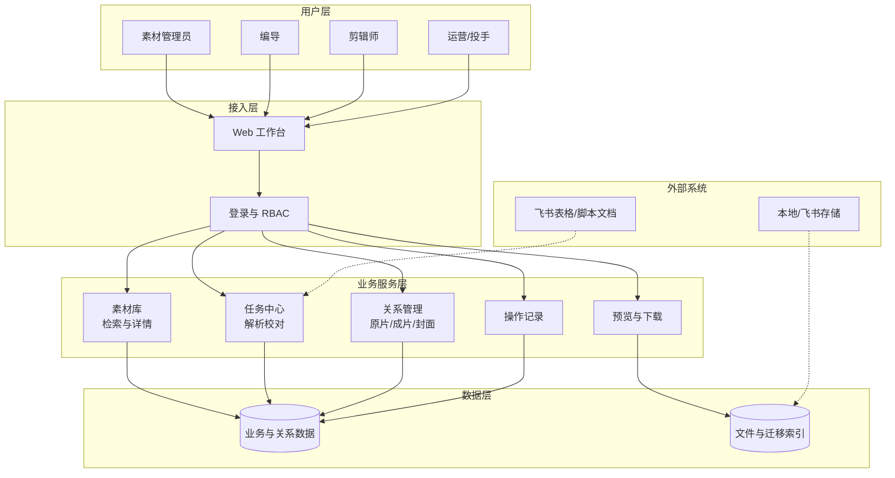
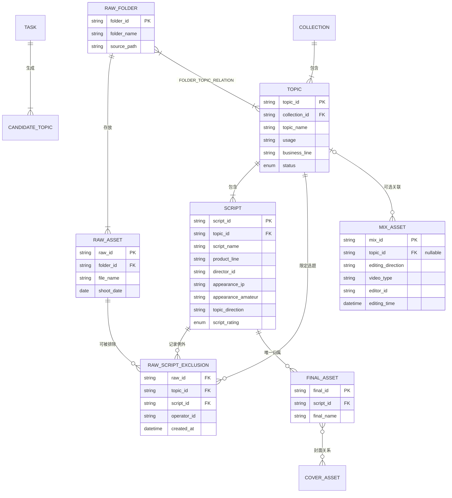
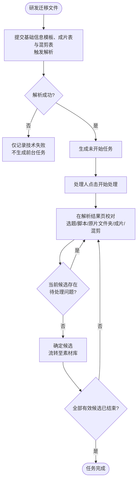
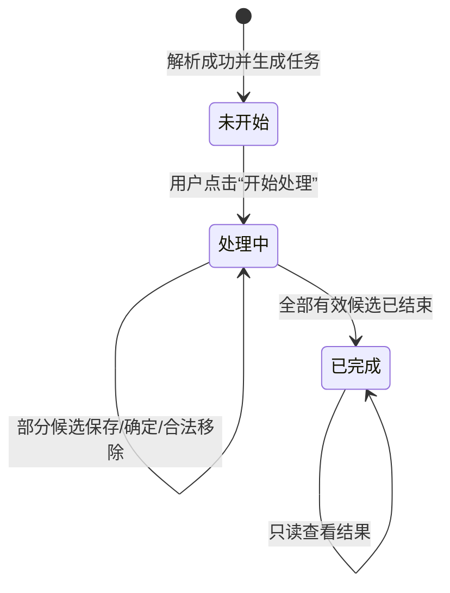

# 合数教育视频管理系统—素材库产品需求文档（PRD）

> 本文档按照公司《复杂业务 PRD 输出规范》整理，以《素材库 PRD V113.6（正式交付版）》为唯一业务内容基线。
>
> 本次仅调整文档结构和表达方式，不新增功能、不改变既有业务规则。原始需求登记暂不纳入本轮整理，待业务侧提供原始材料后另行补充。

## 一、文档信息

| 项目 | 内容 |
| --- | --- |
| 项目名称 | 合数教育视频管理系统—素材库 |
| 需求编号 | [待补充] |
| 当前版本 | V113.6（公司模板版） |
| 文档状态 | 已确认／开发中（最终状态待项目负责人确认） |
| 产品负责人 | [待补充] |
| PRD 编写人 | 李斯仪 |
| 技术负责人 | [待补充] |
| 测试负责人 | [待补充] |
| 创建日期 | [待补充] |
| 本次整理日期 | 2026-10-12 |
| 计划上线日期 | [待补充] |
| 本地原型 | `material-library-v2.html` |
| 线上原型 | https://e3870732-droid.github.io/heshu-video-management-demo/material-library-v2.html |
| GitHub 仓库 | https://github.com/e3870732-droid/heshu-video-management-demo |
| 当前实施基线 | `f4a3934937320777d94c0d4d572e27924e71222e` |

### 1.1 文档权威性与实施基线

本文档确认后，作为公司模板下的正式需求文档。

## 二、原始需求登记

> 本章节按本轮对齐结果暂不处理。本次不补写、不推断、不使用当前方案反向伪造原始需求。待需求提出人、原始描述、提出部门、日期和附件等材料齐备后，再按公司模板补充。

## 三、产品背景与目标

### 3.1 项目背景

#### 业务现状

选题与脚本基础信息由标准模板提供，成片及其脚本关系由单独的成片表提供，混剪及其可选选题关系由单独的混剪表提供，原片仅以百度网盘文件夹作为解析和校对单位。标题、开头、正文和编导备注不在源模板中，由用户后续在系统内录入。研发完成文件迁移后触发解析；素材管理员或编导在解析结果页校对候选选题，确定后流转至素材库。一期不承接拍摄、剪辑或审片流程。

#### 核心问题

1. **资产分散**：业务内容与视频文件分布在多个载体，缺少统一查询和追溯。
2. **关系易失真**：原片文件夹、选题、脚本、成片及封面的关系主要依赖文件名和人工记忆。
3. **历史规则冲突**：旧文档曾将原片误定义为唯一归属某一脚本，或要求同一选题下每份脚本重复建立相同的原片关系。最新口径是：选题关联原片文件夹后，选题下全部脚本默认继承文件夹内原片；脚本只记录对继承结果的例外排除。
4. **校对与正式资产边界不清**：候选关系、正式关系、文件事实和业务字段需要分层管理。

#### 解决思路

- 建立统一的合集、选题、脚本、原片文件夹、原片、成片、封面和混剪资产模型。
- 通过“研发先迁移→系统解析资料→任务中心承接→解析结果页校对→候选选题确定并流转至素材库”形成可追溯闭环。
- 以“原片文件夹—选题”为原片主关系；选题下现有及后续新增脚本默认继承该选题全部有效原片，脚本只维护自身的原片排除项，不重复复制主关系。
- 将普通成片继续定义为唯一选题／脚本归属，封面作为成片的可选横版／竖版关系。

#### 决策依据

- 历史成片约 8,500 条，每日新增约 30–50 条（沿用项目现有资料，上线前由业务再确认）。
- 原片与选题名称不一定一致，不得通过名称相同自动建立正式关系。
- 业务确认原片文件夹首先关联选题；脚本对选题原片默认继承，但可按脚本排除不适用的具体原片。

### 3.2 需求基本情况

| 要素 | 内容 |
| --- | --- |
| 需求提出人 | 视频内容生产与素材管理团队 |
| 核心使用人 | 素材管理员、编导 |
| 其他使用人 | 剪辑师、运营、投手 |
| 受影响人 | 研发迁移与解析责任人、内容管理负责人 |
| 核心场景 | 历史素材迁移校对、日常新资料接入、正式资产检索、选题详情与素材关系维护 |
| 核心痛点 | 文件事实、业务对象和多层关系分散，无法稳定追溯和复用 |
| 需求价值 | 建立唯一资产入口和可追溯关系，降低人工查找、误关联和重复迁移成本 |

#### 核心场景

**场景 A：迁移资料解析与校对**

- 研发先按原目录迁移原片、成片、混剪及已提供封面，然后提交“选题与脚本基础信息模板”、“成片表”和“混剪表”触发解析。
- 系统生成一条解析任务及一个或多个候选选题；处理人从任务中心进入解析结果页校对。
- 解析结果页按当前脚本展示其有效原片集合；各脚本默认继承当前选题的全部有效原片，用户移除某条原片时只对当前脚本记录排除项。
- 当前候选选题的必填字段与必要业务关系合法后，用户点击“确定”，该候选选题作为一个原子单位流转至素材库。

**场景 B：选题与原片关系维护**

- 素材管理员在选题编辑态搜索已迁移原片文件夹。
- 确认后建立文件夹—选题关系；该选题下现有及后续新增脚本默认展示文件夹内全部有效原片。
- 某脚本不需要某原片时，只为当前脚本记录排除项；不影响选题原片、其他脚本、原文件或文件夹关系。恢复时取消该排除项。

**场景 C：素材检索与复用**

- 用户在首页通过全局关键词、对象 Tab 和结构化筛选查询合集、选题、原片、成片和混剪。
- 从列表进入选题或播放视频，返回时恢复来源 Tab、筛选、页码和有效滚动位置。

### 3.3 业务分析与系统调研

#### 现有工具与参考

| 对象 | 类型 | 当前能力 | 可借鉴点 | 局限 |
| --- | --- | --- | --- | --- |
| 飞书表格／脚本文档 | 内部现有工具 | 维护选题、脚本及业务字段 | 模板灵活、业务已熟悉 | 不适合统一管理大量视频与复杂关系 |
| 本地／飞书文件存储 | 内部现有工具 | 存放原片、成片、封面 | 保留原目录和文件事实 | 不承载稳定业务关系 |
| 素材库系统 | 本期建设 | 统一解析、校对、检索、查看和关系管理 | 以稳定 ID 与操作记录建立可追溯资产 | 一期不承载内容生产流程 |

#### 业务痛点优先级

| 优先级 | 痛点 | 影响 | 严重程度 |
| --- | --- | --- | --- |
| P0 | 原片关系模型与真实业务不一致 | 导致误删关系、无法复用和错误禁用原片 | 高 |
| P0 | 多份 PRD 与原型规则不一致 | 研发与测试无法确认真实口径 | 高 |
| P1 | 历史资料量大、依赖人工校对 | 处理成本高、误差不可追溯 | 中高 |
| P1 | 素材检索和跳转上下文容易丢失 | 日常查找和复用效率低 | 中 |

#### 投入产出评估

| 维度 | 估算 |
| --- | --- |
| 预计投入 | [TODO：研发、测试、产品、迁移与业务校对人力] |
| 效率收益 | 缩短历史关系查找、日常素材检索和错误关系修复耗时 |
| 质量收益 | 原片、成片与选题关系可追溯，减少文件重复迁移和误覆盖 |

### 3.4 项目目标与验收总则

#### 项目目标

| 目标类型 | 目标 | 指标 | 目标值 |
| --- | --- | --- | --- |
| 业务目标 | 建立统一可追溯素材关系 | 正式关系指向有效对象比例 | 100% |
| 质量目标 | 消除原片唯一脚本归属错误 | 原片多选题／多脚本关系验收通过率 | 100% |
| 效率目标 | 支持从资料解析到正式入库闭环 | 有效候选确定成功率 | [TODO：上线指标] |
| 体验目标 | 保证列表、详情和播放上下文稳定 | 高频任务关键路径可完成率 | 100% |

#### 交付验收总则

1. 页面、接口、数据关系和操作记录必须使用同一业务口径。
2. 解析结果以合集为处理容器，以候选选题为确定单位；原片文件夹关联候选选题后，该选题下全部脚本默认继承文件夹内原片。
3. 脚本内移除原片只生成当前“选题＋脚本＋原片”的排除项；不改变选题原片主关系、其他脚本或原文件。
4. 同一原片可通过不同文件夹—选题关系对多个选题及其脚本有效，但首页只展示一张原片卡片。
5. 普通成片仍唯一归属一个选题下的一份脚本。
6. 所有写操作进行权限、对象有效性、并发版本和关系完整性校验。

## 四、需求范围

### 4.1 项目方案概述

#### 核心功能

| 模块 | 功能简述 | 优先级 |
| --- | --- | --- |
| 素材库首页 | 统一搜索并分 Tab 展示合集、选题、原片、成片和混剪 | P0 |
| 合集／选题详情 | 查看选题字段、脚本、原片和成片；按权限统一编辑 | P0 |
| 原片关系管理 | 文件夹关联选题、脚本默认继承选题原片、脚本按需排除或恢复具体原片 | P0 |
| 普通成片与封面 | 成片唯一脚本归属，可选关联横版、竖版封面 | P0 |
| 任务中心／解析结果 | 承接研发迁移后资料的校对、修改、确定与追溯 | P0 |
| 混剪资产 | 独立管理混剪；可选关联零个或一个选题，不关联脚本 | P1 |
| 下载与操作记录 | 按权限下载脚本包或单条视频，保留关键变更记录 | P1 |

#### MVP 范围

**包含**：迁移后资料解析校对、正式入库、首页检索、合集／选题详情、原片关系、成片和封面、混剪、单条下载、权限、操作记录。

**不包含**：业务用户上传新视频、从空白新建选题／脚本、拍摄、剪辑、审片、硬删除正式资产、视频批量下载。

### 4.2 项目范围

#### 涉及系统

| 系统 | 关系 | 责任 |
| --- | --- | --- |
| 素材库 Web 系统 | 主体 | 列表、详情、任务、关系、权限和记录 |
| 选题与脚本基础信息模板 | 解析数据源 | 提供合集、选题、脚本名、脚本基础业务字段及百度网盘原片文件夹；不提供标题、开头、正文和编导备注 |
| 成片表 | 解析数据源 | 单独提供成片信息及“成片—候选选题—脚本—可选对应开头”关系 |
| 混剪表 | 解析数据源 | 单独提供混剪信息及可选的“混剪—候选选题”关系；包含剪辑方向、视频类型、剪辑师和剪辑时间，不提供脚本关系 |
| 视频／文件存储 | 文件来源 | 按原目录迁移并提供预览／下载 |
| 现有用户、角色与 IP 主数据 | 平台能力 | 提供登录、角色、编导／出镜 IP 字典 |

#### 影响范围

- **用户**：素材管理员、编导的校对和维护方式；剪辑师、运营、投手的查询和下载方式。
- **流程**：新增研发后台迁移和解析前置，业务从任务中心进入校对。
- **数据**：历史合集、选题、脚本、原片、成片、封面和混剪迁移及关系校准。

#### 不在本期范围

1. 前台上传、替换或硬删除视频文件。
2. 视频剪辑、审片、发布、投流和平台数据回收。
3. 合集、选题或正式脚本的前台硬删除。
4. 通过视频画面的 AI 内容理解、自动分类或自动关联。
5. 对编导备注中的外部链接进行内容抓取、文件下载、网页预览、标题解析或可用性承诺。
6. 将剪辑备注及其他普通文本字段自动识别为可点击链接；本期链接能力仅适用于编导备注。

## 五、需求说明

### 5.1 素材库首页

**页面结构**

- 顶部只保留一个全局关键词搜索框。
- 对象 Tab 固定为：全部／选题／原片／成片／混剪。
- 筛选与重置固定在筛选区右侧，不因字段数量变动位置。
- 全局关键词在五个对象 Tab 间共享；各 Tab 只独立保存结构化筛选、页码和有效滚动位置。
- 卡片长字段单行省略，鼠标悬停显示完整值。

**全局搜索唯一口径**

- 搜索框固定位于对象 Tab 上方，提示词统一为“搜索合集、选题、脚本、原片、成片或混剪”，不得随 Tab 切换而变化。
- 用户输入关键词并按 Enter 后执行搜索；未提交的输入内容不生效，也不因切换 Tab 自动触发搜索。
- 搜索执行后，系统同时计算全部、选题、原片、成片和混剪的结果数，并显示在各 Tab 名称右侧。切换 Tab 只切换结果对象范围，保留已执行的全局关键词，不要求重新搜索。
- 关键词自动去除首尾空格，采用不区分英文大小写的名称包含匹配。本期不做语义理解、同义词扩展、拼音匹配、模糊推测、业务字段联想或基于所属关系的穿透召回。
- 关键词与当前 Tab 结构化筛选之间为“且”；同一筛选字段内多个值之间为“或”，不同筛选字段之间为“且”。
- 点击“重置”时，清空全局关键词和当前 Tab 的结构化筛选，并恢复当前 Tab 的默认列表与分页。

| 对象 Tab | 关键词可检索字段 | 结果去重单位 |
| --- | --- | --- |
| 全部 | 合集名称、合集直接包含的选题名称 | 合集；同一合集内多个选题命中仍只返回一张合集卡片 |
| 选题 | 选题名称、选题直接包含的脚本名 | 选题；同一选题内多个脚本命中仍只返回一张选题卡片 |
| 原片 | 原片文件名 | 原片稳定 ID |
| 成片 | 成片文件名 | 成片稳定 ID |
| 混剪 | 混剪文件名 | 混剪稳定 ID |

- “全部”Tab 以合集为结果单位。关键词直接命中合集名称时，直接返回合集卡片；命中合集内选题名称时，返回其所属合集卡片，并在卡片内说明“包含选题：{ 选题名称 }”；多个选题命中时显示第一条并附“等 N 个选题”。
- 选题 Tab 以选题为结果单位。关键词直接命中选题名称时，直接返回选题卡片，不显示重复命中说明；命中选题内脚本名时，返回其所属选题卡片，并在卡片内说明“包含脚本：{ 脚本名 }”；多个脚本命中时显示第一条并附“等 N 个脚本”。不通过脚本原名、标题、开头、正文或备注召回。
- 召回只向下穿透一层：“合集 → 选题”和“选题 → 脚本”互相独立。脚本名命中选题时，不得再上穿到所属合集；本期不做递归、跨两层或更深的关系链召回。
- 原片、成片和混剪 Tab 只通过当前对象的文件名召回。不通过所属合集、所属选题、所属脚本、关联选题或其他业务字段间接命中。
- 原片可从卡片或详情的“查看选题”入口主动查看关联选题；该关联关系只用于导航和展示，不参与关键词召回。
- 混剪可以关联选题，也可以不关联；两种状态均只通过混剪文件名搜索。
- 当前 Tab 无结果时，仅显示对应对象的空状态和调整提示，不在结果区重复提供“重置条件”入口；用户统一使用顶部筛选栏中“筛选”旁的“重置”清空全局关键词和当前 Tab 的结构化筛选。
- 从搜索结果进入选题详情或视频预览后返回首页时，恢复已执行的全局关键词、来源 Tab、该 Tab 的筛选、页码和有效滚动位置。

**基础业务字段字典**

以下选项为本期解析、编辑、筛选、卡片展示和统计使用的统一有效值。前端不得自行增加同义项，后端不得将字典外文本静默写入正式字段；历史数据中的非标准值需进入人工校对。

| 字段 | 有效选项 |
| --- | --- |
| 选题方向 | 反认知观点型、高低对比型、知识科普型、家长痛点型、课效销售型、避坑科普型、观点阐述型、政策解读型、人设故事型、家长批判型、清单推荐型、时事热点型、学员故事型、名人案例型 |
| 平台 | 小红书、抖音、快手、视频号、百家号 |
| 业务线 | 教育规划、大场、飞轮学习力 |
| 视频类型 | AI、实拍、混合 |
| 剪辑方向 | 强IP、强营销、强痛点 |

**业务线—产品线映射**

| 业务线 | 该业务线下允许选择的产品线 |
| --- | --- |
| 教育规划 | 教育规划精华课（阿留）、教育规划精华课（深圳店播）、教育规划精华课（北京店播）、教育规划陪跑营 |
| 大场 | 豆神双语小王者、豆神语文小王者、伴鱼阅读营、伴鱼科普营、火花思维、洋葱学园、一亩宝盒 |
| 飞轮学习力 | 飞轮学习力体验课、飞轮学习力 |

**字段约束**

- 业务线是一级业务归属，产品线是受业务线约束的二级业务归属；产品线不得脱离业务线独立形成无归属值。
- 选择或变更选题业务线后，各脚本的产品线选项只展示该业务线对应的有效值。已有脚本产品线不属于新业务线时，必须标记冲突并要求用户逐份重新选择；在用户完成选择并保存前保留原编辑值，不得静默清空、替换或保存无效组合。
- 不设置“豆神双语”业务线，也不设置其独立产品线关系；“豆神双语小王者”只保留在“大场”业务线下。
- 平台支持多选，可在小红书、抖音、快手、视频号、百家号中选择一个或多个；不提供“-”作为平台选项。
- 同一字段的编辑选项、筛选选项、卡片标签及详情展示必须使用同一套字典值，不得出现简称、别名或额外枚举。
- 历史资料解析出字典外值或无效业务线—产品线组合时，不自动映射到相似名称；进入人工校对，确认后才能正式保存。

**日期展示、筛选与排序的唯一口径**

| 对象 Tab | 列表展示日期 | 日期筛选字段 | “最近”排序字段 | 字段来源与变化时机 |
| --- | --- | --- | --- | --- |
| 全部／合集 | 创建日期 | 创建日期 | 创建日期倒序 | 合集首次成功创建时生成，之后不随选题或素材变更而改变 |
| 选题 | 更新日期 | 更新日期 | 更新日期倒序 | 选题或其脚本业务字段正式保存成功后更新；进入编辑、取消或保存失败不更新 |
| 原片 | 拍摄日期 | 拍摄日期 | 拍摄日期倒序 | 来源资料解析或有权用户校对的实际拍摄日期；迁移、关联、调整归属或修改备注不自动改变 |
| 成片 | 剪辑日期 | 剪辑日期 | 剪辑日期倒序 | 来源资料解析或有权用户校对的实际剪辑完成日期；迁移、关联封面、调整归属或修改备注不自动改变 |
| 混剪 | 剪辑时间 | 剪辑日期区间（按剪辑时间的日期部分匹配） | 剪辑时间倒序 | 来源混剪表解析或有权用户校对的实际剪辑完成时间；关联选题、调整关系或修改其他字段不自动改变 |

- 每个 Tab 只展示上表对应的一类业务日期，不在同一列表同时提供创建、更新、迁移、上传等多套日期筛选。
- 日期筛选使用“开始日期—结束日期”区间；起止边界均包含。只填开始日期时查询该日及之后，只填结束日期时查询该日及之前。
- 日期筛选为空时不限制结果；启用日期筛选后，对应业务日期为空的记录不命中。
- “最近”不得使用迁移时间、上传时间、关联时间或最后操作时间替代上表的业务日期。
- 预览、下载、搜索关联、移除关联、调整归属、关联封面及备注修改不自动改写拍摄日期或剪辑日期。

**合集卡片**

- 用途标签放在合集名称右侧。
- 展示选题总数，并在其后展示“S 级选题数”和“A 级选题数”；无评级选题数不单独展示，可由总数减去 S、A 数得到。
- 底部只展示“创建”及合集创建日期，不展示合集更新日期。

**选题卡片**

- 用途标签固定放在选题名称右侧；不得在选题卡片上展示平台标签。
- 选题评级以 S／A 图标展示在名称区域；无评级不展示占位图标。评级只读，按选题下脚本评级聚合计算。
- 依次展示所属合集、业务线，以及由有效脚本聚合得到的产品线、编导、出镜 IP、出镜素人和选题方向；多值去重后展示，空值显示“-”。编导位于产品线下方，出镜素人位于出镜 IP 下方。
- 展示“脚本 N ｜ 原片 N ｜ 成片 N”数量摘要；同一选题在“选题”Tab 与合集详情中复用同一卡片字段、顺序、组件和空值规则，合集详情仅可省略已经由页面上下文明确表达的“所属合集”。
- 选题筛选中的产品线、编导、出镜 IP、出镜素人、选题方向均按“任一有效脚本命中”返回选题；评级筛选使用派生后的选题评级，并提供 S、A、无（空值）三个选项。
- 底部只展示“更新日期”，不同时展示创建日期。

**原片卡片**

- 视频区左上角仅在场景有值时显示场景标签，不显示组合设备／机位标签。
- 信息区显示原片名称、文件大小、摄像与拍摄日期；底部按“摄像姓名 · 日期”展示，不显示“摄像”字样。
- 没有脚本时按需显示“脚本 -”；首页原片卡片不展示具体选题／脚本路径或关系数摘要。
- 同一稳定原片 ID 只展示一张卡片。
- “查看选题”：只有一个有效选题时直接进入；多选题时先让用户选择；未关联时隐藏入口。

**成片卡片**

- 展示成片名称、平台、剪辑方向、视频类型、剪辑师、剪辑日期及可选封面；剪辑方向标签位于视频类型标签前。
- 展示关联脚本的编导与出镜 IP；出镜 IP 放在编导之后。成片筛选提供出镜 IP、剪辑方向和视频类型，出镜 IP 按关联脚本值匹配。
- 成片关系唯一指向具体选题／脚本，“查看选题”直接进入并定位脚本。

**混剪卡片**

- 展示混剪标题、关联选题（无关联显示“-”）、剪辑师、剪辑方向、视频类型和剪辑时间；剪辑方向标签位于视频类型标签前。
- 混剪筛选提供剪辑方向和视频类型，不提供出镜 IP 或出镜素人筛选，卡片也不展示出镜 IP 或出镜素人。
- 不展示合集字段。

### 5.2 选题详情与统一编辑

- 顶部“选题信息”按“所属合集、业务线、用途”顺序展示；“所属合集”为只读来源信息，位于“业务线”之前，不提供编辑入口。
- 顶部“选题信息”除所属合集外，只展示并编辑选题名称、用途、业务线，不展示产品线、编导、出镜 IP、出镜素人、选题方向或评级。
- 脚本使用 Tab 切换；切换脚本同时切换该脚本的产品线、编导、出镜 IP、出镜素人、选题方向、脚本评级、创作／拍摄字段、有效原片集合和成片集合。
- 脚本评级允许选择 S、A 或无；“无”在数据库中保存为空值。选题评级只由脚本评级派生，不在选题信息区提供编辑控件。
- 正式详情只有一个“编辑”入口；进入后允许的字段与关系共用一次保存。
- 点击保存后直接执行校验与保存，不再出现二次确认弹窗；保存成功返回详情态，失败则保留全部未保存输入并定位错误字段。
- 编辑态有未保存内容时，切换脚本或离开页面必须提示放弃修改。
- 脚本拍摄字段包括：场景、视觉锤、服装、动作、摄像、设备、机位、道具、镜号、音频。同类多值使用独立输入框复用现有输入样式，不合并为一个长字符串。
- 历史脚本允许没有原片、没有成片，或只有其中一种；原片数和成片数均为 `0..N`，不作为解析结果“确定”或正式详情“保存”的阻断条件。
- `摄像` 为可空字段。历史资料未记录摄像时，详情保留该字段位置但值留空；不自动填充人名，不触发必填错误。

**编导备注与链接规则**

- 编导备注支持纯文本，以及纯文本与一个或多个链接混合输入；保存时必须完整保留用户输入的文字、链接内容及先后顺序，不自动改写备注。
- 系统仅将包含完整协议的 `http://` 或 `https://` 地址识别为链接。无法识别的地址或不完整地址按普通文本保存和展示，不阻止整条备注保存。
- 正式详情态中，识别成功的链接显示为可点击文本；点击后在新标签页打开，当前素材库页面、脚本位置及页面状态保持不变。
- 编辑态仍以原始文本显示和编辑，不将链接拆分为独立字段，不因链接数量改变编导备注的数据结构。
- 长链接必须自动换行或在不丢失原始值的前提下省略展示，不得撑破内容区、遮挡相邻字段或造成横向滚动。
- `javascript:`、`data:`、`file:` 等非 `http(s)` 协议不得生成可点击链接；前端展示和跳转必须进行安全转义，并使用安全的新标签页打开方式。
- 系统不主动访问、抓取、下载或解析链接目标，也不对外部页面的真实性、安全性、权限或持续可用性作保证。
- 本期只有编导备注具备上述链接能力。剪辑备注以及其他普通文本字段即使包含类似 URL 的内容，也仍按普通文本展示，不生成可点击链接。
- 当前产品模型不存在“原片备注”字段，本需求不得据此新增该字段。

### 5.3 原片关系管理（核心规则）

| 编号 | 规则类型 | 规则 |
| --- | --- | --- |
| RAW-01 | 事实 | 原片文件夹先关联选题；文件夹内有效原片构成选题原片，脚本按 BR-RAW-01 默认继承 |
| RAW-02 | 触发 | 新增文件夹—选题关系后，该选题下全部现有脚本立即继承文件夹内有效原片 |
| RAW-03 | 触发 | 选题后续新增脚本时，新脚本自动继承当时全部有效选题原片 |
| RAW-04 | 约束 | 同一文件夹可关联多个选题；同一原片可通过不同选题关系对多个选题及脚本有效 |
| RAW-05 | 触发 | 在脚本内移除原片，只新增“选题＋当前脚本＋该原片”的排除项 |
| RAW-05A | 触发 | 在脚本内新增关联原片，只新增“选题＋当前脚本＋该原片”的脚本级补充关系，其他脚本不继承该次补充 |
| RAW-06 | 触发 | 在脚本内恢复已排除原片，只删除对应排除项，并恢复默认继承展示 |
| RAW-07 | 约束 | 排除或恢复不影响同选题其他脚本、其他选题、原片文件、来源目录或文件夹—选题关系 |
| RAW-08 | 触发 | 解除文件夹—选题关系后，该文件夹原片不再属于该选题；相关脚本不再继承，失效排除项不得继续参与计算 |
| RAW-09 | 计算 | 原片未关联 = 该原片当前不属于任何有效文件夹—选题关系；脚本排除不等于原片未关联 |

**搜索关联抽屉**

- 不设“待关联原片”页签；搜索关联抽屉展示已迁移原片，提供名称搜索与原目录树，不提供关联状态、合集等多层复杂筛选。
- 在选题层确认原片文件夹时，建立文件夹—选题主关系，选题下全部脚本按 BR-RAW-01 默认继承。
- 在解析结果页或正式选题详情的当前脚本中执行“搜索关联”时，确认后只新增当前脚本的补充关系；不改变选题原片主集合，不影响其他脚本。
- 在两个页面中从当前脚本移除或恢复原片时，只改变当前脚本的排除项；沿用现有原片区组件和操作入口，不新增继承状态标签、摘要或新的关系管理区域。
- 取消、关闭或预览不改变任何关系。

### 5.4 普通成片与封面

- 普通成片只能唯一归属一个选题下的一份脚本。
- 搜索关联成片时，只能选择尚未占用的已迁移成片。
- 成片不提供直接解除为未关联状态，只能调整到另一有效选题／脚本。
- 搜索框同时支持成片名称与封面名称。
- 关联抽屉内使用“成片／封面” Tab；封面包括横版与竖版两种类型。
- 成片必选；横版封面、竖版封面都可不选，每种最多选一张。

### 5.5 视频预览

- 默认不自动播放；支持播放／暂停、进度、音量与全屏。
- 所有视频预览均不展示倍速控件。
- 非编辑态不显示“替换”和“移除”；编辑态只可显示“移除”，不提供“替换”。
- 关闭预览后恢复页面原有未保存内容和滚动位置。

### 5.6 任务中心

**页面职责**

- 任务中心用于查看和管理解析任务，不在列表中编辑候选选题的具体内容。
- 任务状态只有：未开始、处理中、已完成。“开始处理”是操作，不是状态；“待处理”只用于解析结果页的阻断性业务问题，不作为任务状态。
- 解析失败不生成前台业务任务，因此任务中心不建立“失败”状态。

**任务摘要与统计**

- 任务卡片展示：任务名称／批次、创建时间、当前处理人、任务状态、候选选题数、脚本数、原片文件夹数与文件夹内视频总数、成片数、混剪数、待处理问题数。
- 原片统计统一使用“`N 个原片文件夹 · 共 M 个视频`”，不把文件夹数与具体视频数混为同一指标。
- 任务的待处理数等于该任务下所有未结束候选选题的阻断性业务问题数之和。

**任务操作**

- 同一用户最多同时领取 5 个状态为“处理中”且尚未完成的任务；查看已完成任务不占用领取名额。
- 用户领取第 1～5 个任务时，系统直接取得处理权并打开解析结果页；领取成功后提示“当前已领取 N/5 个任务”。
- 用户已有 5 个未完成任务时，再点击其他未开始任务的“开始处理”，系统不得改变任务处理人或状态，应使用居中弹窗提示其优先完成已领取任务。
- 达到上限时直接复用系统统一确认弹窗组件，不新建任务专用弹窗样式；标题为“当前最多可同时处理 5 个任务”，正文仅说明当前已领取 5 个未完成任务并提示优先完成至少 1 个；不展示 `5/5` 图形、补充说明卡片、`TASK-XXXX`、`task_id` 等内部字段，也不默认指定某一个任务为“当前任务”。
- 点击“查看已领取任务”后关闭弹窗并切换到任务中心“处理中”列表；点击“我知道了”只关闭弹窗。

| 任务状态 | 主操作 | 操作结果 |
| --- | --- | --- |
| 未开始 | 开始处理 | 任务进入“处理中”，并打开该任务的解析结果页 |
| 处理中 | 继续处理 | 打开解析结果页，保留上次已保存的校对进度 |
| 已完成 | 查看 | 以只读方式查看已结束的处理结果 |

### 5.7 解析结果页

**核心口径**

- 解析结果页是某一解析任务的候选选题校对工作台，不是任务中心列表，也不是正式素材库详情页。
- 解析结果页沿用现有合集维度页面结构。合集下增加候选选题列表，用户在同一合集内切换当前候选选题；当前候选选题仍是保存、确定或移除的最小业务单位。
- 一条解析任务可生成一个或多个候选选题。每个候选选题独立保存、确定或合法移除。
- “保存”只保存当前校对进度，不流转至素材库；“确定”用于将当前候选选题及其合法关系作为一个原子单位流转至素材库。
- 顶部统计只承担任务汇总；合集名称、候选选题列表及当前选题状态在左侧容器展示，不在顶部重复展示来源合集、来源业务线、任务业务线、匹配正式合集或匹配状态。

**合集、候选选题与脚本展示**

- 合集容器中展示该合集下的候选选题，不新增独立的合集详情页或新的导航层级。
- 每个候选选题保留现有“确定”和“移除”操作；“确定”执行当前候选选题的流转校验，“移除”仅移除当前候选选题，不影响同合集其他候选选题。
- 左侧每个候选选题卡片始终直接展示其全部脚本，不以选题是否被点击作为展示条件；当前选题与当前脚本只使用高亮状态区分。
- 进入解析结果页时默认选中第一个候选选题的第一份脚本；点击任意选题下的其他脚本后，右侧切换为该脚本详情。
- 右侧当前脚本详情直接复用正式选题详情中已有的脚本展示形式和字段顺序；不在右侧重复增加另一组脚本导航，也不改变正式选题详情本身。
- 不为解析结果脚本新增“继承选题原片”“已调整”等摘要、标签或操作入口。
- 左侧每份脚本展示自身实时的“N 个原片 · M 条成片”；一份脚本的原片排除项不影响其他脚本的数量。
- 除增加候选选题列表、候选选题操作、复用脚本展示及统一脚本原片排除行为外，解析结果页的统计区、选题信息区、成片区和现有布局均保持不变。

**数据来源**

| 数据源 | 用途 | 解析字段 |
| --- | --- | --- |
| 选题与脚本基础信息模板 | 生成合集、候选选题、脚本基础信息和原片文件夹线索 | 选题合集、选题、选题方向、剪辑方向、脚本名、拍摄日期、脚本原名、百度网盘文件夹、镜号、音频、编导、摄像、用途、业务线、产品线、出镜 IP、出镜素人、场景、视觉锤、服装、动作、设备、机位、道具 |
| 成片表 | 生成成片信息及其业务关系 | 成片展示字段，以及成片对应的候选选题、脚本和可选对应开头 |
| 混剪表 | 生成独立混剪资产及其可选选题关系 | 混剪信息、可选对应选题、剪辑方向、视频类型、剪辑师、剪辑时间；不包含脚本字段或脚本关系 |

- 源模板不提供标题、开头、正文和编导备注；这些属于系统内脚本内容，由用户在系统中新建或维护。
- 脚本没有标题、开头或正文是合法状态，不属于解析缺失，不进入待处理，不阻断确定。

**页面对象结构与字段归属**

```text
解析任务
├── 选题合集
│   └── 候选选题
│       ├── 选题信息
│       ├── 一份或多份脚本
│       │   ├── 脚本基础信息（模板解析）
│       │   └── 脚本内容（系统内录入）
│       ├── 零个或多个原片文件夹
│       └── 零条或多条成片
└── 零条或多条混剪（任务级独立资产，可选关联候选选题）
```

| 层级 | 字段或对象 | 规则 |
| --- | --- | --- |
| 选题层 | 选题名称、用途、业务线 | 候选选题的公共信息；不在选题层重复保存脚本字段 |
| 脚本层 | 脚本名、选题方向、剪辑方向、拍摄日期、脚本原名、镜号、音频、编导、摄像、产品线、出镜 IP、出镜素人、场景、视觉锤、服装、动作、设备、机位、道具、脚本评级 | 每份脚本独立校对；每份脚本必须有脚本名；脚本评级可为 S、A 或无，“无”存为空值；展示形式复用正式选题详情现有脚本组件 |
| 脚本内容 | 标题、开头、正文、编导备注 | 用户在系统内录入；标题、开头、正文均为 `0..N`，编导备注可空 |
| 原片 | 百度网盘原片文件夹、文件夹内原片与脚本排除项 | 文件夹—候选选题是主关系；当前脚本默认展示全部选题原片，移除只写入当前脚本排除项 |
| 成片 | 成片信息、对应脚本、可选对应开头 | 每条成片独立校对关系；成片表未指定开头时，只建立成片—脚本关系 |
| 混剪 | 混剪信息、可选对应选题、剪辑方向、视频类型、剪辑师、剪辑时间 | 不关联脚本；选题可不选，选择时最多关联一个有效候选选题 |

**原片文件夹规则**

- 解析结果页原片区域保持当前原型的名称、位置、分组、原片卡片和拍摄日期校对形式；展示集合必须按“选题原片减去当前脚本排除项”实时计算。
- 原片文件夹可关联一个或多个候选选题；同一候选选题可关联零个或多个原片文件夹。
- 原片文件夹关联当前候选选题后，当前选题下全部脚本按 BR-RAW-01 默认继承；该关系不在脚本展示区重复增加摘要或标签。
- 解析结果页与正式选题详情编辑态复用同一移除规则：用户在某份脚本中移除原片 A，只新增 `topic_id + script_id + raw_id` 排除项；不删除原片 A，不解除文件夹—选题主关系，不影响同选题其他脚本。
- 切换脚本后，原片卡片、原片数量和空状态必须使用目标脚本自身的排除项重新计算，不得沿用上一份脚本的显示结果。
- 脚本的具体原片数允许为 0。全部排除不进入待处理，不阻断保存或确定。
- 确定候选选题时，文件夹—选题主关系与各脚本排除项一并原子流转至素材库；正式选题详情继续使用同一计算规则，不重新生成另一套关系。

**成片关系规则**

- 成片表中的每条普通成片必须唯一对应当前候选选题下的一份有效脚本。
- “对应开头”为可选关系。成片表未填对应开头时，不进入待处理，成片只关联脚本。
- 成片表已填对应开头，但目标脚本中不存在或无法唯一匹配该开头时，进入待处理。用户可任选一种处理：清空对应开头，仅保留成片—脚本关系；或在目标脚本中创建开头后再建立关系。系统不强制用户创建开头。
- 封面为可选关系，未关联封面不阻断候选选题确定。混剪是独立资产，不参与普通成片关系校验。

**混剪解析规则**

- 混剪由单独的混剪表解析，作为任务级独立资产展示和校对，不归属脚本。
- 混剪可不关联选题；如关联，最多只能关联一个有效候选选题。未关联选题不进入待处理，不阻断其作为独立混剪流转至素材库。
- 历史迁移混剪的基础业务字段为剪辑方向、视频类型、剪辑师和剪辑时间；不从选题或脚本继承这些值。
- 混剪表填写了选题，但无法唯一匹配有效候选选题时，该关系进入待处理；用户可重新选择选题，也可清空选题关系。

**解析成功与解析失败**

| 结果 | 判定标准 | 后续处理 |
| --- | --- | --- |
| 解析成功 | 系统能生成至少一个可在解析结果页打开的候选选题结构 | 生成前台任务；字段缺失、字典冲突和业务关系不明确作为待处理问题，不将整任务判为解析失败 |
| 解析失败 | 源资料无法访问或读取、无法生成任何候选选题、无法建立基础对象结构，或解析程序在达到技术重试上限后仍失败 | 不生成前台业务任务；记录技术失败原因并交由研发处理 |

**待处理规则**

> 待处理只统计“用户可处理且未处理前会阻断当前候选选题确定”的业务问题。技术失败不计入待处理。

| 进入待处理的情况 | 不进入待处理的情况 |
| --- | --- |
| 选题名称、用途或业务线缺失，或值不在有效字典内 | 脚本没有标题、开头或正文 |
| 任一脚本缺少脚本名 | 脚本没有具体原片，或当前脚本已将选题原片全部排除 |
| 业务线与脚本产品线冲突，或源数据中已填的枚举值无法对应有效字典 | 摄像、脚本评级、脚本原名、编导备注、封面或其他明确允许为空的字段未填 |
| 原片文件夹无法唯一确定应关联的候选选题，或存在重复、冲突的文件夹—候选选题关系 | 成片表未填“对应开头” |
| 成片未唯一对应当前候选选题下的有效脚本，或脚本匹配缺失、无效、不唯一 | 脚本成片数为 0；不以“每份脚本必须有成片”作为确定条件 |
| 成片表已填对应开头，但目标脚本中不存在或无法唯一匹配该开头 | 预览代理或外部文件临时无法打开；此类技术问题按异常处理，不伪装成业务待处理 |
| 混剪表已填选题，但无法唯一匹配有效候选选题 | 混剪表未填选题；选题关系为可选 |

**保存、确定与任务完成**

- 保存时允许当前候选选题仍存在待处理问题；保存成功后任务仍为“处理中”。
- 确定前重新执行待处理校验。存在任一阻断性问题时，当前候选选题不得流转，页面必须保留已编辑内容并定位问题。
- 确定是候选选题级原子操作：选题、脚本、原片文件夹—选题关系、脚本原片排除项和成片关系必须全部成功或全部不生效，不允许部分流转。
- 当任务下所有候选选题均已确定或合法移除时，任务自动进入“已完成”。

### 5.8 混剪

- 混剪是独立视频对象，可选关联零个或一个已正式入库选题，不关联脚本。
- 混剪展示选题；没有选题时显示“-”，不展示合集。
- 历史迁移混剪的剪辑方向、视频类型、剪辑师和剪辑时间来自混剪表，不从关联选题或选题下脚本派生。
- 未关联选题是合法状态；关联后可调整为另一个有效选题，也可解除关联恢复为无选题。上述操作不改变混剪文件本身。
- 业务字段长度超出卡片时省略，悬停显示完整值。

## 六、通用业务规则

### 6.1 产品框架、数据模型、流程与状态机

#### 应用架构



#### 核心数据模型



**关系计算规则**：

```text
某脚本有效原片
= 当前选题全部有效原片
+ 当前“选题×脚本”单独新增关联的原片
- 当前“选题×脚本”已排除的原片
且原片文件、脚本、选题及对应关系均为有效状态
```

**BR-RAW-01｜选题原片继承规则（唯一业务口径）**

- 原片文件夹—选题关系是原片业务归属的主关系。关系有效时，文件夹内全部有效原片构成该选题的“选题原片”。
- 选题下现有脚本及后续新增脚本默认继承全部选题原片；系统不得为每份脚本复制一套相同的原片主关系。
- 用户在某脚本内单独新增关联原片时，只建立“选题＋脚本＋原片”脚本级补充关系；不将该原片追加到选题原片集合，不影响其他脚本。
- 用户从某脚本移除一条继承原片时，仅新增该“选题＋脚本＋原片”的排除项；恢复关联时删除对应排除项。
- 排除项不改变原片文件、原片文件夹—选题关系、选题原片集合或其他脚本的有效原片集合。
- 脚本有效原片允许为 0；“全部排除”属于合法状态，不进入待处理，也不阻断保存、确定或流转至素材库。
- 本规则由 10.2.2、10.2.3、10.2.7、10.3 和附录 A 引用；这些章节只描述各页面如何呈现和操作，不得再定义相反的数据关系。

**选题与脚本字段归属（唯一口径）**

| 数据层级 | 正式存储字段 | 说明 |
| --- | --- | --- |
| 选题层 | 选题名称、用途、业务线 | 仅保存同一选题下所有脚本共用的信息；不得在选题层重复保存产品线、编导、出镜信息、选题方向或评级 |
| 脚本层 | 产品线、编导、出镜 IP、出镜素人、选题方向、脚本评级、脚本原名、编导备注、摄像、场景、设备、机位、姿势／动作、服装、道具、视觉锤、镜号、音频、标题、开头、正文 | 每份脚本独立维护；列表中的选题级展示值按聚合规则计算，不反写选题表 |

- 选题评级由脚本评级派生：任一有效脚本为 S，则选题评级为 S；没有 S 但至少一份有效脚本为 A，则为 A；全部脚本均无评级或选题暂无有效脚本，则为无。
- 产品线仍受选题业务线约束，但值存储在脚本层。变更选题业务线后，如任一脚本产品线不属于新业务线，系统保留用户尚未保存的编辑内容并标记冲突，要求逐份脚本重新选择后方可保存；不得静默清空、替换或映射。
- 成片唯一关联具体脚本；其产品线、编导、出镜 IP、出镜素人、选题方向等业务归属均从关联脚本读取，不从选题复制或维护第二份值。

#### 核心业务流程



#### 任务状态机



| 状态 | 进入条件 | 允许操作 | 离开条件 |
| --- | --- | --- | --- |
| 未开始 | 解析成功并生成前台任务 | 开始处理、查看任务摘要 | 点击“开始处理”后进入处理中 |
| 处理中 | 已开始处理，且仍有未结束候选选题 | 编辑、保存、确定或合法移除候选选题 | 所有候选选题均已确定或合法移除后进入已完成 |
| 已完成 | 任务下无未结束候选选题 | 只读查看 | 无 |

> “开始处理”是操作，不是任务状态。解析失败属于技术结果，不生成前台业务任务，因此不设“失败”业务状态。

### 6.2 角色与权限

#### 角色

| 角色 | 核心责任 |
| --- | --- |
| 素材管理员 | 正式资产维护、原片／成片／封面关系管理、任务处理 |
| 编导 | 任务处理、正式内容查看与脚本下载 |
| 剪辑师 | 正式内容查看、单份脚本及授权视频下载 |
| 运营／投手 | 正式内容查看及权限内成片／混剪下载 |

#### 功能权限矩阵

| 功能 | 素材管理员 | 编导 | 剪辑师 | 运营 | 投手 |
| --- | --- | --- | --- | --- | --- |
| 查看素材库 | ✓ | ✓ | ✓ | ✓ | ✓ |
| 查看任务中心 | ✓ | ✓ | — | — | — |
| 处理候选任务 | ✓ | ✓ | — | — | — |
| 编辑正式选题／脚本 | ✓ | — | — | — | — |
| 管理原片文件夹—选题关系 | ✓ | — | — | — | — |
| 在脚本中排除／恢复原片 | ✓ | — | — | — | — |
| 调整普通成片／封面 | ✓ | — | — | — | — |
| 单条原片下载 | ✓ | ✓ | ✓ | — | — |
| 单条成片下载 | ✓ | ✓ | ✓ | ✓ | ✓ |
| 混剪下载 | ✓ | ✓ | ✓ | ✓ | ✓ |

- 一期五类角色可查看全部业务线的正式素材。
- 权限必须同时在界面和服务端校验。

## 七、异常与边界处理

### 7.1 异常处理

| 异常 | 处理 |
| --- | --- |
| 源资料无法访问或读取，或无法生成任何候选选题 | 判定为解析失败，不生成前台业务任务；记录技术原因并交研发处理 |
| 解析成功但必填字段或必要业务关系缺失 | 生成任务并计入解析结果页的待处理问题；不将整个解析判为失败 |
| 成片已填对应开头，但目标脚本无该开头 | 阻断当前候选选题确定；允许用户清空对应开头或新建开头，不强制新建 |
| 混剪表未填选题 | 按无选题的独立混剪处理，不计入待处理，不自动猜测选题 |
| 混剪表已填选题，但无法唯一匹配 | 该选题关系进入待处理；允许重新选择有效选题或清空关系 |
| 已迁移文件搜索不到 | 提示联系研发完成迁移；不提供前台临时上传 |
| 同名文件夹／视频匹配不唯一 | 展示来源路径和文件属性供人工选择，不自动选第一条 |
| 文件或关系版本已变更 | 拒绝静默覆盖，显示最新状态并要求刷新重试 |
| 移除原片后脚本原片数为 0 | 允许保存；展示“当前脚本暂无原片”空状态，不删除脚本或其他素材关系 |
| 恢复一条已失效或已不属于当前选题的原片 | 不建立无效关系；刷新选题原片范围并提示该原片已不可恢复 |
| 解除文件夹—选题关系后仍存在相关脚本排除项 | 相关排除项停止参与有效原片计算；实现层可删除或标记失效，但不得继续影响其他选题关系 |
| 脚本成片数为 0 | 允许确定与保存；展示“当前脚本暂无成片”空状态，不计入待处理 |
| 预览代理失败 | 显示“视频暂时无法预览”和重新加载，不影响业务信息或授权下载 |
| 保存超时 | 通过幂等请求标识查询最终结果，不允许双击重复提交 |
| 无权写操作 | 界面无入口，接口仍拒绝请求并记录安全日志 |
| 编导备注包含无法识别或不安全协议的地址 | 备注整体允许保存；该部分按普通文本安全展示，不生成可点击链接 |
| 编导备注中的外部链接无法打开 | 不影响备注本身和页面其他数据；浏览器按外部页面实际状态处理，不由素材库改写或删除该链接 |

## 八、数据埋点与监控

### 8.1 数据指标与埋点

| 事件 | 触发 | 核心参数 | 用途 |
| --- | --- | --- | --- |
| `material_library_view` | 进入素材库 | role, tab | 功能采纳率 |
| `task_processing_start` | 开始处理 | task_id, operator_id | 任务转化与耗时 |
| `candidate_confirm` | 确定候选 | task_id, topic_id, duration, pending_count | 校对效率与失败率 |
| `candidate_save` | 保存候选校对进度 | task_id, topic_id, pending_count | 统计中断与继续处理情况 |
| `candidate_pending_resolved` | 解决一项待处理问题 | task_id, topic_id, pending_type | 分析历史资料的主要缺口 |
| `folder_topic_relation_save` | 新增／移除文件夹—选题关系 | folder_id, topic_id, action, operator_id | 原片关系使用情况 |
| `raw_script_exclusion_save` | 排除／恢复当前脚本的一条继承原片 | raw_id, topic_id, script_id, action, operator_id | 脚本原片例外调整使用情况 |
| `video_preview_result` | 预览成功／失败 | asset_type, asset_id, result | 预览可用性 |
| `asset_download` | 下载文件 | role, asset_type, asset_id | 下载使用与权限审计 |

> 埋点工具、事件上报规范和日志保留周期由研发技术方案确定。

### 8.2 系统监控待确认项

以下监控项由研发、测试和数据团队在技术评审时确认口径、阈值、告警对象与责任人：解析成功率、技术失败率、保存失败率、候选确定失败率、预览失败率、下载失败率、任务平均处理时长、长期未完成任务数、状态链路不一致数、迁移数量不一致数和关系完整性校验失败数。

## 九、验收标准

### 9.1 功能验收总则

1. 页面、接口、数据关系、操作记录和统计使用同一业务口径。
2. 解析结果页和正式选题编辑态使用同一套业务规则。
3. 已确认组件、卡片、抽屉、弹窗、尺寸和交互直接复用。
4. 用户界面不展示内部任务编号或后端字段。
5. 所有写操作校验权限、对象有效性、版本和关系完整性。
6. 验收以用户最终看到的页面和刷新后的持久化结果为准。

### 9.2 状态链路专项验收

- 任务完成后从处理中移出并进入已完成。
- 写入处理人、完成时间和操作记录。
- 按钮变为“查看结果”。
- 释放一个领取名额。
- 处理中、已完成和全部列表统计同步更新。
- 刷新后状态、列表归属、按钮、时间、记录和统计不得回退。

### 9.3 数据关系专项验收

- 文件夹关联选题后，该选题现有和后续脚本默认继承选题原片。
- 当前脚本移除原片只产生当前脚本排除项。
- 当前脚本补充原片不影响同选题其他脚本。
- 正式详情和解析结果页对同一关系计算结果一致。
- 成片始终唯一归属有效脚本。
- 混剪不建立脚本关系。

### 9.4 非功能验收

| 类型 | 已确认标准 | 待确认标准 |
| --- | --- | --- |
| 安全 | 双端权限校验；外链安全转义；拒绝不安全协议 | 日志保存期和审计范围 |
| 并发 | 乐观锁，禁止静默覆盖 | 冲突响应规范 |
| 一致性 | 状态、记录、统计和名额完整联动 | 服务端事务方案 |
| 可恢复性 | 保存失败保留输入；刷新恢复正式状态；上线可回滚 | 快照周期和恢复目标 |
| 性能 | 大视频预览失败不阻塞业务信息 | 页面、搜索、保存响应目标 |
| 容量 | 技术阈值不在本次业务规则中虚构 | 单文件、单文件夹、ZIP 和预览超时阈值 |
| 兼容性 | Web 端可用 | 浏览器和最低版本 |

### 9.5 核心验收用例

| 编号 | 初始条件／操作 | 预期结果 |
| --- | --- | --- |
| AC-RAW-01 | 文件夹 F 含 A、B；选题 T 已有脚本 S1、S2；将 F 关联 T | S1、S2 均默认展示 A、B；只建立 F—T 主关系，不为两份脚本复制相同的原片主关系 |
| AC-RAW-02 | 在 T/S1 移除 A | 新增 A—T—S1 排除项；S1 只展示 B，S2 仍展示 A、B，F—T 关系不变 |
| AC-RAW-03 | F 已关联 T1，再关联 T2 | 保留 F—T1，并新增 F—T2；T1、T2 下各自全部脚本分别继承 A、B |
| AC-RAW-04 | T 已关联 F，后续新增 S3 | S3 创建后默认展示 F 中 A、B，无需重新搜索或关联 |
| AC-RAW-04A | 在 T/S1 恢复此前排除的 A | 删除 A—T—S1 排除项；S1 恢复展示 A，A 文件及 F—T 关系始终不变 |
| AC-RAW-04B | 在 T/S1 排除 A、B，使有效原片数为 0 | 允许保存并展示“当前脚本暂无原片”；不计入待处理，不影响 S2 或候选确定 |
| AC-RAW-04C | 在 T/S1 单独新增关联原片 C | S1 展示 C 且原片数加 1；S2 不展示 C 且数量不变；T 的文件夹—选题主关系不变 |
| AC-RAW-05 | 原片 A 同时对三个选题、五份脚本有效 | 原片 Tab 只展示一张 A 卡片，不展示单一关系路径或关系数摘要 |
| AC-RAW-06 | A 有多个关联选题，点击查看选题 | 先展示关联选题列表，不默认跳转任意选题 |
| AC-HISTORY-01 | 历史脚本 S1 没有具体原片，但存在成片 | 不计入待处理；只要其他必填与关系规则合法，允许确定并流转至素材库 |
| AC-HISTORY-02 | 历史脚本 S2 成片数为 0 | 不计入待处理；只要其他必填与关系规则合法，允许确定并流转至素材库 |
| AC-HISTORY-03 | 历史脚本没有具体原片且没有成片 | 不计入待处理；只要选题和脚本必填信息合法，仍允许确定并流转至素材库 |
| AC-CAMERA-01 | 历史脚本未记录摄像 | 摄像字段留空显示，编辑时输入框为空，不报必填错误 |
| AC-FINAL-01 | 成片 V 已归属 T/S1，尝试在 T/S2 重复关联 | 禁止重复占用；如需更改，使用调整归属且保持唯一关系 |
| AC-COVER-01 | 为成片选择封面 | 可不选；横版最多一张，竖版最多一张；不影响成片归属 |
| AC-VIDEO-01 | 打开任一视频预览 | 不显示倍速控件；非编辑态无替换和移除，编辑态只有移除 |
| AC-TASK-01 | 解析成功并生成任务 | 任务初始状态为“未开始”；“开始处理”仅作为操作按钮展示 |
| AC-TASK-02 | 在未开始任务上点击“开始处理” | 任务进入“处理中”并打开解析结果页 |
| AC-TASK-02A | 当前用户已领取 4 个未完成任务，再领取 1 个未开始任务 | 领取成功并打开解析结果页；当前用户未完成任务数变为 5，提示“当前已领取 5/5 个任务” |
| AC-TASK-02B | 当前用户已领取 5 个未完成任务，再点击其他未开始任务的“开始处理” | 不取得新任务处理权；显示居中上限提示弹窗，弹窗不出现任何任务 ID；可关闭或进入“处理中”查看已领取任务 |
| AC-TASK-03 | 任务下所有候选选题均已确定或合法移除 | 任务自动进入“已完成”，后续只读查看 |
| AC-PARSE-00 | 打开包含多个候选选题的解析结果页 | 沿用现有合集维度页面；合集下展示候选选题列表，每个选题提供“确定”和“移除”，切换选题只切换当前校对对象 |
| AC-PARSE-01 | 源资料可读，系统生成至少一个候选选题，但部分必填字段缺失 | 判定为解析成功并生成任务；缺失项进入待处理 |
| AC-PARSE-02 | 源资料不可读，或经技术重试后仍无法生成任何候选选题 | 判定为解析失败；不生成前台任务，仅记录技术原因 |
| AC-PARSE-03 | 查看解析结果的原片区 | 区域名称、位置、分组和原片卡片保持当前原型；默认展示当前选题全部有效原片，切换脚本后按该脚本排除项重新计算 |
| AC-PARSE-03A | 查看当前候选选题下的脚本 | 脚本展示形式、字段顺序和切换方式与正式选题详情现有脚本组件一致；不新增原片继承摘要、标签或操作入口 |
| AC-PARSE-03B | 在解析结果页的 T/S1 移除原片 A，再切换至 S2 | S1 不再展示 A 且原片数减 1；S2 仍展示 A 且数量不变；选题原片和文件夹—选题关系不变 |
| AC-PARSE-03C | 将含脚本排除项的候选选题确定入库 | 文件夹—选题主关系与各脚本排除项原子流转；正式选题详情使用同一计算结果，不重新分配原片 |
| AC-PARSE-04 | 一份脚本有脚本名，但标题、开头和正文都为空 | 不计入待处理，不阻断确定 |
| AC-PARSE-05 | 一份脚本缺少脚本名 | 计入待处理，补全脚本名前阻断当前候选选题确定 |
| AC-PARSE-06 | 成片表未填对应开头，但已唯一关联有效脚本 | 不计入待处理，成片只建立脚本关系 |
| AC-PARSE-07 | 成片表已填对应开头，但目标脚本中不存在该开头 | 计入待处理；用户可清空对应开头或创建开头，系统不强制创建 |
| AC-PARSE-08 | 当前候选选题仍有待处理问题时点击“保存” | 保存当前进度成功，不流转至素材库，任务保持“处理中” |
| AC-PARSE-09 | 当前候选选题无待处理问题时点击“确定” | 选题、脚本、文件夹—选题关系、脚本原片排除项与成片关系全部成功流转至素材库，或全部不生效 |
| AC-MIX-01 | 混剪表提供混剪、剪辑方向、视频类型、剪辑师和剪辑时间，但未填选题 | 解析为无选题的独立混剪，不计入待处理，不建立脚本关系 |
| AC-MIX-02 | 混剪表中填写了能唯一匹配的选题 | 建立混剪与该选题的唯一可选关系，不建立脚本关系 |
| AC-MIX-03 | 混剪表已填选题，但无法唯一匹配候选选题 | 该关系进入待处理；用户可重新选择选题或清空选题关系 |
| AC-MIX-04 | 将已关联选题的混剪解除关联 | 混剪恢复为无选题的合法状态，混剪文件和剪辑业务字段不变 |
| AC-SEARCH-01 | 在任一对象 Tab 输入关键词并按 Enter | 系统执行一次全局搜索，同时刷新全部、选题、原片、成片和混剪 Tab 的结果数 |
| AC-SEARCH-02 | 执行搜索后依次切换全部、选题、原片、成片和混剪 Tab | 搜索词和搜索框提示词保持不变；只切换结果对象范围，各 Tab 恢复各自的筛选、页码和有效滚动位置 |
| AC-SEARCH-03 | 输入新文字但未按 Enter，直接切换 Tab | 新输入不生效，不触发新搜索；列表继续使用上一个已执行的关键词 |
| AC-SEARCH-04 | 在“全部”Tab 使用合集名称搜索 | 返回对应合集卡片；不额外显示重复命中说明 |
| AC-SEARCH-05 | 在“全部”Tab 使用合集内选题名称搜索 | 只返回对应合集卡片，并显示“包含选题：…”；同一合集内多个选题命中仍只返回一张卡片 |
| AC-SEARCH-06 | 在选题 Tab 使用选题名称搜索 | 返回对应选题卡片；不显示“搜索命中”等重复说明 |
| AC-SEARCH-07 | 在选题 Tab 使用选题内脚本名搜索 | 返回对应选题卡片，并显示“包含脚本：…”；同一选题内多个脚本命中仍只返回一张卡片；该脚本名不得使所属合集在“全部”Tab 中被命中 |
| AC-SEARCH-07A | 使用所属选题、所属脚本或所属合集的名称搜索原片、成片或混剪 | 对应对象 Tab 不因所属关系返回结果；只在关键词包含于当前对象自身文件名时返回 |
| AC-SEARCH-08 | 同时输入关键词并设置当前 Tab 的多个结构化筛选 | 结果同时满足关键词与不同筛选字段；同一字段的多个选项按“或”匹配 |
| AC-SEARCH-09 | 从搜索结果进入选题详情或视频预览后返回 | 恢复已执行的全局关键词、来源 Tab、该 Tab 的筛选、页码和有效滚动位置 |
| AC-SEARCH-10 | 点击当前 Tab 的“重置” | 清空全局关键词和当前 Tab 筛选，恢复当前 Tab 的完整列表及默认分页 |
| AC-DATE-01 | 进入“全部”Tab，查看合集卡片和日期筛选 | 卡片只展示创建日期；筛选区只提供创建日期区间；不展示或筛选合集更新日期 |
| AC-DATE-02 | 在“全部”Tab 设置单日创建日期区间 | 只返回该日创建的合集；“最近”按创建日期倒序，不受合集内选题后续更新影响 |
| AC-DATE-03 | 进入“选题”Tab 并按更新日期区间筛选 | 卡片只显示更新日期；结果和“最近”排序都以选题更新日期为准 |
| AC-DATE-04 | 打开选题编辑后取消，再成功保存一次选题或脚本业务字段 | 取消时更新日期不变；正式保存成功后才更新；保存失败不更新 |
| AC-DATE-05 | 进入“原片”Tab 并按拍摄日期区间筛选 | 结果和“最近”排序只使用拍摄日期；迁移日期、上传日期和关联日期不参与 |
| AC-DATE-06 | 进入“成片”或“混剪”Tab 并按剪辑日期区间筛选 | 成片按剪辑日期匹配；混剪按剪辑时间的日期部分匹配；“最近”分别按剪辑日期、剪辑时间倒序，迁移、上传和关联时间不参与 |
| AC-DATE-07 | 日期区间只填开始、只填结束或同时填写起止日期 | 只填开始时包含开始日及之后；只填结束时包含结束日及之前；同时填写时两个边界均包含 |
| AC-DATE-08 | 对原片／成片／混剪执行预览、下载、关联、移除关联、调整归属、封面关联或备注修改 | 对应拍摄日期、剪辑日期或混剪剪辑时间不被自动改写 |
| AC-DIRECTOR-NOTE-01 | 在编导备注中输入普通文字与一个完整 `https://` 链接并保存 | 保存成功；详情态完整保留文字顺序，链接可点击，点击后在新标签页打开且当前页面状态不变 |
| AC-DIRECTOR-NOTE-02 | 在同一条编导备注中输入多个 `http://`／`https://` 链接并保存 | 所有合法链接分别可点击；备注仍作为一个文本字段保存，不被拆成多个业务字段 |
| AC-DIRECTOR-NOTE-03 | 在编导备注中输入不完整地址或 `javascript:`、`data:`、`file:` 等协议内容 | 备注整体允许保存；对应内容仅按安全的普通文本展示，不执行、不跳转 |
| AC-DIRECTOR-NOTE-04 | 在编导备注中输入超长链接并分别查看详情态和编辑态 | 详情态不撑破布局、不遮挡其他字段；编辑态可查看并继续编辑完整原始内容 |
| AC-DIRECTOR-NOTE-05 | 在剪辑备注中输入与合法 URL 相同格式的文字并保存 | 按普通文本保存和展示，不生成可点击链接；仅编导备注启用链接识别 |
| AC-DIRECTOR-NOTE-06 | 编导备注中的外部链接失效、无权限或目标页面报错 | 素材库内的备注内容仍正常显示，其他数据与操作不受影响，系统不自动删除或改写链接 |
| AC-DICT-01 | 打开选题方向的编辑或筛选选项 | 只显示正式定义的 14 个选题方向，名称与字段字典完全一致 |
| AC-DICT-02 | 选择业务线“教育规划”“大场”或“飞轮学习力” | 产品线只显示对应映射表中的有效值，不显示其他业务线产品线 |
| AC-DICT-03 | 选题下某脚本已有产品线后，将选题业务线改为不包含该产品线的另一业务线 | 该脚本产品线被标记冲突但不静默清空；用户必须从新业务线有效产品线中重新选择，未处理完所有冲突前不能保存 |
| AC-DICT-04 | 查看业务线、产品线选项及筛选项 | 不出现“豆神双语”业务线；“豆神双语小王者”仍作为“大场”的产品线正常显示和筛选 |
| AC-DICT-05 | 打开平台、视频类型和剪辑方向的编辑或筛选选项 | 平台只包含小红书、抖音、快手、视频号、百家号且支持多选；视频类型只包含 AI、实拍、混合；剪辑方向只包含强IP、强营销、强痛点 |
| AC-DICT-06 | 历史资料包含字典外字段值或无效业务线—产品线组合 | 系统不静默映射或正式保存，进入人工校对并要求选择有效值 |
| AC-LAYER-01 | 打开选题详情或解析结果的选题信息区 | 只出现选题名称、用途、业务线；产品线、编导、出镜 IP、出镜素人、选题方向和评级均不在选题层编辑 |
| AC-LAYER-02 | 同一选题包含两份脚本，分别填写不同产品线、编导、出镜信息、方向与评级 | 两份脚本分别保存各自值，互不覆盖；选题表不生成这些字段的公共副本 |
| AC-RATING-01 | 选题下任一有效脚本评级为 S | 选题派生评级为 S，选题卡片显示 S 图标 |
| AC-RATING-02 | 选题下没有 S，但至少一份有效脚本评级为 A | 选题派生评级为 A，选题卡片显示 A 图标 |
| AC-RATING-03 | 选题下所有有效脚本均无评级，或暂无有效脚本 | 选题派生评级为无，选题卡片不显示评级图标；评级筛选“无（空值）”可命中 |
| AC-TOPIC-CARD-01 | 分别在选题 Tab 和合集详情查看同一选题 | 两处使用相同字段顺序、聚合值、评级、数量摘要与空值规则；除合集详情可省略所属合集外，内容一致 |
| AC-TOPIC-SOURCE-01 | 打开正式选题详情 | 选题信息区按“所属合集、业务线、用途”顺序展示；所属合集只读，其他详情内容和操作保持不变 |
| AC-TOPIC-FILTER-01 | 用产品线、编导、出镜 IP、出镜素人或选题方向筛选选题 | 只要选题下任一有效脚本命中即返回该选题；同一选题只返回一次 |
| AC-TOPIC-AGG-01 | 多份脚本含重复和不同的产品线、人员或方向 | 选题卡片按字段去重聚合，重复值只展示一次，不将聚合结果写回选题层 |
| AC-FINAL-SCRIPT-01 | 查看或按出镜 IP 筛选一条已关联脚本的成片 | 卡片和筛选均使用关联脚本的出镜 IP；脚本值变更并保存后，成片展示与筛选结果同步更新 |
| AC-SAVE-01 | 用户修改选题或脚本字段后点击保存 | 系统直接校验并保存，不显示二次确认弹窗；成功返回详情态，失败保留输入并明确错误字段 |

## 十、项目排期与依赖

### 10.1 关键里程碑

| 阶段 | 交付内容 | 负责人 | 计划日期 | 完成标准 |
| --- | --- | --- | --- | --- |
| 需求确认 | 公司模板版 PRD、原型和字段口径确认 | [待补充] | [待补充] | 业务、产品、研发、测试结论一致 |
| 技术评审 | 数据模型、迁移、权限、并发、幂等和容量方案 | [待补充] | [待补充] | 技术待决项关闭 |
| 数据演练 | 少量历史合集和选题迁移 | [待补充] | [待补充] | 数量、字段和关系抽样通过 |
| 功能测试 | 主流程、异常、权限和专项回归 | [待补充] | [待补充] | P0/P1 用例达到上线标准 |
| 业务试点 | 素材管理员和编导试点 | [待补充] | [待补充] | 任务闭环和正式维护可用 |
| 扩大使用 | 剪辑师、运营和投手接入 | [待补充] | [待补充] | 查询、预览和下载稳定 |
| 全量上线 | 全部授权用户使用 | [待补充] | [待补充] | 上线检查清单全部通过 |

### 10.2 外部依赖

- 三类源资料的正式字段版本和冻结机制。
- 视频、封面和目录文件迁移完成。
- 登录、RBAC 和人员主数据可用。
- 预览、下载和文件存储能力可用。
- 埋点工具、监控平台和日志规范确认。
- 研发提供容量、超时、重试和数据恢复方案。

### 10.3 前提、约束与风险

#### 前提与约束

| 编号 | 内容 | 影响 |
| --- | --- | --- |
| A1 | 研发在解析前已完成原片、成片、混剪及已有封面迁移 | 迁移未完成时前台只能提示联系研发，不提供临时上传 |
| A2 | “选题与脚本基础信息模板”、“成片表”与“混剪表”在开发前形成版本化字段映射 | 任一模板变动均需同步解析规则与测试样例 |
| C1 | 正式入库内容只有素材管理员可编辑 | 其他角色界面与接口均只读 |
| C2 | 一期不提供视频批量下载 | 选择控件不得误导为下载多选 |

#### 风险

| 风险 | 概率 | 影响 | 应对 |
| --- | --- | --- | --- |
| 历史 PRD 仍被当作开发依据 | 高 | 高 | 仓库 README 和历史文档顶部明确标记本文档为唯一基线 |
| 原片关系仍按唯一 `scriptId` 或逐脚本复制实现 | 高 | 高 | 开发前评审 ER 模型：文件夹—选题为主关系，脚本仅保存原片排除项，并通过统一公式计算有效原片 |
| 迁移文件名或路径不稳定 | 中 | 高 | 使用稳定 ID 管理身份，名称只用于展示和搜索 |
| 多人并发编辑覆盖 | 中 | 高 | 乐观锁＋版本冲突提示＋拒绝静默覆盖 |
| 大视频预览或下载失败 | 中 | 中 | 代理预览失败时保留业务信息与授权原文件下载 |

### 10.4 待决事项

| 编号 | 待决事项 | 负责人 | 时限 | 是否阻断本次 PRD 提交 |
| --- | --- | --- | --- | --- |
| TBD-1 | 最大单文件、单文件夹视频数、预览超时和 ZIP 生成阈值 | 研发 | 技术评审前 | 否，但阻断上线 |
| TBD-2 | 埋点工具和日志保留周期 | 研发／数据 | 上线前 | 否 |
| TBD-3 | PRD 编写人、审核人与正式签字流程 | 产品负责人 | 提交评审前 | 是 |
| TBD-4 | 试点范围、上线日期和培训责任人 | 业务／产品 | 上线计划评审前 | 否 |

## 十一、上线方案

### 11.1 上线与运营计划

| 阶段 | 范围 | 目标 | 回滚方式 |
| --- | --- | --- | --- |
| 数据演练 | 少量历史合集与选题 | 验证解析、原片关系、成片与封面 | 删除演练批次的候选，不影响原文件 |
| 试点 | 素材管理员＋编导 | 验证任务闭环和正式资产维护 | 暂停新任务，保留已迁移文件与旧流程 |
| 扩大使用 | 剪辑师、运营、投手 | 验证检索、预览与下载 | 回退上一稳定版本 |
| 全量使用 | 全部授权用户 | 建立统一素材库入口 | 使用可恢复数据快照与上一稳定版本 |

**上线前门禁**

1. 原片文件夹—选题关系、脚本默认继承及脚本原片排除项通过专项回归。
2. 历史文档已标记为非实施基线，研发和测试均使用本文档。
3. 试点迁移数据量、失败样例与人工校对结果已抽样复核。

### 11.2 上线检查清单

- [ ] 公司模板版 PRD 已完成评审并确认唯一基线。
- [ ] HTML 原型与正式 PRD 的页面、组件、按钮和业务规则一致。
- [ ] 原片主关系、脚本继承、补充和排除通过专项回归。
- [ ] 任务状态、列表归属、按钮、处理人、完成时间、记录、统计和名额通过专项回归。
- [ ] 解析结果页与正式选题编辑态使用同一业务规则。
- [ ] 权限同时通过界面和接口验证。
- [ ] 迁移数量、失败样例和人工校对结果完成抽样复核。
- [ ] 脚本语法检查、代码差异检查和关键交互链路检查通过。
- [ ] 回滚版本、数据快照和恢复步骤已确认。

## 十二、附录

### 12.1 术语

| 术语 | 定义 |
| --- | --- |
| 合集 | 一条业务线下承载多个选题的业务容器 |
| 选题 | 以选题名称、用途、业务线为公共信息，承载多份脚本、原片文件夹关系及关联资产的核心业务对象 |
| 解析任务 | 由一次成功的资料解析产生，在任务中心中承载一个或多个候选选题 |
| 候选选题 | 解析结果页中的校对与确定单位；“确定”成功后流转为素材库正式选题 |
| 待处理问题 | 解析成功后仍需用户处理，且未处理前会阻断当前候选选题“确定”的业务问题；不包含纯技术失败和允许为空的字段 |
| 脚本评级 | 脚本自身的质量等级，取值为 S、A、无；S 表示最佳，A 表示佳，“无”表示普通且数据库存储为空值 |
| 选题评级 | 根据选题下全部有效脚本评级实时派生的只读聚合值，优先级为 S＞A＞无，不作为选题独立可编辑字段 |
| 原片文件夹 | 按原目录迁移的原片容器，也是原片关联选题的业务对象 |
| 脚本默认继承 | 选题关联原片文件夹后，选题下现有及后续新增脚本默认获得该选题全部有效原片 |
| 脚本原片排除 | 某脚本不使用一条继承原片时，记录“选题＋脚本＋原片”排除项；仅影响当前脚本的有效原片集合 |
| 普通成片 | 唯一归属一个选题下具体脚本的已剪辑视频 |
| 混剪 | 独立视频对象；可选关联零个或一个选题，不关联脚本；基础业务字段为剪辑方向、视频类型、剪辑师和剪辑时间 |

### 12.2 参考文档

| 文档 | 用途 |
| --- | --- |
| `素材库PRD文档.md` | V3.0 业务底稿，仅历史追溯 |
| `PRD-V112-to-V113/03_素材库PRD_V113_结构去重工作稿.md` | 历史修订与验收案例来源，不作为开发基线 |
| `素材库原型_V113修改工作版.html` | 当前交互原型，页面细节需与本 PRD 对齐 |

### 12.3 自检结果

| 风险项 | 结果 |
| --- | --- |
| 产品定位 | ✅ 已明确企业自研内容资产管理系统 |
| 核心业务流程 | ✅ 已覆盖迁移、解析、校对、确定、正式维护 |
| ER 模型 | ✅ 已将文件夹—选题设为主关系，并以脚本原片排除项表达例外 |
| 角色权限 | ✅ 已覆盖五类业务角色和关键页面元素 |
| 功能致命缺口 | ✅ 核心闭环无明显断点 |
| 异常与并发 | ✅ 已覆盖未迁移、匹配冲突、并发、超时和预览失败 |
| AI 功能 | 不适用；本期不建设 AI 画面理解或自动决策 |
| SaaS 多租户 | 不适用；本产品为企业内部自研系统 |

#### 交付前只需补齐

1. 填写 PRD 编写人与审核人。
2. 如已知，填写试点、上线日期和技术容量阈值；不影响本次业务规则评审。

### 12.4 内容覆盖声明

本公司模板版已将《素材库 PRD V113.6（正式交付版）》第 1—14 章及附录 A、附录 B 的全部业务内容映射至对应章节；按已确认要求不迁入原文的 PRD 修订历史，原始需求登记仍暂不处理。本文档不再依赖“详见旧 PRD”或“后续迁入”才能完成研发和测试评审。

